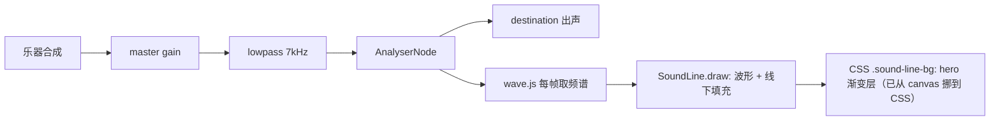

# AGENTS.md — new_blog 项目上下文

> **给 AI 编码助手的上手文档。** 读完这一份即可开始改动，不必再翻历史对话。
> 这里记录的是**事实**（当前代码的真实状态）与**约束**（改了会坏的地方）。
>
> 文档基线：**2026-10-14**。若代码与此文档冲突，**以代码为准**，并顺手更新本文档。
>
> 配套文档：`DEVELOPMENT.md`（面向人的详细开发文档 + 灵感池）、`README.md`（快速开始）。

---

## 0. 三十秒速览

```
项目  个人博客前端（Vue 3 + TS + Vite），视觉方向：深蓝 #0631BB + 米色 #fff8e7
      （★ 是**米色**不是纯白，用户明确要求过），Persona 3 气质
路径  c:\Users\zhao\Desktop\new_blog
命令  npm run dev / npm run build / npm run typecheck
      内容体检 npm run check:content（快）· 全量校验 npm run check（= 体检 + 构建 + 体积预算）
      新增文章 npm run new:post -- <slug> "标题" [分类] [tags]
      体积预算 npm run budget · 3D 模型压缩 npm run model:prepare -- 模型.glb
关键  单色系统 · hero 音频线 + 归静过渡 · 内容集合（posts / projects / pages 三套同引擎）
      **Markdown 文章系统（md → 构建期索引）**
铁律  动 hero 前先读 §4；改尺寸必查 --nav-h 与「变量定义在哪一层」
      改文章系统前先读 §8（内容约定 + 图片 + 校验行为 + CI）
      改 MusicBar / MusicBall / 曲目 / 网易云端点先读 §5.7（两行结构 + --mb-wipe 擦除 + 曲目抽屉）
      动边缘函数（浏览量 / 音乐 / Steam）先读 §5.16（workers/api/ 一个 Worker 三件事）
      改歌词（新增 lrc / 三句摆位 / 时间轴偏移）先读 §5.17（本地 lrc + 懒加载 + `--band-half`）
      改 hero 逐字浮水 / 播放律动先读 §5.18（只 hero、逐字栅格化会掉到个位数 fps）
      动 AppLoader 时序 / 首屏空白 / 水体初始化先读 §5.14（clip-path 打字机 + warm-up 闸门 + boot.ts）
```

**当前状态**：

- 文章完全由 `content/posts/*.md` 驱动（不再是写死的数组）
- 类型检查与构建通过；回归基线（7 页面 × 6~13 视口）全通过
- **Git 已初始化**（首个提交 `62d4fdd`，2026-10-10）—— `master` 跟踪 `origin`；
  ★ 站点还没上线，见 §11 未完成项

---

## 1. 技术栈

| 层 | 选型 | 版本 | 关键备注 |
| --- | --- | --- | --- |
| 框架 | Vue | 3.5.42 | 全 SFC + `<script setup>` |
| 语言 | TypeScript | ~6.0.2 | ⚠️ **`baseUrl` 已弃用**，见 §6.1 |
| 构建 | Vite | 8.3.0 | 别名 `@` → `src`；`base` 由 CI 的 `BASE_PATH` 注入 |
| 路由 | vue-router | 5.3.1 | `createWebHistory` + Pages 深链接回跳（见 §8.6） |
| 动效 | motion | 13.4.0 | ⚠️ **无 Vue 入口**，见 §5.1 |
| 平滑滚动 | lenis | 1.3.26 | |
| 音频可视化 | @foobar404/wave | 2.0.5 | MIT / 38KB / 无依赖 |
| 3D | （**暂无**） | — | ★ `three` + `@types/three` 于 2026-10-06 删除（全仓零引用，见 §12）。水彩是 `webgl-fluid-enhanced`（动态 import）。将来真接 3D 模型时再装回来，且**必须**在**调用方**动态 `import('three')`——静态引入会让入口从 177 kB 涨到 583 kB（见 §5.10） |
| Markdown | markdown-it + highlight.js + dompurify | 15 / 11 / 3 | |
| 文章系统 | 自研 Vite 插件 + js-yaml | — | 见 §8；⚠️ js-yaml 的 ESM 无 default 导出 |
| 字体 | @fontsource（本地） | — | Inter / JetBrains Mono / Anton |

> ★ **这里没有 Pinia、也没有 axios**。项目是纯静态站（无后端）；
> 曾经有过 `src/api`、`src/stores`、`src/types` 与这两个依赖，
> 收尾时就删了。需要接后端时再加。

```bash
npm run dev      # http://localhost:5173
npm run build    # vue-tsc -b && vite build
npm run typecheck                 # 只做类型检查
```

★ `new:post` 脚手架 2026-09-22 删过一次（原因是它会生成中文 slug），
  2026-10-06 按用户「模板思路是对的」加回来 —— 现在 **slug 必须自己给英文**，
  当初删它的那个理由已经不存在（见 §8.8）。不需要的话删掉 `scripts/new-post.mjs`
  与 package.json 里的 `new:post` 即可，`_TEMPLATE.md` 与体检脚本都不依赖它。
★ 没有 `-d / --draft` 选项 —— **不存在「草稿」概念**（见 §8.2）。

---

## 2. 目录结构（真实状态）

```
content/posts/*.md      # 文章（Markdown + frontmatter）★ 写文章只碰这里（2026-10-08 大清洗后**内容已清空**，只剩 _TEMPLATE.md）
content/projects/*.md   # 项目（同一套引擎，见 §5.12）★ 加项目只碰这里（2026-10-08 同样清空，只剩 _TEMPLATE.md）
content/pages/*.md      # 独立页面（目前只有 about，见 §5.13）★ 改「关于」只碰这里
content-kit.ts          # ★ 内容引擎：扫描 / frontmatter 校验 / 图片解析 / 虚拟模块 / HMR
vite-plugin-posts.ts    # 文章集合的 spec（薄薄一层，规则全在 content-kit.ts）
vite-plugin-projects.ts # 项目集合的 spec
vite-plugin-pages.ts    # 页面集合的 spec（同上）
.env.example            # 环境变量样板：**三个端点变量** VITE_VIEWS_ENDPOINT / VITE_MUSIC_ENDPOINT / VITE_STEAM_ENDPOINT（同一个 Worker 的三条路径，见 §5.16）+ Steam key 怎么写不进前端
docs/reports/           # 每轮改动的对照图放这里（与构建完全无关，不进 dist）★ 2026-10-08 按用户「不用的图片全删掉」把历史图全清了（★ 当时留的备份 %TEMP%\dsh-cleanup-backup 已于 2026-10-09 按用户要求整目录删除），目录现在是空的；以后新汇报图仍放这里，别再丢回仓库根
                        # ★ 别再往仓库根丢截图 —— 根目录只放代码与配置
public/favicon.ico      # 站点图标：多尺寸 16/32/48（PNG 载荷的 ICO）+ apple-touch-icon.png（180，**iOS 用**）
                        # ★ 由用户 2026-10-07 给的手绘头像压缩而来（`favicon.svg` 已于 2026-10-08 大清洗删除）
workers/api/            # 边缘函数：**一个 Worker 三件事**（/views 浏览量 + /music 音频转发 + /steam Steam 资料，见 §5.16）★ 不在任何 tsconfig 的 include 里 ⇒ 纯 JS + 同名 .d.ts
├─ src/index.js         # Worker 入口：按首段路由分发 + 全局 OPTIONS
├─ src/http.js          # json() / preflight() / CORS 头 / 路由表
├─ src/views.js         # 浏览量：KV 读改写自增（key = total）
├─ src/netease.js       # 网易云：换 320 kbps 直链 + 透传 Range（dev 中间件 import 的就是这一份）
├─ src/steam.js         # Steam：GetPlayerSummaries + GetRecentlyPlayedGames，含隐私判空 + 5 分钟缓存
├─ wrangler.toml        # name = blog-api；KV 绑定 VIEWS；[vars] ALLOWED_IDS / STEAM_ID / STEAM_RECENT_COUNT
└─ README.md            # 部署四步：login → kv namespace create VIEWS → secret put STEAM_API_KEY → deploy
scripts/
├─ check-content.mjs    # 内容体检（文章 + 项目 + 页面；直接 import 三个 spec 的 check*，规则只有一份）
├─ check-content.sh     # 上面那套的 bash 版（CI / Git Bash）
├─ new-post.mjs         # 从 _TEMPLATE.md 生成新文章
├─ budget.mjs           # 构建体积预算（首屏 / 单块 / 大二进制）
└─ model-prepare.mjs    # 3D 模型压缩管线（gltf-transform optimize，见 §5.10）

src/
├─ posts.ts               # 文章**门面层**：视图只 import 它，不碰虚拟模块；另有 siteStats（见 §5.13）
├─ projects.ts            # 项目**门面层**：数据来自 `virtual:projects`（content/projects/*.md）；只有 slug / title / date / summary / cover + 派生 year / image，见 §5.12
├─ pages.ts               # 页面**门面层**：数据来自 `virtual:pages`（content/pages/*.md），见 §5.13
├─ playlist.ts            # 音乐曲目清单（**唯一真相源**：网易云 id + 手写元数据 + 端点拼 URL，见 §5.7）
├─ lyrics/*.lrc           # 歌词（**文件名 = playlist.ts 的 slug**；`import.meta.glob` 懒加载，每首一个独立 chunk，见 §5.17）
├─ assets/works/*.avif    # 通用作品图池（项目 md 的 cover 可写 `works/xx.avif`；**只有被引用的才进 dist** —— 2026-10-08 两轮清洗后 6 张全删，图池现在是空的；要用图就把文件丢回这个目录）
├─ components/
│  ├─ AppLoader.vue       # 首屏载入（**每次整页加载**播一次；卡死/没位移的三条兜底见 §5.14）
│  ├─ WaterBody.vue       # hero 线**以下**的水体（鼠标交互）；原 `HeroStage.vue` 3D 舞台已于 m06383 删除
│  ├─ LiquidTransition.vue # 液态玻璃转场遮罩（App.vue 里独立的一层 fixed，不是 Transition）
│  ├─ InitialLetter.vue   # 巨型字母 SVG（Blog 的 B）
│  ├─ MarkdownRenderer.vue
│  ├─ MusicBar.vue        # 音乐栏（走带键 + 细轨进度 + 曲目抽屉 + 断点续播）
│  ├─ MusicBall.vue       # 音乐球（非首页的右下浮动球 + 面板：环状进度 + 走带键 + 曲目列表，见 §5.7）
│  ├─ SiteStats.vue       # 「关于」页侧栏的站点统计卡（文章 / 标签 / 总字数 / 浏览量，见 §5.13）
│  ├─ SteamCard.vue       # 「关于」页**右栏**那张卡：Steam「最近在玩」（★ 没配端点就整个不渲染，见 §5.16）
│  ├─ LyricStage.vue      # hero 上的歌词层：上一句右上 / 当前句正中 / 下一句左下（纯文字、pointer-events: none，见 §5.17）
│  ├─ NextButton.vue      # 「N ext」翻页按钮（各页共用，见 §5.6）
│  ├─ SoundLine.vue       # 音频线（兼画 hero 渐变 + 线下填充）
│  └─ CursorDot.vue       # 跟随光标的半透明白圆（挂 App.vue，404 页也生效；按下时微微收缩 —— scale 写在 transform 末尾，见组件注释）
├─ composables/
│  ├─ lofi.ts             # 音频可视化状态（波形数据来自 player 的 analyser）+ 渲染器工厂；★ 不再合成音乐
│  ├─ siteViews.ts        # 站点浏览量（PV）：POST 计一次 / GET 读总数；端点由 VITE_VIEWS_ENDPOINT 注入，没配就不发请求（见 §5.13）
│  ├─ steam.ts            # Steam「最近在玩」：读 /steam + 5 分钟模块级缓存 + 并发去重，失败一律吞成可显示状态（见 §5.16）
│  ├─ motion.ts           # Lenis 单例 / prefersReducedMotion / 启动信号（`whenBooted()` = 等 AppLoader 掀幕）
│  ├─ lyrics.ts           # useLyrics：`onFrameTime()` → 二分定行 → { prev, now, next }（见 §5.17）
│  └─ typewriter.ts       # useTypewriter：格言逐字出现 + 打完后光标淡出；reduced-motion 直接给全文（见 §5.13）
├─ directives/magnetic.ts, reveal.ts, imgFallback.ts   # imgFallback（`v-img-fallback`）：图 404 / 坏图时给 img 加 `.is-broken`、父级 `.has-broken-img`（CSS 在 style.css —— ★ 图只能 `visibility: hidden`，`display: none` 会让带 aspect-ratio 的框塌掉；占位文字与对角线一律 `currentColor` + `opacity: .45`，米色卡里随 `--brand`、蓝底上随 `--text`）
├─ layouts/DefaultLayout.vue   # 导航 + main + 页脚（含毛玻璃重叠检测、视图过渡）
├─ router/index.ts
├─ views/                 # Home / ArticleList / ArticleDetail / Archive / About / ProjectList / ProjectDetail / NotFound
├─ App.vue
├─ style.css              # 设计系统（6 段，见 §3）
├─ main.ts                # 含 Pages 深链接 ?redirect= 回跳
└─ env.d.ts               # 含 virtual:posts / virtual:projects / virtual:pages 的模块类型声明
```

> ⚠️ `README.md` 的目录树是**权威的**（已随代码同步）。
> 本文档与 `DEVELOPMENT.md` 侧重「为什么这么写」与「不要再踩」。

---

## 3. 设计系统（`src/style.css`）

按 6 段组织，改动前先确认落在哪一段：

| 段 | 行 | 内容 |
| --- | --- | --- |
| 令牌层 | 1 | `:root` 全部变量 |
| 基础层 | 135 | reset、`html::before` 固定渐变层、**全局滚动条** |
| 排版工具类 | 240 | `.u-h1 ~ .u-h4`、`.u-main`、`.u-small`、`.u-muted` |
| 布局 | 342 | `.u-container`、`.u-grid`、`.space-*` |
| 组件 | 412 | 按钮、列表项 |
| 滚动进场 | — | 目前是空段（样式已全部移除，见段内注释） |

★ **段名与行号会漂移**，改样式前先用 `grep -n '^/\* =' src/style.css` 定位。

### 3.1 配色：只有两个颜色

```
--brand: #0631bb   ← 唯一被显式指定的色，同时是最深锚点
--text : #fff8e7   ← 米色（暖白），不是纯白；全站唯一文字色来源
其余全部 color-mix 派生
```

背景是**由浅到深的固定渐变**：

```css
--bg-top: color-mix(in srgb, var(--brand) 74%, #4fd2ff);  /* 顶部，偏青 */
--bg: var(--brand);                                       /* 底部，最深 */
```

★ 渐变画在 `html::before`（`position: fixed`），**不是**给 `body` 加 background。
理由：body 背景会随文档高度拉伸 → 长页面颜色错位 + "渐变到头变纯色"断层。
★ 也**不是** `body::before` —— body 会被 `scrollbar-gutter` 挤窄（少 10px），
  html 的盒子才等于视口（见 §3.2 的滚动条竖带一节）。

⚠️ **连带后果**：视口顶部的颜色**永远是 `--bg-top`**（无论滚到哪）。
所以导航毛玻璃底色必须用 `--bg-top`，用 `--bg` 会在浅色渐变上压出深色横带。

★ `--bg-mid` 已删除（改用两停止点渐变后成为死代码）。

### 3.2 全局滚动条（纵向 + 横向 + 所有滚动容器）

三个令牌（都在 `:root`，仍然只由 `--text` 派生）：

```css
--scroll-thumb:       color-mix(in srgb, var(--text) 26%, transparent);
--scroll-thumb-hover: color-mix(in srgb, var(--text) 55%, transparent);
--scroll-size: 10px;
```

★★ **轨道必须透明**（本设计最关键的一条）：背景是 `html::before` 的
**固定**渐变层。若给轨道填实色（无论 `--bg` 还是 `--bg-top`），
都会在右侧压出一条与渐变**错位**的色带 —— 滚动条槽相对视口固定，
而渐变色沿文档流变化，两者永远对不齐。透明轨道让渐变直接透上来。

★ **两种写法都要写，且不能混用**：

| 写法 | 作用范围 | 能力 |
| --- | --- | --- |
| `scrollbar-width` / `scrollbar-color` | Firefox、Chromium 121+ | 只有两档粗细 + 两色，无圆角 |
| `::-webkit-scrollbar` 系列 | Chromium / Safari | 可做圆角、留白、hover |

Chromium 下写了 `::-webkit-scrollbar` 后标准属性会被忽略，
所以 webkit 分支要**显式再写一遍颜色**，保证两边观感一致。

★ **写在 `html` 上，不要用 `*`**：`::-webkit-scrollbar` 会**继承**，
`html` 一层就覆盖全站（含 `.md-code pre` / `.md-table-wrap`）。
用 `*` 则每个元素都要重算样式，徒增开销。

★ 拇指**不加 border、不做内缩**（2026-09-21 用户要求「去掉边框，只留下条」）：
  曾用 `border: 2px solid transparent` + `background-clip: content-box` 做内缩留白，
  但那会先画一圈圆角外轮廓、再在里面填色，高对比度下像给拇指描了边。
  现在只留一个色块，细度靠 `--scroll-size` 控制。
★ 只过渡 `background-color`；过渡 `width/height` 会触发布局，拖动时反而卡。
★ 必须显式隐藏 `::-webkit-scrollbar-button`，否则 Chromium 会残留
一对方形箭头按钮，与圆角风格冲突。
★ 配 `scrollbar-gutter: stable`：始终预留槽位。
实测好处：6 个页面（含不滚动的 404）的 `.u-container` 左边缘都是
**同一个值**，切页时内容零抖动。代价是右侧固定少 10px。
★ 配套 `color-scheme: dark`：让原生控件（表单、滚动条）走深色分支，
不会在深蓝底上闪出白色滚动条。

★★ **渐变层不能用 `inset: 0`，必须写 `width: 100vw`**（2026-09-21 修）。

症状：滚动条旁边有一条**深色竖边**（用户报的“边框”）。

```
inset: 0          → 解析成 clientWidth（实测 1430px）
视口               → 1440px
差的 10px         → 正是 scrollbar-gutter 预留的槽
槽的轨道是透明的   → 露出 html 的兜底实色 --bg（深蓝）
同一高度内容区     → --bg-top（浅）→ 形成竖色带
```

修法：`width: 100vw`（含滚动条宽度）→ 渐变铺到槽下面，竖带消失。
★ 也顺带说明为什么挂 `html::before` 比 `body::before` 稳：
body 会被 `scrollbar-gutter` 挤窄，html 的盒子就是视口。
★ 拇指不加 border 的完整理由见上一段（同一次修正）。

### 3.3 hero 音频线三层色

```
--bg-top    #195bcc   最浅
--hero-line #1049d0   音频线处落点
--hero-fill #0735bd   线下实心填充
```

★★ **渐变不能在线处收敛到 `--hero-fill`**——同色盖同色，波形起伏肉眼看不见。
（这是"效果不明显"的根因。）换色守三条：

1. `--hero-line` 比 `--bg-top` **暗**（否则"先沉后浮"）
2. 与 `--hero-fill` 的 WCAG 亮度比 **≥1.2:1**（`#1049d0` = 1.28）
3. 三者与白字对比度 ≥4.5（实测 6.16 / 7.28 / 9.32）

### 3.4 `--nav-h` 必须等于导航实际高度 ★★

★★ **导航高度由 `--nav-h` 直接决定**（`.nav { height: var(--nav-h) }`）。

这一点很重要：旧写法是「高度 = `.nav-logo-link` 的内边距 + 行高」自然撑开，
而 `--nav-h` 是独立写死的值 —— 两者必须**手工同步**，
于是每当断点里改字号或内边距就忘一次，hero 顶部凭空多出几十像素空隙
（实测漂过 65vs63、54vs63）。现在 `--nav-h` 是唯一真相，漂移从根上不可能。

| 断点 | `--nav-h` | 实际 | 字号 |
| --- | --- | --- | --- |
| >767px | `4.5rem` | 72px | 16px |
| 521~767px | `4.3125rem` | 69px | clamp（≤16px） |
| ≤520px | `4rem` | 64px | clamp |
| ≤345px | `3.5rem` | 56px | clamp 触底 10px |

★ **代价**：子元素必须装得进这个高度，否则会**溢出**（不再把导航撑高）。
  所以 `.nav-logo-link` 的**纵向内边距必须自适应**：
  `padding-block: min(1.5rem, calc((var(--nav-h) - 1.6em) / 2))`。
  写死 `1.5rem` 时实测 700px 下溢出 2.1px。
★ 自检：`nav.getBoundingClientRect().height === --nav-h`（误差 ≤1px），
  且 logo / 链接盒子的上下边都落在导航范围内。

### 3.5 中文字号行高必须分档

参考站行高是为**英文压缩字体**调的，套中文会严重重叠：

| 类 | 英文 lh | 中文 lh |
| --- | --- | --- |
| `.u-h1` | 0.8 | **1.15**（`.u-h1-cn` + 降字号） |
| `.u-h2` | 1.1 | **1.45** |
| `.u-h3` / `.u-h4` | 1.1 | **1.5** |
| `.u-main` / `.u-small` | 1.25 | **1.75** |

★ **绝不给含中文的文本设 `line-height: 1`**。
自检：遍历叶子元素，含中文且 `lineHeight < fontSize * 1.15` 即算重叠。

---

## 4. hero 尺寸体系 ★★ 改这里之前必读

### 4.1 变量表

| 变量 | 定义位置 | 含义 |
| --- | --- | --- |
| `--hero-content-h` | `.hero`（svh 兜底）+ `.hero-contain`/`.hero-visual`（`100cqh`） | **垂直预算基准** |
| `--visual-w` | `.hero`（桌面 14rem）+ `.hero-contain`/`.hero-visual`（移动端动态） | 中间舞台宽度 |
| `--hero-half` | `.hero` / `.hero-contain` | 半个内容区高 |
| `--brand-max-h` | `.hero-contain` | Blog 组的宽度/垂直上限 |
| `--brand-h` | `.hero-contain` | `min(--hero-half, --brand-max-h)` ← 实际高度 |
| `--corner-w` | `.hero-corner` | L 形角标线宽 |

### 4.2 ★★ 两个必须记住的架构陷阱

**陷阱 1：`.hero-contain` 与 `<SoundLine />` / `<WaterBody />` 是兄弟节点，不是父子**

```html
<section class="hero">
  <div class="hero-contain"> ... </div>
  <SoundLine />
  <WaterBody />   <!-- ← 与 .hero-contain 平级（原 `<HeroStage class="hero-visual">` 已随 3D 删除，m06383） -->
</section>
```

→ 在 `.hero-contain` 上定义的变量，**兄弟元素读不到**：波带几何（`--wave-*`）
因此必须定义在 `.hero` 上（HomeView 里有同名注释）。历史教训：当年 `.hero-visual`
的 `width: var(--visual-w)` 曾**静默退回 `auto`**（舞台被撑到 712px 并溢出 hero，
**无任何报错**）。

**陷阱 2：`.hero` 上的 `--hero-content-h` 不知道 `min-height` 的存在**

≤767px 有 `.hero { min-height: 43rem }`。`.hero` 自身算 `100svh − nav-h` = 411，
而真实内容盒是 619（被 min-height 抬起来）。
→ 凡是要用**真实内容高**的地方，必须挂到拿到 `100cqh` 的元素上。

### 4.3 尺寸公式

**桌面**（>767px，左右分栏：Blog 在左、舞台居中）：
```css
--brand-max-h: calc((100vw - margin*2 - var(--visual-w)) / 2 / 0.734 - var(--gutter));
```
`0.734` = B 宽 0.3597 + log 宽 0.3746（每 1px 高度对应的总宽）。

**移动端**（≤767px，纵向堆叠：Blog 在顶、舞台在中，两者不争宽度）：
```
B     = 内容高 × 0.30
舞台   = 内容宽 32%（4:5 → 高 40%）
NEXT  = 0.38 × B
舞台垂直中心 = 内容区 62%
```

★★ **别再用「倒推公式」**（旧版是 `1.16 × --hero-half − 109px`）。
那是从舞台位置反解的，把"B 占屏幕的比例"**耦合到屏幕高度**上
→ 实测占比随屏高从 33% 涨到 40%，越高的屏 B 越大、越挤模型。
**直接写百分比，占比才恒定。**

实测（内容高 582→827）：B 恒 30%、舞台恒 40%、NEXT/B 恒 0.38。
390×845 舞台从 160 → **295**。

### 4.4 hero 的硬约束

- ★★ **入场动画绝不能动 `transform`**。布局依赖它：
  `.hero-brand-row` 的基线对齐、`.hero-visual` 的 `translate(-50%,-50%)` 居中、
  `.hero-next` 的 baseline 对齐全会坏。**只允许动 `opacity` / `filter`**。
- ★★ **`opacity: 0` → JS 恢复的模式必须有兜底**。
  已有 `armRevealSafety()`：3.5s 后强制把仍 <0.05 的元素设为 1。
  否则 rAF 被挂起时元素**永久不可见**，NEXT 点不到、页面看着是坏的。
- ★ **`.hero-contain { pointer-events: none }`**（它铺满 hero 且 z-index 更高，
  否则吃掉 3D 舞台的鼠标事件）。`NEXT` / 播放按钮各自设回 `auto`。
- ★ **`.hero-title-wrap` 是 `flex: 1` 的配重块，不能删**（即使里面是空的）。
  删了 NEXT 就没了可推的配重，会被挤到左侧。保留并加 `aria-hidden="true"`。
- ★ **`.stage` 里什么尺寸都别写**。它与 `.hero-visual` 是同一节点，
  写了 `height: 100%` 会干掉父级的 `aspect-ratio`（实测高度涨到 900px 而非 280px）。
- ★ `.stage-content` 要显式「单行单列」才能让子元素铺满并重叠：
  ```css
  .stage-content { display: grid; grid-template-columns: 1fr; grid-template-rows: 1fr; }
  .stage-content :deep(> *) { grid-area: 1 / 1; min-width: 0; min-height: 0; }
  ```

### 4.5 Blog 排版（基线对齐）

- 结构：巨型 `B`（SVG，viewBox 150×417）+ 小写 `log`，**共享基线**（B 的底边即基线）
- ❌ 不要用 `document.createRange()` 量 text node —— 返回**字体自然行高**，会偏大甚至溢出
- 精确算法（Anton 度量，font-size=1）：`font-size = 0.45/0.98 ≈ 0.459 × B 高度`；
  `line-height: 0.85` 时 box 底恰在基线上
- 定位：`align-items: flex-end` 让 log 基线与 SVG 底边重合
- ★ 判「Blog 在左上角」要**同时看两个轴**：
  `row.top === contain.top + 16 && svg.left === contain.left`（只比 top 会误报）
- ★ 测 NEXT/Blog 比例**不能用 boundingClientRect 高度比**（box 高含字体下伸）。
  要算 cap 之比：`fontSize × 0.86 / B高度`

### 4.6 L 形角标

- `.hero-corner-tr` 在 `.hero-top`（`top:0/right:0` → ⌐）
- `.hero-corner-bl` 在 `.hero-bottom`（`bottom:0/left:0` → L）
- 尺寸 = `calc(var(--brand-h) * 0.3)` = **与 `.hero-log` 字号完全相同**
- 线宽 = `clamp(5px, calc(var(--brand-h) * 0.03), 14px)`（≈边长的 10%）
  ★ 系数别乱调大：`--brand-h` 在 190~470 之间，系数大了会**全部顶到 clamp 上限**，
  退化成固定值、失去响应式意义

---

## 5. 核心模块

### 5.1 `composables/motion.ts`

集中两件事，避免各组件各自初始化打架：

1. **Lenis 单例**：`initSmoothScroll()` / `destroySmoothScroll()` / `getLenis()`
   （★ `smoothScrollTo(top)` 已于 2026-09-22 删除 —— 零调用点，全站滚动复位
     都走 router 的 `scrollBehavior`；留着只会误导人以为想滚动应该调它）
2. **`prefersReducedMotion()`** + **`markBooted()` / `whenBooted(timeoutMs=2600)`**

★★ **motion v13 没有 Vue 入口**（exports 只有 `.` / `./react*` / `./three` / `./vgpu`）。
全部是原生 DOM 用法：`animate(el, {...}, {...})` / `inView` / `scroll` / `stagger`。
**没有 `timeline` / `createTimeline`**（实测 `undefined`）—— 串联用 `delay` 或 `.finished.then()`。

**Lenis 的坑**：

- **必须把 `scrollTo` 桥接到 router 的 `scrollBehavior`**（`lenis.scrollTo(top, {immediate:true})`
  然后 `return false`）。否则 Lenis 内部状态停在旧位置，下一帧把页面拽回去。
- **所有滚动复位都走 router 的 `scrollBehavior`**（它直接操作 lenis 实例）。
  不要用 `window.scrollTo`（与 Lenis 互相拽），
  也不要用 `scrollIntoView`（叠加 `scroll-behavior`，定位漂移）。
- `autoRaf: false` + 手动 rAF；`syncTouch: false`。

### 5.2 音频线：`SoundLine.vue` + `lofi.ts`



- 波形数据来自 `player.ts` 的 analyser —— 播的是**网易云 320 kbps mp3**（见 §5.7）。
  ★ 2026-10-09 前这里写的是「实时合成的 lo-fi（BPM 74，Dm7→G7→Cmaj7→Am7）」：那套合成器已随 mp3 播放器一起删除，别再照它改
- `analyser` 边分析边透传 → 既能被读又能出声
- ★ **必须在用户手势里 `ctx.resume()`**（自动播放策略）→ 由按钮触发
- ★★ **离开首页不要暂停**（2026-10-09 改）：音乐要跨路由接着放，非首页由右下角音乐球接管
  （`HomeView.vue` 的 `onBeforeUnmount` 里那句 `pauseMusic()` 已删 —— 见 §5.7「音乐球」）。
  AudioContext 是模块级单例，但不暂停也不会「一直响」：暂停/继续归播放器状态机与 UI 控制。

**波形参数**（2026-10-09 先按「波动太小」调幅度、同日又按「律动不明显」修映射，见下）：
`MAX_AMPLITUDE`（运行时从 CSS `--wave-amp` 读，兜底 40）、
`BASE_WIDTH = 0.7`、`POINTS = 128`、`HARMONICS = 5`、
`HARMONIC_CYCLES = [1.6, 2.9, 4.5, 6.3, 8.6]`、`DISP_N = 0.92`、`SPEED_K = 0.023`、
`BASE_SHAPE = [1, 0.62, 0.38, 0.22, 0.12]`、`GROUP_SPEED = 0.005`、`GROUP_DEPTH = 0.42`、
`RIPPLE_AMP = 0.1`、`RIPPLE_SPEED = 0.03`、`PUNCH_GAIN = 0.9`、`PUNCH_K = 3`、`FLUX_WEIGHT = 2`、
`BAND_END = 64`、`LEVEL_REF = 0.78`、`LEVEL_CURVE = 0.85`、`BODY_GAIN = 1.4`
（+ `tanh` 软限幅）。

★ 波形是**三层叠加**：主体涌浪（5 谐波 × 频谱调制 × 斯托克斯变形）
+ 成组涌动（慢行波包络）+ 泛波（高频细纹）。缺一层就不像水。
★ 2026-10-09 用户说「波动不是很大」⇒ 幅度与速度一起加：峰谷跨度均值 50.5 → **61.5px**
（std 5.11 → 10.46）、水面流速 1.0 → **3.11 px/100ms**；`--wave-amp` 上限 34 → 40px
（`HomeView.vue` 的 `clamp(7px, 100cqw * 0.0275, 40px)`，波带高 = 振幅 × 3.6）。
新增**节拍冲量**：`envFast` / `envSlow` 两条包络之差（`punch`）经 `tanh` 乘进电平 ——
★ 两条包络都要作用在**未截断**的比值上，否则鼓点被削平。
★ 量测方法：`.sound-line-canvas` 是**波线以上不透明、以下透明**，所以要取「每列最后一个
不透明像素」当波线位置；取「每列第一个」只会得到每列 y=0 的假读数。

★★ 2026-10-09 第二轮（用户 m17332：「wave 是我们期望的幅度了，但跟音乐的律动不明显」）。
拿真实曲目录 24s 频谱、离线用组件同一套常量重放，摊开两个根因：

1. **电平早已饱和**：`LEVEL_REF = 0.24` 是给当年内置合成器定的（那时 `avg ≈ 0.29`），
   而后来的网易云 320 kbps 曲目，前 64 个 bin 的均值中位数是 **0.579 / 0.648**
   ⇒ `norm = avg / 0.24 ≈ 2.4` ⇒ `Math.min(1.2, …)` 在 **95% 以上**的活跃帧都贴顶
   ⇒ 画出来的振幅**恒为 48px、深度 0**，只有相位在动（「律动不明显」的直接原因）。
   ⇒ `LEVEL_REF` 0.24 → **0.78**（贴顶率降到 ~13.5%，留出可动的行程）。
2. **节拍信号选错了**：快/慢包络跑在「全带能量」上，实测只抓到 **0.69 次/s** 的起落
   —— 能量被中高频持续声（人声/弦乐）托着，底鼓进来只涨一点点；而同一段音频用
   **谱通量自相关**量出来的真实节拍是 **0.59s = 101 BPM = 1.68 拍/s**。
   ⇒ 电平改用 **`能量 + FLUX_WEIGHT × 谱通量`**（`flux` = 逐 bin 正向增量之和 / 255），
   `FLUX_WEIGHT = 2` ⇒ 脉冲率 **1.7 次/s**，与真实拍速对齐。
   ⚠️ 权重别乱加：1 → 1.2 次/s（还在漏拍），4 → 1.95 次/s 但开始重复计数。
3. 包络与输出各收快一档：包络起 `45:150` → **`30:90`**、落 `250`；
   输出平滑 `110:190` → **`45:240`**（快起慢落 = 鼓点当场窜起、余音慢慢退）。
★ 这是**有意的代价**：旧版是恒 61.5px 的顶格振幅，现在中位 ≈ **30px**、峰值仍到 **65px**
  —— 平静段真的会小下去，那正是「律动」。想整体再大一圈：调 `--wave-amp`
  （`--band-h` = 振幅 × 3.6 要同步）或把 `LEVEL_REF` 再降到 ~0.62
  （代价：贴顶率涨到 ~30%，鼓点更容易被削平）。
★ 复查口径：`dev`（离中线最大偏移）与 `amp` 不可直接比（`dev/amp ≈ 0.46`），
  **统一用 p2p**（`p2p/amp ≈ 1.29`）；探针要挂钩 `AnalyserNode.prototype.getByteFrequencyData`
  拿真频谱，别只看画布。

#### ★★ 暂停时的「归静过渡」（不要退回瞬间塌平）

用户要求：暂停后波形不该**瞬间**变成直线，要有「水面慢慢平静」的过渡。

实现（`SETTLE_MS = 900`，ease-out cubic）：

| 阶段 | 行为 |
| --- | --- |
| `playerState → idle` | `beginSettle()`：冻结**相位**与**各谐波活跃度**，记下当前振幅 |
| 归静中（每帧） | 不读频谱、不推进相位；振幅 `settleFromAmp * (1 - ease(p))` 收到 0 |
| `p >= 1` | `endSettle()` → `stopLibraryLoop()` 切静止态 |

★★ **形状必须冻结**（相位 + `settleHAmp` 都停住）。
若继续推进相位，收敛时波峰还在左右乱窜 —— 看着像"还在振"，不像在平静下来。

★★ **最后一帧必须与静止态几何重合**：振幅收到 0 时
`waveY(i) === centerY`，与 `paintStatic` 画的直线**逐像素一致**，
所以切换那一刻零跳变。
→ 为此把绘制核心抽成 `paintWaves(c, frozen, amplitude)`，
  **播放态与归静态共用同一份几何计算**。两处各写一份迟早漂移，
  切换瞬间就会"跳一下"。

★ **不能用 CSS transition 缩放 canvas**：那会把填充边界一起做位图缩放，
  边缘发虚、下边界还会飘。在绘制层面收振幅，边界始终是真实算出的水面。

★ **归静期间 `resize()` 不能重画静止态** —— 否则 ResizeObserver 一触发
  波形就直接变平线，过渡被吃掉。条件是
  `playerState.value !== 'playing' && !settling`。

★ **兜底定时器**（`SETTLE_MS + 260`）：库的 rAF 在标签页隐藏等情况会被限流，
  没人推进归静 → 到点强制切静止态，保证画面最终一定是平的。
  卸载时要 `clearTimeout`。

★ 归静途中重新播放：`endSettle()` + `startLibraryLoop()`，
  实测跨度 13 → 41 立刻恢复，不卡住。

**验证方法**（此环境 rAF 被限流，不能等它自己跑）：
手动调 `renderer._activeAnimations[0].draw(...)` 推进，用
**每列第一个 alpha > 8 的 y** 作为边界（不要用亮度找白线 —— 会和背景混），
统计多列的 max-min 即「波形跨度」。关键：**持续喂"很吵"的频谱数据**，
若画面仍单调收敛，就证明衰减由定时器驱动、与输入无关。
实测 35 → 21 → 14 → 8 → 5 → 2 → 1 → 0（约 760ms 归零）。


**★ wave.js 职责边界**（读 bundle 源码确认，别猜）：

| 能做 | 不做 |
| --- | --- |
| 建 AnalyserNode、每帧取频谱、`clearRect`、rAF 循环、`addAnimation({draw})` | ❌ **devicePixelRatio**（源码出现 0 次）→ 必须自己适配 |
| | ❌ 采集系统音频 |

- `new Wave(analyserNode, canvas)` 走 `instanceof AnalyserNode` 分支，
  **用外部 AnalyserNode、不自己建音频图**（否则会把播放中的音频改道）
- 但它**不设** `smoothingTimeConstant` / `fftSize` → 自己设（.85 / 1024）

★★ **renderer 是模块级单例，必须比对 canvas**：

```ts
export function createRenderer(canvas: HTMLCanvasElement) {
  if (!analyser) return null
  if (renderer && boundCanvasOf(renderer) === canvas) return renderer  // ★ 比对
  renderer = new Wave(analyser, canvas)
  return renderer
}
```

组件重挂载（HMR / 路由来回）会创建**新 canvas**，旧实例仍指向已脱离 DOM 的旧 canvas
→ 动画全画到虚空。症状：`draw()` 调用正常、音频数据在流，但画布 hash 恒定不变。
决定性检查：`document.contains(renderer._canvasElement) === false`。

⚠️ 关库的 rAF 走 `createRenderer(cv)?.clearAnimations()`，
**不要**用 `getRenderer()?.clearAnimations()`（可能作用在旧实例上）。
但 `onBeforeUnmount` 仍要 `getRenderer()?.clearAnimations()`（库的 rAF 自持，不清会泄漏）。

★★ **`waveY` 必须是 `drawLine` 的内部闭包**（见 §6.4）。

### 5.3 `MarkdownRenderer.vue`

- ★ **必须用「核心包 + 按需注册语言」**：`import hljs from 'highlight.js/lib/core'`，
  不要全量 `import hljs from 'highlight.js'`（5MB+）
- 已注册：js/ts/xml(html,vue)/css/json/bash/python/sql/yaml/markdown/diff/rust/go/java
- **无语言标记的代码块不做自动识别**（混合代码上容易猜错，配色会乱）
- ★ **安全双保险**：`html: false`（不解析原始 HTML）+ `DOMPurify.sanitize()`
  已用 7 个攻击向量实测（`<script>` / `` / `javascript:` / `<iframe>` / `data:text/html`）
- 语法高亮**只用白/蓝系**，不引入暖色（唯一例外：字符串 `#a8e5ff`）

### 5.4 `DefaultLayout.vue` — 导航毛玻璃

`detect()` 判断「导航条带（文档坐标 `[scrollY, scrollY+navH]`）是否与任一内容区间相交」。

- ★ **必须用区间相交**，不能只缓存"最靠上内容的顶边"再比 `scrollY`
  —— 内容已滚到视口上方时会误判（实测 320×700 的 `/about` 滚到底）
- ★ 内容位置用 `offsetTop` 累加算**文档坐标**（绕开 transform），只统计**叶子元素**
- ★ 页面组件**懒加载**：`DefaultLayout` 的 `onMounted` 先于内层页面执行，
  那时 `<main>` 是空的 → 必须用 `MutationObserver` 补测，否则首测为空就**永久失效**
- ★ 毛玻璃在**所有断点**生效。**不要**在 JS 里加 `matchMedia` 尺寸门控 ——
  CSS 改成全断点后 JS 门控漏改过一次，导致窄屏完全没有毛玻璃（静默失效）

**导航布局：始终单行**（logo 左、链接条右，`justify-content: space-between`）

| 断点 | 字号 | 高度 |
| --- | --- | --- |
| >767px | 16px | 72px |
| 521~767px | `clamp(10px, 2.2vw, 16px)` → 持续缩小 | 69px |
| ≤520px | 同上；≤345px 时 `clamp` 已触底 10px | 64px / 56px |

★ **永远不换行** —— 用户明确要求（曾抄参考站的小屏形态改两行，被否）。
  ⚠️ 实测 320px 视口、10px 字号下 **`Projects` 版已快顶满**：链接条左边缘 62.6px、
  logo 右边缘 55.3px → **中间只剩 7.3px**（Talk 时代是 ~33px）。再加第六项、
  或换一个更长的词，就会撞上 logo（390px 下余量 77.3px、360px 下 47.3px）。
★ 字号必须**跨整个窄屏区间持续变小**。
  踩过两次：① 「14px / 12px」两档 → 中间 420px 是死区；
  ② `1.6vw` → 在 767px 处已触底，其下全是 12px。
  现用 `2.2vw`，从 767 到 455 全程在缩。
★ 导航居中在宽屏靠 `position: absolute; left: 50%; translateX(-50%)`
  （**相对视口**，用 grid 列跨度会相对容器居中、实测偏右 752px）；
  ≤520px 切到 `space-between` —— 绝不能用「绝对定位居中」，窄屏必撞。
★ **当前页不加任何样式**（见 §6.8）。
★ **页脚**（同一组件，`v-if="!isHome"` —— 首页不能有可滚动量）：链接行 + `.footer-meta`（`© 年份 我的博客` / `Vue + Vite 构建` / 备案号 `豫ICP备2026008086号`）。
  备案号是 `.footer-icp`，跳到 `https://beian.miit.gov.cn/`；target/rel **就地写死**（它是全站唯一手写的外链，不走 `parseHref`）。
  三项只靠 `gap` 分隔、**不用 `·`** —— 窄屏折行时分隔点会被孤零零留在行尾（390px 实测两行），与上面那排链接的观感也才一致。

### 5.5 视图过渡 —— 绝不能包整个布局

过渡在 `DefaultLayout.vue` 的 `<main>` **内部**，不在 `App.vue`。

★★ 为什么：过渡会给元素加 `transform`，而 **`.nav` 是 `position: fixed`**。
  CSS 规范：祖先链上有 `transform` / `filter` / `perspective` 时，
  `fixed` 的包含块从「视口」变成「那个祖先」—— fixed 直接失效。
  实测导航 `navTop` 跟着过渡从 0 → -10.9 → +16 来回跑（用户报的「导航乱跳」）。

- ★ **只动 `opacity`**，不碰 `transform`（opacity 不影响包含块）
- ★ **不能用 `mode="out-in"`**：`<main>` 是 `flex: 1`，旧内容一消失、
  新内容未挂上时 main 高度归零 → **页脚往上跳**。
  改用交错：新视图立即进 DOM（高度当场定），旧视图 `position: absolute`
  脱离文档流叠在上面淡出（所以 `.main` 要有 `position: relative`）。
- ★ `scrollBehavior` 里复位滚动要包一层 `requestAnimationFrame`：
  它的调用时机是「路由刚解析完、DOM 还没更新」，同步复位会让用户看到
  「内容还在、视口却突然回顶」的抽走感。

### 5.6 `NextButton.vue` —— 翻页按钮

- 行为是**翻页**：`Home → Articles → Archive → About →（回 Home）`，
  顺序写在 `FLOW` 数组里（数据驱动，加页面只改这一处）
- 必须用 `router.push`，不能改 `location`（那会整页刷新，丢 Loader/Lenis 状态）
- 回顶部交给 `scrollBehavior`，组件里**不要**自己 `scrollTo`
- hover 是**文字变灰**：`color: var(--muted)`
  ❌ 不要用 `opacity`（米色字透出背景蓝会发浑）
- 组件**不声明** `--next-cap`，只用 `var(--next-cap, 兜底)` ——
  否则会与父级声明在同一元素上撞车，胜负取决于优先级与源码顺序
- 文章详情页**不放假 NEXT**（用户要求）

### 5.7 `MusicBar.vue` / `MusicBall.vue` —— 音乐栏与音乐球（细轨 + 曲目抽屉 + 全站浮动球）

**只被 `src/views/HomeView.vue` 用**（`.hero-music-row` 里），**不是全局底栏**（非首页的入口是音乐球，见下文）：
一个 240px 宽的胶囊，落在 hero 大字下方。两行结构：

| 行 | 内容 |
| --- | --- |
| 行 1 `.mb-row` | 走带键（上一首 / 播放暂停 / 下一首）+ `.mb-time` + `.mb-aside`（静音键 + 抽屉开关 `.mb-now`） |
| 行 2 `.mb-scrub` | 进度：3px 轨道 + 9px 播放头 + 透明 range（**只有细轨** —— 2026-10-07 试过真实波形，当天撤掉，见本节末尾「历史」） |

抽屉 `.mb-drawer`（`.mb-shell` 的**兄弟节点**，关闭时高度 0）里是曲名 / 歌手 / 专辑 + 曲目列表；
移动端（≤767px）整个外壳变成 `position: fixed` 的 48×48 圆钮，行 2 与抽屉都 `display: none`。

#### 音乐球 `MusicBall.vue`（2026-10-09：非首页也能听）

需求（m16393）「我希望音乐栏在其他页面也可以播放，变成一个音乐球」；形态选了
「首页保留胶囊 + 其他页浮动球」+「点球展开面板，播放键在面板里」。

- 挂在 `layouts/DefaultLayout.vue` 的 `</footer>` 之后 —— **必须待在 `<main>` 外**：
  视图过渡会给 `<main>` 里的元素写 transform，祖先一旦有 transform，
  `position: fixed` 的球就换包含块、跟着页面乱飘。
- `visible = !onHome && hasTracks`（首页不渲染、没曲子不渲染）；`z-index: 54`
  （内容之上、液态玻璃转场 55 之下、导航 60 之下）。
- 球 = 52px 圆 + SVG 进度环 + 均衡器三根小柱（**暂停时 `animation-play-state: paused`，
  不要用 v-if 换图标** —— 那会在播放/暂停之间抖动清零）。
  ★ 环的 `stroke-dasharray: 138.23` 与 JS 的 `2 * Math.PI * RING_R`（`RING_R = 22`）必须一致，
  `strokeDashoffset` 只在整数百分比变化时写（每帧重画描边没有意义）。
- 面板 `.mc-panel`（`role="region"` + `id="music-ball-panel"`）＝ 标题/元信息 + 细轨 + 时间 +
  走带键 + 静音 + 曲目列表，控件与胶囊**同一套 `player.ts` API**（`toggle/previous/next/select/
  `beginScrub/updateScrub/endScrub/onFrameProgress`）；关闭时 `:inert="true"`（收起的面板不能被
  Tab 进去），收起用 `visibility` 而不是 `v-if`（保住进度环与布局）。
- 收起三条路：再点球 / 点面板外（`document` **捕获阶段** `pointerdown`）/ Esc（并把焦点还给球）。
  监听器只在展开期间挂着（`watch(open, …)` 开关）—— 展开那一下不会自杀，pointerdown 早于 watcher。
- ★★ **`HomeView.vue` 里「离开首页 `pauseMusic()`」那句必须保持删除**：不删，「切页继续播」
  永远不可能发生（实测切到 `/about` 时 `status` 直接被改成 `paused`）。别再把它加回来；
  真要「没人管时停」，判据也得是「没有任何页面在展示控制入口」，而不是「离开首页」。
- 实测（dev 4000 + Edge，1440×900 / 390×844 / 768×900）：首页无球；首页胶囊播放中切到 `/about`
  ⇒ 球 `is-playing`、进度环继续走、`eqState: running`；点球展开 ⇒ `aria-expanded=true`、
  面板 336×222 全在视口内、`inert` 解除、当前曲挂跳动小柱；面板内切歌 / 点列表项（面板保持展开）/
  Esc 收起 + 焦点回球 / 点外部收起；三档都无横向溢出、控制台零错误。

#### 曲目从哪来（2026-10-09 起：网易云；仓库里**没有任何音频文件**）

`src/playlist.ts` 是唯一真相源（两首 id + 手写元数据），`url` 拼成
`${VITE_MUSIC_ENDPOINT}/stream?id=<id>`；dev 没配就落 `/music`
（`plugins/vite-plugin-api-proxy.ts` 装的是与线上**同一份** `workers/api/src/netease.js`）。
线上由 Cloudflare Worker `workers/api/` 转发：先向
`music.163.com/api/song/enhance/player/url/v1?level=exhigh&encodeType=mp3` 换 320 kbps 直链
（带 IP 令牌、`expi=1200` ⇒ 缓存 15 分钟后过期重取），再把 `Range` 原样透传。

★ 四个必须记住的点：

1. **网易云 API 不给 CORS 头**（跨域 GET / OPTIONS 都没有 `access-control-allow-origin`）
   ⇒ 浏览器不能直连，必须走自建端点。
2. CDN 直链（`*.music.126.net`）给 `Access-Control-Allow-Origin: *`，但音频要进 Web Audio 图
   （`SoundLine` 的 analyser），所以 `player.ts` 里 **`audio.crossOrigin = 'anonymous'` 不能删** ——
   删了的症状是「进度在走、没声音、波形全零」（跨源 tap 到静音源）。
3. 端点响应必须 expose `Content-Range` / `Accept-Ranges`（`netease.js` 的 `CORS_HEADERS`），
   否则拖动进度条失灵。实测 `Range: bytes=0-1023` → `206` + `content-range: bytes 0-1023/7954852`。
4. **dev 中间件必须用 `pipeline` 转发，不能用裸 `source.pipe(res)`**（2026-10-09 修）：
   `<audio>` 缓冲够了 / 拖进度条 / 切歌都会**主动 abort** 上一个请求（dev 日志里一堆
   `net::ERR_ABORTED`），裸 pipe 不替 Readable 挂 error 监听 ⇒ 上游体被 `ECONNRESET` 打断时
   抛出**无人接管**的 `'error'` 事件 ⇒ **整个 vite 进程退出**（实测 `TypeError: terminated`
   + `read ECONNRESET`，exit 1，音乐听到一半 dev server 就没了）。现在
   `plugins/vite-plugin-api-proxy.ts` 用 `await pipeline(source, res)`，并配 `isClientGone()`
   把「客户端提前断开」降级成一行 warn。Worker 侧不受影响（Cloudflare 不需要我们管进程存活）。

生产没配 `VITE_MUSIC_ENDPOINT` ⇒ `tracks` 为空 ⇒ 音乐栏走空态文案（`.mb-empty`，写明怎么配）。

★ 播放态不是换一套主题色，而是靠 `--mb-wipe`（135deg 渐变）把外壳整体「擦」成蓝底、
字色同时翻成米色；`--mb-track` / `--mb-fill` / `--mb-edge` 都用 `@property syntax: '<color>'`
注册过，所以它们**参与 0.35–0.45s 过渡**、`getComputedStyle` 读出来也已是解析后的颜色
（进度条与播放头的取色都靠这一点 —— 2026-10-07 撤掉波形后，这条性质只服务于 `.mb-track` / `.mb-thumb`）。

#### 历史：真实波形（2026-10-07 当天试过，当天撤掉）

用户原话（m09969）「感觉咱这个播放器还是有点low，有没有什么比较现代ui的本地音乐播放器」，
当天选了「手写外壳 + wavesurfer 波形」并做完、实测全绿；随后用户（m10392）说
「不用这个真实波形了」⇒ **代码与依赖都已撤掉**（`npm uninstall wavesurfer.js`，
`src/composables/player.ts` 也不再导出 `getAudioElement()` / `absoluteTrackUrl()`），
行 2 回到纯细轨。★ **别再自己加回来** —— 撤掉发生在仓库首个提交（2026-10-10）之前，git 历史里也没有它，「加回来」等于重写一遍下面的坑。

万一将来又要上，记住这些（都是那次实测踩出来的）：

- **成品库基本空缺**：media-chrome 只给控件（皮肤还是原生深色条）、wavesurfer 只给波形、
  vidstack / plyr 在 npm 上已标 deprecated、APlayer 停更 8 年且观感建立在封面模糊背景上
  （用户明确「完全不要封面」）⇒ 只能「自己的外壳 + wavesurfer 当画布」。
- 接 wavesurfer 的硬约束：`media` 传**我们自己的 audio 元素**（全 dist grep 确认它不调
  `createMediaElementSource`，不会和 `player.ts` 的 Web Audio 图撞车；`destroy()` 也不 pause 它）；
  传进去的 URL 必须和引擎写进 `audio.src` 的**完全同一字符串**（它的 `setSrc()` 里有
  `if (prevSrc === url) return`，字符串一致时 `load()` 是空操作、不会把播放位置归零）；
  **必须动态 `await import()`**（独立块 50.95 KB raw / 14.59 KB gz，静态引入会把首屏从 71 KB
  顶到 ~120 KB，破 `scripts/budget.mjs` 的 88 KB 门槛）；**等第一次真的播放才建**
  （画波形要把整首 mp3 下载 + `decodeAudioData`，没人点就别拉 768 KB）；
  `.mb-wave` 必须 `position: absolute; inset: 0`（`.mb-scrub` 是 flex 行，留在文档流里会和
  同样 `width: 100%` 的 `.mb-track` 平分宽度 —— 实测波形只画到 112px，右半边空的）；
  `ws.load()` 的 rejection 要接住（快速连点下一首会以 `AbortError: The load was superseded
  by a newer load call` 拒绝）；移动端（≤767px 行 2 是 `display: none`）先用
  `getBoundingClientRect().width === 0` 挡掉，再由 `matchMedia('(min-width: 768px)')` 补建。
- 那次**顺手修好、并且保留下来了**的三件事（与波形无关，别跟着一起撤）：
  ① `.mb-thumb` 从 `.mb-track` 里搬出来直接挂在 `.mb-scrub` 下（定位逐像素相同，但不再被
  轨道裁剪）；② `.mb-thumb` 的背景改成 `var(--mb-fill)`（播放态跟着翻米色 —— 原来的
  `var(--brand)` 蓝点在蓝底上几乎看不见）；③ range 的 `step="10"` 与 `onScrubMove()` 里的
  `if (dragRatio.value == null) beginScrub(r)` —— **原来键盘 ←/→ 完全无效**（键盘只派发
  `input`、从不派发 `pointerdown`，旧代码 `if (dragRatio.value == null) return` 直接吞掉）。

#### 历史：滑动开关形态（已不存在，别照它改）

2026-10-07 之前这一节写的是「iOS 滑动开关」版（`.mb-knob` 圆钮 + `.mb-veil` 遮罩 +
`.mb-body` 两行 + `clip-path: inset()` 擦除方向那几条）。那套 DOM 已被现在的
`.mb-shell` / `.mb-row` / `.mb-scrub` / `.mb-drawer` + `--mb-wipe` 渐变取代 ——
`mb-knob` / `mb-veil` / `mb-body` 在组件里**一个都不存在**了。保留这段只为说明
「为什么老文档里的类名搜不到」。

### 5.8 桌面端内容边距 `--desktop-pad`

**问题**：`100vw` 把**滚动条宽度也算进去**（实测 `innerWidth` 1440
而 `clientWidth` 只有 1425）。于是 `.u-container` 算出 `1440 - 32 = 1408`，
在 1425 的可用宽度里居中后左右只剩 **8.3px** —— 设计意图的 16px 被吃掉一半。

```css
--desktop-pad: min(var(--site-margin), calc((100vw - 100%) / 2));
```

★ 只在 `@media (min-width: 901px)` 下应用到 `.u-container`：
移动端滚动条是覆盖式的，没有这个问题；窄屏上 1rem 的固定下限会推大留白。

⚠️ **必须作用在 `.u-container` 这一层，不能写成 `main > .u-container`** ——
`HomeView` 的 `.hero-contain` 是嵌在 `section.hero` 里的，不是 `main` 的直接子元素，
第一次这么写时 hero 漏掉了这条规则、与其他页面对不齐。

### 5.9 文章详情页的毛玻璃面板 `.panel`（2026-10-06）

`ArticleDetailView.vue` 里整篇文章外面包了一层 `.panel`（头部 → 正文 → 翻页 → 页脚按钮）。

★ **为什么是「包一层 div」而不是给 `.article` 加背景**：
`.article` 是 `.u-container`（宽 `100vw − 2rem`），而正文栏只有 `62ch`。
直接给容器上色 → 宽屏上玻璃比文字宽出一大截，看着像"页面被分成两块"。

★★ **关键机关：面板的 content box 恰好等于 `--reading-w`**

```css
.panel {
  --panel-pad: clamp(1.25rem, 4vw, 3.25rem);
  width: 100%;
  max-width: calc(var(--reading-w) + var(--panel-pad) * 2);
  margin-inline: auto;
  padding: var(--panel-pad);
}
```
配合全局 `box-sizing: border-box` ⇒ content box = `--reading-w`，
所以里面那组 `max-width: var(--reading-w)` 的块（`.article-head` / `.rule` /
`.body` / `.pager` / `.foot`）**一条都不用改**，文字栏宽逐像素不变。
实测 1440 视口：面板 744.7px（= 62ch 640.7 + 2×52），子块右边界 1035.8 vs
面板 content box 右边界 1036.7（差 1px = 边框），面板内元素溢出扫描 **0 个**。

★★ **背景是平滑的固定渐变，模糊本身看不出效果**
`backdrop-filter` 在纯色/平滑渐变上**几乎无变化**。真正让它读成"玻璃"的是三件套：

1. 淡白纱：`linear-gradient(180deg, --text 7% → 3% → 5%)` 三层白色停止点
2. 1px 亮边：`border: 1px solid color-mix(--text 14%)` + `inset 0 1px 0 (--text 22%)` 顶部内高光
3. **大而软的投影**：`0 30px 70px -26px rgba(2,12,48,.55)` ← **最关键**
   —— 平滑渐变上只有投影能把"纸"抬起来；去掉它立刻退化成"颜色略有不同的矩形"

底色用 `color-mix(in srgb, var(--bg) 58%, transparent)`（半透明实底），
所以**不支持 `backdrop-filter` 时面板依然成立**，不需要 `@supports` 分支。

★★ **结尾那个 `.spacer` 必须留在面板外面**
它是「卡片底边 → 页脚」的间距。放进面板里，卡片底边会**一直贴到页脚**
（实测只剩 ~5px）。移出去后实测间距回到 64px。

⚠️ **性能**：渐变层是 `position: fixed` 而面板会滚动 → 滚动时模糊每帧都要重算
（与导航那条 `backdrop-filter` 同性质）。这篇文章页没有 canvas，
比首页 hero 上那两条便宜得多；但**别在首页 hero 上照抄这个面板**。

### 5.10 大资产（3D 模型 / 大图）规矩（2026-10-06；2026-10-08 修订）

背景：用户提出「以后还要加 3D 模型，首屏会不会暴降」。实测首屏（`dist/index.html`
只引用两个文件）= **194 KB raw / 70 KB gzip**；而一个中等模型压缩后 **300 KB ~ 1.5 MB**，
比整个首屏 JS 还重 5~20 倍 —— 所以规矩不是「省 JS」，而是
**模型永远不进关键路径**。现在只剩两件工具（第三件已删，见下）：

| 件 | 作用 |
| --- | --- |
| `scripts/model-prepare.mjs`（`npm run model:prepare -- 模型.glb`） | 压缩 + 硬门槛 |
| `scripts/budget.mjs`（`npm run budget` / `budget:check`，已接进 `npm run check`） | 首屏 ≤88 KB gz、单 chunk ≤150 KB gz、单个大二进制 ≤1.5 MB raw |

★ ~~`src/composables/deferredAsset.ts` + `src/components/DeferredStage.vue`~~
（占位 → 空闲预取 → 进度 → Loader 之后交叉淡入）**已于 2026-10-08 大清洗删除**：
`three` 根本没装回来、全仓零引用 —— 留着只是给「将来」看的代码。
★ 当时留的备份 `%TEMP%\dsh-cleanup-backup` 已于 2026-10-09 按用户要求整目录删除（不可恢复）。
下面几条是那套管线的实测结论，**将来重建时照抄，别再踩一遍**。

★ **压缩默认 meshopt，不是 draco**：draco 的解码器是 ~300 KB wasm（还得自托管），
meshopt 解码器 ~25 KB 且 three 的 `examples/jsm/libs/` 自带 ——
省下的模型体积还不够补解码器的。命令：
`gltf-transform optimize in.glb out.glb --compress meshopt --texture-compress webp`
（CLI 要全局装 `@gltf-transform/cli`；国内装不上多是 sharp 二进制拉不下来，
脚本会把 npmmirror 镜像的两行配置打出来）。超 1.5 MB 脚本直接 `exit 1`。

★★ **红线：`import('three')` 只能写在调用方**（父组件传给包装组件的 `load` 函数里），
包装组件只消费结果。否则 three 会被打进入口 chunk ——
实测静态引入会让入口从 177 kB 涨到 583 kB。

★ **状态机** `idle → warming → loading → ready | error`：
- `warming` 是 `warm()` 的 `fetch(url, { cache: 'force-cache' })`，
  **必须把 body 读完**（`await res.arrayBuffer()`）—— 只 resolve fetch 就 abort 的话
  HTTP 缓存里可能只留半截。
- `url` 为空串时不发任何请求、也什么都不渲染（实测 `children: 0`、`avif 请求: 0`）。
- ★ 预取时机是**双 rAF + `requestIdleCallback(timeout: 2000)`**，
  **不是** `whenBooted()` —— Loader 本身要跑 2~4 秒，等它等于让模型晚到 4 秒。
- ★ **交叉淡入才等 `whenBooted()`**：否则淡入演在 Loader 遮罩后面，用户看不到。
  实测 boot 之后 `whenBooted()` 立刻 resolve（`whenBootedMs: 0`），不会把淡入挂死。

★★ **`start()` 必须 `await warm()`**（真踩到）：第一版 `warm()` 发射后不管，
组件里 `warm(); void start()` 连着调 → 同一份字节下了**两遍**
（实测两条 resource entry 各 42 KB），预取反而纯亏。现在 `warm(): Promise<void>`
缓存 `warmPromise`、`start()` 先 await 它，另有 `startPromise` 保证幂等。

★ 当时那套组件的实测（`.tmp-stage.mjs`：空 url / 普通图 / 慢加载三个实例，`errs: []`）：
`mount@5262 → warming@5273 → idle@5343 → loading@5345 → ready@5520 → revealed@5521`，
进度回调 `{loaded:42403,total:42403,ratio:1}`。

---

### 5.11 文章详情页：小标题栏（TOC）+ 返回顶部（2026-10-07）

用户 m08416。目录在**面板外面**的右侧，只在真的有 h2/h3/h4 时才渲染（`v-if="toc.length"`）。

**版面**：≥1280px 时 `.article:not(.missing)` 变三列网格
`minmax(0,1fr) / calc(var(--reading-w) + var(--panel-pad)*2) / minmax(0,1fr)`，
`.panel` → 第 2 列、`.toc-col` → 第 3 列、面板外那个 `.spacer` → `grid-column: 1 / -1`。
侧列宽度由两侧 `1fr` 自己算，**不需要新的宽度令牌**；面板因此仍与改动前逐像素同位（1440 实测 x=344）。
⚠️ **绝不能给这个网格加 `align-items: start`** —— 那样 `.toc-col` 只有自身高度，`position: sticky` 无处可黏，效果直接消失。
⚠️ `:not(.missing)` 不能省：`.article` 被 404 分支复用，散块进网格会散成三列。
⚠️ `--panel-pad` / `--panel-radius` 因此从 `.panel` **上移到 `.article`**（自定义属性只向下继承，网格列宽要用）。
★ 用网格而不是给目录做绝对定位，是因为**只有常规流元素能 sticky**；而 sticky 正好就是「滑到导航下沿黏住、上滑恢复」的语义（fixed 做不到上滑恢复）。

**目录内容从渲染后的 DOM 反查**（`nextTick` 后 `bodyEl.querySelectorAll('h2, h3, h4')`），不再解析一遍 markdown：id 与列表同源不会错位，换渲染器也不用改；已有 id 的标题不动。`headingId()` 只保留 `\p{Letter}\p{Number}`（中文保留），实测 `## 先定「不允许什么」` → `id="h-先定不允许什么"`。

**滚动**：`jumpTo()` / `toTop()` 共用 `scrollToY()` —— 有 Lenis 走 `lenis.scrollTo(top,{duration:0.9})`，没有才退原生；**不要** `window.scrollTo` / `scrollIntoView`（见 §5.1）。落点 = `navHeight() + TOC_GAP(24)`，`navHeight()` 从 `--nav-h` 现算，**样式区 `.toc { top: calc(var(--nav-h) + 24px) }` 必须与它一致**，否则点完停在偏高/偏低处。
**高亮**：`syncActive()`（滚动 rAF 节流）取越过 `navH + 24 + 8` 的最后一个小标题，只提亮 + 短线加长。用户没点名要这一条，删掉只需去掉 `activeId` 的写入与 `.is-active` 两条规则。
**返回顶部**：`.foot` 改 `justify-content: space-between`，按钮是 `.btn.u-h4.to-top`（opacity .72 → hover 1）。
**`MarkdownRenderer.vue`** 里另有 `:deep(h2),:deep(h3),:deep(h4){ scroll-margin-top: calc(var(--nav-h) + 24px) }` —— 管的是**浏览器原生**锚点（粘贴带 `#` 的链接、新标签打开），点目录那条路不依赖它。

★ 实测（`.tmp-toc.mjs`，1440×900）：`.toc` x=1120.7 / w=240（面板右 1088.7 → 间距 32 = 2rem）、`position: sticky`、`top: 96px`；滚到中段 `isStuck: true`（同一帧面板顶已到 −1164）且高亮跟到「变量定义在哪一层」；点第 2 项落点 `headingTop 96.4`（期望 96，差 **0.4px**）；点返回顶部 `scrollY 0`；页脚两按钮同一行、返回顶部右边缘 1035.8 = `.foot` 右边缘。1200px 下 `.toc-col` 为 `display:none`、面板仍居中。
★ 探针坑：`browsingContext.setViewport` 会超时 —— 要看窄屏就 `$env:W='1200'; node .tmp-toc.mjs` 重开一次，别中途改视口。

---

### 5.12 项目板块（Projects）：md 驱动 + 共用 `content-kit.ts`（2026-10-07）

★★ **用户 m09009：「算了，我突然觉得评论太臃肿了，完全去掉这个板块换成 project 板块吧」** —— 留言板（总评）**整块删除**：`src/views/GuestbookView.vue`、`src/composables/comments.ts`、`/guestbook` 路由、nav 第五项 `Talk`、页脚「留言」、文章末尾「说点什么 →」（含 `.to-talk` 样式）。**别再加回来**（撤掉早于仓库首个提交 2026-10-10，git 历史里也没有它，「加回来」等于重写）。现在 nav 第五项 = **Projects** → `/projects`。

★★ **2026-10-08 大清洗：`content/projects/` 下两条占位项目（`2026-09-28-blog` / `2026-08-16-typeset-lab`）已随文章一起删除**（★ 原文件所在的 `%TEMP%\dsh-cleanup-backup` 已于 2026-10-09 按用户要求整目录删除），只留 `_TEMPLATE.md`；列表空态文案同时从「项目还在整理 —— 之后会陆续放上来。」改成 **「这里还没有项目。」**（与文章空态一致）。

★★ **用户 m09288：「项目这个板块也做成像md文章系统一样的机制吧，就是一个md甩进去，点进去跟文章一样」** —— 项目现在是**和文章同一套引擎**：`content/projects/` 里丢一个 md，列表自动多一张卡，`/projects/<slug>` 详情页与文章详情页同版面。

| 件 | 作用 |
| --- | --- |
| `content/projects/*.md` | 内容（frontmatter 见下）★ **加项目只碰这里** |
| `content-kit.ts` | ★★ **唯一实现**：扫描 / frontmatter 校验 / 图片解析 / 虚拟模块生成 / HMR 监听 |
| `vite-plugin-projects.ts` | 项目集合的 spec（薄薄一层：目录 + 必填字段 + `buildMeta`）—— 规则全在 `content-kit.ts` |
| `src/projects.ts` | 门面层：视图只 import 它（`virtual:projects` / `virtual:projects-map` 只有它碰） |
| `src/views/ProjectListView.vue` | 列表：`.page-head` + 24 列网格（`.card` 跨 8 列 = 一行 3 个、16:10 横图）+ 空态 `.empty`；**整张卡是 `<RouterLink>`**；卡片只有 **封面 / 标题（`.card-title`）/ 摘要（`.card-summary`）/ 年份（`.card-year`，`padding-top: .25rem` + `opacity: .72`）** |
| `src/views/ProjectDetailView.vue` | 详情：与文章详情**同版面**（`.panel.glass-panel`、`.spacer` 留在面板外、`.pager` 上下篇、`.foot` = `所有项目` / `返回顶部 ↑`）；头部只有 `← 返回项目` → 年份（`p.u-h4.u-muted`）→ `h1` → 导语；**没有 TOC**（项目小节少） |
| `src/router/index.ts` | `/projects` 与 `/projects/:id`，都路由级懒加载（首屏预算不动） |

`src/projects.ts` 的 `Project` = `ProjectMeta` + 派生 `year`（`date.slice(0,4)`）与 `image`（查 `assetUrls`）—— 视图不需要自己碰 URL 表。

**frontmatter**（`content/projects/_TEMPLATE.md` 里有速查表）：

```markdown
---
title: 这个博客       # 必填
date: 2026-09-28      # 必填，YYYY-MM-DD（决定排序：日期倒序，同日期按 slug）
summary: 一句话摘要。  # 必填（列表卡片的摘要行）
cover: works/你的封面.avif  # 可选（`works/xx` → src/assets/works/；`assets/xx` → 集合目录下的 assets/）
---
正文是 Markdown（h2/h3、列表、代码块、引用都按文章那套渲染）
```

★ **为什么两个集合共用一个 `content-kit.ts`**：校验规则有第二份就会走样（今天文章拒 `tags: CSS`、明天项目接受它）。文章那边迁移时先备份了插件与体检脚本再全量回归（备份已删），实测文章系统全绿：列表 6 张卡 / 详情正文 631 字 + TOC 3 项 + 上下篇 / 归档「6 篇 · 2 个月」。
★ **图片解析（`resolveAsset`）**：`works/xx` → `assets/xx` → 本集合 md 同目录 → **全库唯一同名**兜底；写错 = dev 跳过该文件并在页面顶部弹 `.write-warn`、`npm run build` 直接抛错。
★ **只有被引用的图才进 dist**（只对用到的 key 生成 `import.meta.glob({query:'?url'})`）；`src/assets/works/` 是**通用图池**，没被引用的不进包。
★ **加项目不用改任何页面/路由**；dev 下丢进 md 会热更（`configureServer` 同时 watch md 目录与所有图片目录）。
★ **项目只有四样东西**（2026-10-08 用户 m13371：「项目不需要标签和分类，全部去掉，只需要解析时间（年份）大标题，小标题，图片」）：frontmatter 只剩 `title` / `date` / `summary` / `cover`，`tags` / `role` / `link`（详情页「访问 ↗」）**全删**，项目**从来没有** category（引擎注释里就写着「没有 category —— 项目没有主分类」）。
★ **`tags: false` 是构建期硬闸门**：`vite-plugin-projects.ts` 的 spec 写了 `tags: false`（`content-kit.ts` 的 `SpecInfo` / `CollectionSpec` 新增同名可选开关，默认 `true`）；`parseTags()` 一见它就拒绝任何 `tags:`，抛 `[projects] <文件> 不支持 tags —— 项目没有标签。` —— ★ **故意不静默忽略**，否则作者会以为标签生效了。文章集合不吃这个开关（继续按老规则校验 tags）。
★ **外链白名单随 `link` 一起删了**（`parseLink()` 没了）：真要加回详情页外链，先把只放行 `http(s)` 的白名单加回来（`javascript:` 进 `<a href>` 等于自己开个 XSS）。列表卡片上本来也没有外链（整张卡已是 `<RouterLink>`，再嵌 `<a>` 是无效 HTML）。
★ 列表页**没有毛玻璃面板**：面板的语义是「单篇内容的纸」（详情页），采集页一律直接在页面上排卡片，一行三个不用把宽度让给面板内边距。
★ `.glass-panel`（`src/style.css`）**保留**：文章详情页 + 项目详情页都在用。
★ `.page-lead`（导语）用 `24em` 而不是 `ch`：`ch` 是一个 "0" 的宽度（≈0.55 个汉字），`34ch` 只放得下约 19 个汉字，中文换行点全靠猜。
★ 体检：`npm run check:projects`（= `node scripts/check-content.mjs --only=projects`）· `npm run check:content`（文章 + 项目一起）· `npm run check`（体检 + 构建 + 体积预算）。

★ 实测（`.tmp-pj2.mjs`：puppeteer-core + 本机 Edge，每站全新 page，等真内容选择器后 sleep 4200 等 AppLoader 掀幕）：
- 列表 1440×900：`共 2 个项目`、两条占位项目按日期倒序（blog 2026-09-28 → typeset-lab 2026-08-16）、封面 `naturalWidth 2500 complete`、无横向溢出（`docScrollW 1430` = innerW − 10 滚动条槽）、**0 错误 0 警告**。
- 点卡片进详情：`/projects/blog`、title `项目详情 · 我的博客`、头部 `headKids = [a.back, p.u-h4.u-muted(年份), h1.title, p.lead]`、正文 560 字 + 4 个 h2 + 1 个代码块、pager 只有「下一个排版实验场」、面板 `blur(20px) saturate(1.4)` / `padding 52px` / `radius 22px`、面板到页脚 117px、`user-select: text`。
- 深链 `/projects/typeset-lab`：`.foot` 只有 `['所有项目','返回顶部 ↑']`（2026-10-08 删掉外链按钮后已重测）；`/projects/nope` → `.project.missing`（404 + 「找不到这个项目」+ 回列表），**不渲染 `.panel`**。
- 390：列表/详情都无横向溢出（`docScrollW 380 ≤ 390`）、面板到页脚 85px；320：`docScrollW 310`、导航五项 Home/Articles/Archive/About/Projects。
- 首屏 gz **70 KB**（门槛 88）；产物里**没有** `GuestbookView-*.js`。

★ 实测（2026-10-08 字段精简，`.tmp-proj.mjs` = dev **4000** + Edge）：三档（1440 / 1000 / 390）列表卡都只有 **标题 / 摘要 / 年份**、封面 `naturalWidth 2500`、页面上 `#` 出现 **0** 次、`warn: null`、无横向溢出（1430 / 990 / 380）；详情页 `headKids = [a.back, p.u-h4.u-muted(年份), h1.title, p.lead]`、`tagEls: 0`、`extLinks: []`、`.foot = ['所有项目','返回顶部 ↑']`、正文 562 字、`errs: []`。`npm run typecheck` / `check:content` / `build`（1.37s）全绿；**负向测试**：临时 md 写 `tags:` 被体检明确拒绝（`[projects] … 不支持 tags —— 项目没有标签。`）。回归：`/articles/hello` 的标签仍可点（`#随笔 -> /articles?tags=%E9%9A%8F%E7%AC%94`）、meta 仍是「随笔 2026-09-19」。

⚠️ 量卡片时看到「下面几张卡 `opacity: 0`、页面留一大片空白」**不是 bug** —— 那是 `v-reveal` 在等元素进视口。判定方法：把视口拉高到全部卡片都在首屏内 → `opacity` 全 1。
⚠️ 本环境里 `window.scrollTo` 与 `page.mouse.wheel` **都滚不动页面**（Lenis 每帧把位置写回自己的 `animatedScroll`，实测 `scrollY` 恒为 0）→ 想验证「首屏外的东西」就换**高视口**，别指望滚。

★ 通用探针配方（比旧 BiDi 省事）：`puppeteer-core` 是 `package.json` 里的 devDependency（只给探针用，仓库代码零引用），Edge 在 `C:\Program Files (x86)\Microsoft\Edge\Application\msedge.exe`；**每个宽度 / 每次导航都用全新 page**。
⚠️ 同一个 page 上**先 `screenshot({fullPage:true})` 再 `goto` 下一站，新页面会渲染不出来**（实测等到 25s 也等不到任何元素、`pageerror` 也没有）。
⚠️ 截图/量数据前要**等真内容选择器出现再 sleep ≥4s**（等 AppLoader 掀幕），否则 fullPage 截到的是幕布（整页只剩一个大 B）。
⚠️ 文章正文是**动态 import** 的：量之前 `waitForSelector('.article.missing, .toc-col')`，只 `sleep` 会量到空壳（`scrollY` 只有一个屏高、选择器全 null）。
⚠️ `node x.mjs *> x.log` 在 PowerShell 里落的是 **UTF-16**，`read` 会当二进制拒读 → 让脚本自己 `fs.writeFileSync('x.json', …, 'utf8')`。
⚠️ **探针产物别写进项目根目录**（截图 / json 都算）：Vite dev server 会**整页重载** → AppLoader 重新盖屏、`CursorDot` 等组件重新挂载（要等下一次 pointermove 才恢复）。实测踩过：给"按下时微微收缩"截图时，第二张图里圆点**整只消失**，看着像 bug，其实是第一张图写进根目录触发的重载。写到 `$env:TEMP` 下（`fs.mkdirSync(dir, {recursive:true})`）。
★ **用完自己清**（用户 2026-10-08：「以后截了图自己删掉」）：只为本轮验收服务的截图 / json，**收尾前把自己建的 `$env:TEMP\dsh-*` 目录删掉**，别留给用户清；只有真要给人看的图才留下（放 `docs/reports/`）。

#### 已删的留言板：留几条结论，免得将来又白跑一遍

用户 m08617 提出接总评论（设想：GitHub 仓库评论 + 将来放到 CF 边缘函数）。做出来的形态是独立路由 `/guestbook`、只读展示、不区分来源；**当天就被 m09009 整块换成项目页**。若将来又要评论，这几条结论不用重测：

- **读不需要后端**：`api.github.com/repos/{o}/{r}/{issues|discussions}/{n}/comments` 实测 `Access-Control-Allow-Origin: *`（带 `Origin` 头验过），`ETag` 也在 `Access-Control-Expose-Headers` 里 → 浏览器可以发 `If-None-Match`，**304 不计入 60 次/小时/IP 的匿名限流**，所以缓存放 `sessionStorage` 有效。
- **写必须过边缘函数**：`github.com/login/oauth/access_token`（code→token 交换）**不发 CORS** → 只能由 Worker 做 OAuth；拿到 token 后发评论反而可以直接从浏览器 POST 回 `api.github.com`（那边支持 CORS）。
- **评论正文不走 markdown**（`white-space: pre-wrap`）：外部输入，少一层渲染就少一个 XSS 面；输入框还要显式 `user-select: text`（全站 `* { user-select: none }`）。

---

### 5.13 页面集合（pages）：「关于」也是一篇 md（2026-10-07）

★★ **用户 m10392：「不用这个真实波形了」（同一条要求里让 About 也走 md）** ——
「关于」不再是写死在 `AboutView.vue` 里的 JSX，而是 `content/pages/about.md` 一篇内容。
页面是**第三个集合**，与文章 / 项目**共用同一个 `content-kit.ts`**。

| 件 | 作用 |
| --- | --- |
| `content/pages/*.md` | 内容（目前只有 `about.md`）★ **改「关于」只碰这里** |
| `content/pages/_TEMPLATE.md` | 字段速查 + 跑 `npm run check:pages`（frontmatter 合法，体检会过） |
| `vite-plugin-pages.ts` | 集合的 spec：目录 + 必填（`title` / `date`）+ 可选字段 + 导出 `checkPages(root)` |
| `src/pages.ts` | 门面层：`Page` = `PageMeta` + `avatar`（由 `cover` 查 `assetUrls`）+ `findPage(slug)` / `getPageBody(slug)`（`pageTotal` 于 2026-10-08 删除，零引用） |
| `src/views/AboutView.vue` | 版面（三列：左侧栏粘性头像卡 + 中列 `.panel.glass-panel` 正文**居中** + 右空轨道，见下「版面要点」） |
| `src/components/SiteStats.vue` | 侧栏第二张卡「站点统计」（粘在头像卡下面，同一个粘性单元；见下「站点统计卡」） |

**frontmatter**：

```markdown
---
title: 设计是怎么工作，而不只是看上去如何   # 必填
date: 2026-10-07                          # 必填，YYYY-MM-DD
eyebrow: 关于                              # 可选：标题上方的小字
summary: 这个站是什么、用什么写的、最近在折腾什么。  # 可选：导语
cover: assets/avatar.jpg                  # 可选：**这里复用为头像**（走同一条图片管线）
name: 小火兰                              # 可选：卡片上的名字
tagline: 爱你所爱                          # 可选：卡片上的签名
links:                                    # 可选：YAML 数组
  - label: 邮箱
    href: mailto:huolandeshuyin@qq.com     # ★ 只放行 http(s):// 与 mailto:（见 parseHref）
    icon: mail                             # 图标名（不做白名单，未知名字退回通用外链图标）
---
正文是 Markdown（h2/h3、列表、粗体都按文章那套渲染）
```

★ `cover` 复用为头像：`Page.avatar = assetUrls[cover]` —— 所以头像走的是**和文章封面同一条**
`resolveAsset` 管线（`assets/xx` → 集合目录下的 `assets/`），路径写错就与文章一样报错。
★ `href` 只放行 `http(s)://` 与 `mailto:`（`parseHref`，白名单是 `HREF_PATTERN`）：写相对路径 / 写错一律在**构建期**抛错，
错误前缀 `[pages]`（和 `[posts]` / `[projects]` 一致）。
★ 2026-10-08 用户给的三条链接：GitHub / Steam 用 simple-icons 的 path，邮箱那条改成 **Material 的信封**
（simple-icons 那枚是描边风格，跟两枚实心图标放一起不搭）—— 三者都内联在视图里，**不是依赖**：
别为了三个图标去装 `simple-icons` 包。

**版面要点**（`AboutView.vue`）：

- `.about-grid { grid-template-columns: minmax(0,1fr) calc(var(--reading-w) + var(--panel-pad)*2) minmax(0,1fr); gap: var(--space-6); align-items: start }`
  ★★ **三列，不是「两栏 + `margin-inline: auto`」**：中列写死成 `--reading-w + pad*2`、两侧 `1fr` 对称
  ⇒ 正文纸与文章详情页**逐像素同位**（1440 实测两页 `.panel` 都是 x=343 / w=744）。
  老版是「整个网格 `max-width: calc(15rem + gap + 744)` + `margin-inline: auto`」，
  正文因此右移 ~143px（x=487）—— 用户 m10793「about页有点设计出入，md应在中间，头像框属于侧边栏」说的就是这个。
  ★★ `align-items: start` 是左侧卡片 `position: sticky` 能生效的**前提**
  （与 §5.11 TOC 同一条道理：stretch 会让侧栏与正文等高，就没有可黏的行程了）
- `.profile { grid-column: 1; justify-self: end; width: 15rem; max-width: 100%; display: flex; flex-direction: column; gap: var(--space-4); position: sticky; top: calc(var(--nav-h) + var(--space-4)) }`
  ★★ **侧栏是「一个粘性单元」，不是一张卡**（2026-10-07 加了第二张卡「站点统计」之后）：
  `sticky` 只挂在这一层，两张卡是它的 flex 子项。**绝不要给两张卡各自写 `sticky`** ——
  它们会同时黏在同一个 `top` 上、直接叠在一起（实测过）。
  ★ `max-width: 100%` 不能省：1280~1345 这一带两侧轨道只剩 ~208px，`width: 15rem` 的卡片会从列里溢出去
  （实测左边缘跑到 **x = −16**，被视口切掉）；加上它卡片跟着缩（1280 实测卡 208 宽、头像 192→160）。
- `.about-main { grid-column: 2; min-width: 0 }`
- ★★ **2026-10-10（用户 m00455「移动一下steam组件到右边，要和左边组件对称」）：Steam 卡挪到右栏** ——
  `.steam-side { grid-column: 3; grid-row: 1; justify-self: start; width: 15rem; max-width: 100%;
  display: flex; flex-direction: column; gap: var(--space-4); position: sticky;
  top: calc(var(--nav-h) + var(--space-4)) }`，与 `.profile` 逐项镜像（左栏 `justify-self: end`、
  右栏 `start`，两边都贴着中列）。实测 1440：左栏 x 62.8 / 右栏 x 1127.2、各 240 宽，
  到面板的间隙 **40.0 / 40.1**（对称），三栏顶边同在 y=120。
  ★★ **三栏都必须显式写 `grid-row: 1`**（第一版漏了，实测面板 y 从 120 掉到 735）：自动放置的
  **游标在「有确定列、没有确定行」的 item 之间是单调的** —— 先 col 1、再 col 3 之后，接着那个
  col 2 的 `.about-main` 因为「列号比游标小」会被顶到**第 2 行**。窄屏那档三条又要各自改回
  `grid-row: auto`（单列网格里都钉 row 1 会直接叠在一起）。
  ★ 模板里它是 `.about-grid` 的**第 2 个子节点**（放在 `.about-main` 之前）⇒ 窄屏单栏时顺序仍是
  「头像卡那排 → Steam 卡 → 正文」，与挪动前一致（实测 620：y 96 → 389 → 556.7）。
- ≤1279px 收单栏：`grid-template-columns: minmax(0,1fr)`，**必须同时写 `.about-main { grid-column: 1 }`**
  ★★ 单列网格里留 `grid-column: 2` 会凭空造出一条**隐式轨道**（宽度 = 面板 743），把第 1 列挤成 40~198px：
  卡片被压成细长条、两格还会重叠（实测 1279 卡片 16..470 / 面板 510..1253）。
  这一档还要 `position: static`（关掉 sticky）。
  ★ 右栏同理：`.steam-side { grid-column: 1; grid-row: auto; justify-self: stretch; position: static;
  width: 100%; max-width: calc(var(--reading-w) + var(--panel-pad) * 2); margin-inline: auto;
  container-type: inline-size }` —— `grid-column`/`grid-row` 都要复位（隐式轨道与叠层两个坑），
  `container-type` 也不能省（SteamCard 的 `@container` 量的是它那一行）。
  ★ 于是 2026-10-09 那条「`.profile > .steam-card { flex: 1 1 100% }` 让第三张卡独占一行」**已删**
  （Steam 卡已不在 `.profile` 里）；`.profile` 的 `flex-wrap: wrap` 只作保底。
  ★★ **2026-10-08（用户 m14298「我希望响应式设计是在窄框情况下站点信息和介绍头像卡在同一排」）：
  单栏时两张卡改并排一行** —— `.profile { flex-direction: row; align-items: stretch; container-type: inline-size }`
  + `.profile > * { flex: 1 1 0; min-width: 0 }`（`flex: 1 1 0` 让两张卡等宽，`min-width: 0` 不能省）。
  ★★ **卡内横排 / 竖排改用容器查询，不要再写视口断点**（并排后卡片宽度 ≠ 视口宽度）：
  `@container (max-width: 38rem)` ⇒ 卡内转竖排（头像居中在上、昵称 / 格言 / 图标在下），
  阈值量的是**整行**宽（38rem ⇒ 每张卡约 19rem）；桌面端 `.profile` 没有 `container-type`，这条不会命中。
  实测：620px 视口（整行 588px）以前留在横排 ⇒ 文字列只剩 128px、三个 2.4rem 图标（要 131.2px）折成两行，改 38rem 后正常。
  ≤420px 头像再缩到 4.25rem、卡片内边距降到 `--space-4`，并把 `.profile-links` 的 gap 收到 `0.35rem`
  （390px 文字列 129px，0.5rem 间隙要 131.2px ⇒ 差 2px 折行）。
- 卡片是**米色实底 + 品牌蓝字**（`background: var(--text); color: var(--brand)` —— 与全站的反色关系一致），圆角 `clamp(16px,1.6vw,22px)`
- **hover 都写在 `@media (hover:hover)` 里**（触屏上会「粘住」）。★★ 这里要分清**三层**（用户 2026-10-07 连着澄清过两次，别搞混）：
  **① 外面的米色卡 `.profile-card` 一动不动** —— 不要给它加 `:hover`（用户 m10929「整个卡不要做 hover 效果」：不抬升、不加投影；实测指针压在名字/空白处时卡片 `transform: none` / `box-shadow: none`）；
  **② 放大的是头像容器 `.profile-avatar` 这个框本身**（用户 m11080「不是让你把图片放大，是让你把头像容器的 div 框放大（不是外面的白底 div）」）⇒ 写 `.profile-avatar:hover { scale: 1.05 }`，`transition` 也挂在容器上，**不要**写成 `.profile-avatar:hover img`（那是「框不动、把图裁得更紧」，肉眼是另一种效果）；容器带 `overflow: hidden` + 圆角，所以框和里面的图一起长大、裁剪不变；`scale` 不参与布局 ⇒ 卡片不重排，多出的那圈落在 `--space-5` 的内边距里（实测 1440：容器 192 → 201.6，卡片恒 240×359.36）；**用 `scale` 长写而不是 `transform: scale()`**（与列表卡 `.card-media img` 同一套写法），并且必须 `will-change: transform` + 时长 **0.55s**（用户 m11116「动画不丝滑」）：容器带 `overflow: hidden` + 圆角 + 一张 `object-fit: cover` 位图、旁边紧挨 `backdrop-filter: blur(20px)` 的 `.panel`，不提升成独立图层就会每帧重新光栅化「圆角裁剪 + 位图」（0.8s 的旧写法实测最坏帧 17.3ms、有 >25ms 长帧；提升后最坏帧 6.2ms、长帧 0）；
  **③ 图标按钮**是另一回事：反色（蓝底米色图标）+ `translateY(-3px)`。
- 正文区直接复用 `.panel.glass-panel`（§5.9 那一套：`--panel-pad` + `max-width: calc(--reading-w + pad*2)`），所以正文栏宽与文章详情页**逐像素一致**

**站点统计卡**（`src/components/SiteStats.vue`，用户 m11554「about的头像卡的下面加一个一样的粘性组件」）：
行集由用户 **m13084** 定：**文章 / 标签 / 总字数 / 浏览量**（「分类 / 运行天数 / 最后活动」三行已删）。

- **四行里三行由内容推导，不需要后端**：`src/posts.ts` 的 `siteStats` = `{ posts, tags, words }`
  （`posts` = `postTotal`；`tags` = `allTags.length`；`words` = `totalWords` = 逐篇 `words` 求和）。
  ★ 用户 m13084 之前这里还有 `categories` / `since` / `latest`（分类去重数 = `new Set(allPosts.map((p) => p.category)).size`；
  日期升序首尾）—— 删那三行时一并删掉了；要加回来就补回这两处，`daysAgo()` 那套读法见下面的留档。
- ★★ **第 4 行「浏览量」必须来自外部计数端点**（静态站自己算不出来）：客户端逻辑在
  `src/composables/siteViews.ts`，服务端 **2026-10-09 已写完**（`workers/api/src/views.js`，KV 一个 key，见 §5.16）
  —— 用户原话「后续接 cf 的边缘函数」。端点由 `VITE_VIEWS_ENDPOINT` 在构建期注入（例如
  `https://blog-api.<account>.workers.dev/views`）：
  `countPageView()` = POST（计一次，挂在 `src/App.vue` 的 `onMounted` ⇒ **一次整页加载计一次**，SPA 路由切换不重复）、
  `readSiteViews()` = GET（组件 `onMounted` 里读），两者契约都是 `{ views: number }`，均 4s `AbortController` 超时 +
  `cache: 'no-store'` + POST `keepalive` + `credentials: 'omit'`，**任何失败都返回 `null`**。
  ★★ **没配端点就一次请求都不发**（`hasViewsEndpoint === false`，实测 `endpointReqs: 0`）→ 数值显示 `—`，
  本地 dev 与未接 Worker 时**不会在控制台刷 404**；契约（含 CORS 要求）写在仓库根 `.env.example`。
- `words` 是**构建期算好写进 meta 的**（`content-kit.ts` 的 `countWords(body)`：剥掉围栏 / 行内代码 / 图片 / 链接地址 /
  HTML 标签 / 标题与列表标记之后，数 CJK 字符 + 拉丁词，返回两者之和），`PostMeta.words` 一路带到 `src/posts.ts`。
  ★ 视图里**不要**自己去数正文 —— 列表页拿不到正文（正文是懒加载的 `loadPost`）。
  ★ 这个字段 2026-10-07 才加，「总字数」是从那天起才有意义的数字。
- 样式与头像卡**同一套反色关系**：`background: var(--text); color: var(--brand)` + 同一个
  `border-radius: var(--panel-radius, 18px)`（`--panel-radius` 定义在 `.about` 上，组件外用兜底值）。
  标题前那根竖条是 `background: currentColor`（参考图里是黄条，这里跟着卡片字色走）。
  行是 `grid-template-columns: 1.05rem minmax(0,1fr) auto`（图标 / 标签 / 右对齐数值），
  数值用 `--font-mono` + `tabular-nums`，标签用 `color-mix(var(--brand) 78%)` 淡一档。
  图标是 4 条**自绘 24×24 描边 path**（`ICONS` 里只有 `posts` / `tags` / `words` / `views`（眼睛），`stroke: currentColor`）—— ★ 别为这个装图标库。
- ★★ **窄屏必须换列**：≤1279px 起侧栏两张卡并排（见上「关于页」那段的 `@container`），
  统计卡只剩 350px 量级 —— 一列排 4 行会把标签与数值拉开 ⇒ `.stats-list` 在 ≤1279 用
  `repeat(auto-fit, minmax(7.5rem, 1fr))`（实测 1000px 两列各 141.1px、768px 两列各 136.4px、620px 单列 240px）。
  ★★ **再窄就靠容器查询，不要写死视口断点**（并排后卡片宽度 ≠ 视口宽度，写死列数必算错）：
  容器是 `AboutView` 的 `.profile`（`container-type: inline-size`）。
  `@container (max-width: 38rem)` 收内边距 + 标题/行字号（卡 < ~19rem）；
  `@container (max-width: 23rem)` 换 `minmax(0, 1fr)` 单列 + 行字号 0.75rem + 图标 0.95rem
  —— 320px 实测 `auto-fit` 的 7.5rem 最小轨道会硬撑出容器（`statsList:120>94`），这一档专治它。
- （「运行天数 / 最后活动」两行已删，当年的读法留档：`daysAgo(iso)` 空串 / 非法返回 `null` →
  运行天数 = `daysAgo(since) + 1`（起点算第 1 天）；最后活动 = `0 → 今天` / `1 → 昨天` / `N 天前`；没有文章时必须显示 `—` 而不是 `NaN`。）

★ 实测（`.tmp-stats2.mjs`，**0 错误 0 警告**）：**1440** 统计卡 240×252.9 落在头像卡下方 20px（= `--space-4`）、
圆角 22px、列表 flex 单列；**整组粘性** —— Lenis `scrollTo(300)` 后头像卡 top **92**、统计卡 top **471.4**
（= 92 + 359.4 + 20，两张卡刚性同移）、面板 top −180。
**1000**（单栏）卡 720.3×134.6、列表 3 列（每列 208.1）；**390** 卡 358×165.1、列表 2 列（143）。
全宽度 `scrollWidth ≤ innerWidth`。当前数值：文章 6 / 标签 10 / 总字数 1,739 / 浏览量 —（未配端点）。

**头像卡的「居中 + 格言打字机」**（用户 m13253「about中的三个链接logo，格言，昵称应该都居中，然后格言给个打字机效果」）：

- 居中：`.profile-name` / `.profile-tagline` 加 `text-align: center`，`.profile-links` 加 `justify-content: center`。
  ★ 实测 1440 三者 + 卡片的横向中心都是 **182.83**（`cardCenter` 182.828 / `nameCenter` / `taglineTextCenter` / `linksCenter`）。
- 打字机：`src/composables/typewriter.ts` 的 `useTypewriter(() => page.value?.tagline ?? '')` → `{ shown, done }`。
  默认 `speed = 78ms/字`、`startDelay = 260ms`；标点后多停一拍（`。！？…` ×5、`，、；：` ×3，**固定倍率不用随机数**，探针才能断言）。
  ★★ **必须 `await whenBooted()` 再开演** —— 否则整段演在 AppLoader 幕布后面，掀幕时已经打完了。
  ★ `prefersReducedMotion()` 为真 → 直接给全文 + `done = true`（不上光标）。
- 模板是三件套：`.tw-ghost`（**不可见的全文副本**，`color: transparent`，负责读屏 + 撑住宽高）、
  `.tw-live`（`aria-hidden="true"`，逐字变长）、`.tw-caret`（**嵌在 `.tw-live` 内部的行内 span**）。
  ★★ `.profile-tagline` 用 `display: grid` + `> * { grid-area: 1 / 1; min-width: 0 }` 把两者叠起来，
  段落高度因此恒等于**全文**高度 ⇒ 打字过程零跳动（实测 `.profile-links` 的 top 全程恒 **416.97**、`taglineH` 恒 21）。
  ★★ **光标必须留在 `.tw-live` 的行内流里**：写成网格子项（`justify-self: start`）会钉在格子起点、不跟文字走
  （那个坑当时就是这么踩的）。`is-done` 时 `animation: none` + `opacity: 0`（`transition: opacity .4s .9s`）＝打完停一拍淡出；
  想让它一直闪就删这一条。
- ★ 窄屏（≤1279 横向卡）三样居中在**头像右侧的文本列**里，不是整卡居中（实测 1000：`cardCenter` 495 / 文本中心 551；
  390：190 / 234，差 = 头像宽 + gap）—— 头像在左正文在右时这是唯一合理的「居中」。
- ★ 实测（`.tmp-tw.mjs`，**0 错误 0 警告**）：1440 t=1092ms 出第 1 字（boot ≈830 + 260）→ t=2164ms 打满 12 字；
  光标 `left` 恒等于文字右边缘 −1px（紧跟末字）；reduced-motion 进页即 12/12 全文；
  1000 / 390 无横向溢出（990 ≤ 1000、380 ≤ 390）。

★ 体检：`npm run check:pages`（= `--only=pages`）；`npm run check:content` 现在一起查三个集合。
★ 实测（`.tmp-about2.mjs` 各宽度 + `.tmp-about3.mjs` 汇报图；**全宽度 0 错误 0 警告**）：
**1440** → 卡片 63..303（240 宽）、面板 **x=343 / w=744**，与 `/articles/hello` 的 `.panel` **逐像素同位**；
`grid cols = 286.83 / 744.34 / 286.83`（两侧对称 ⇒ 正文真的居中）；头像 `naturalWidth 420 / complete: true`
（证明 `cover → assetUrls` 查表通）；Lenis `scrollTo(700)` 后卡片 top `92`（黏住，= `--nav-h` 72 + `--space-4` 20）、
面板 top `−580`（滚走）。**1280** 仍三列（卡 16..224 + 面板 264..1007，头像缩到 160）。
**≤1279** 单栏（1279 / 1000 / 760 / 390 / 320：卡片与面板同框、卡片横向、头像 68~88）；
全宽度 `documentElement.scrollWidth ≤ innerWidth`（320: 310 ≤ 320）。
⚠️ 300 级窄屏（≤520px）下导航已接近顶满（见 §5.4），再加第六个 nav 项或更长的词会撞 logo。

### 5.14 首屏 Loader（`AppLoader.vue`）与三条兜底（2026-10-07）

★ 编舞规格来自用户 m06789，**别随手改顺序**：① 打字机打出 Blog（B 先淡入 → l → o → g，带光标）
→ ② 把 B **飞到 hero 的 `.hero-initial` 上**（FLIP：**rAF 每帧重解落点**，不用 WAAPI 关键帧 —— 它的终点是"开飞那一刻"算的，会过期）
→ ③ 遮罩透明度缓降 → ④ 收幕放行 hero → ⑤ hero 入场（HomeView，**B 不参与**）。
遮罩是 `z-index: 999` 的 fixed，**卡住 = 整站不可点**。

★★ 用户 m10960 报过两个症状：「loading 动画有时卡死」「有时没位移就直接进入了某个页面」——
根因是**编舞全靠 rAF，而飞行目标只有首页才有**：

| 症状 | 根因 | 兜底 |
| --- | --- | --- |
| 卡死（遮罩盖死整站） | `nextFrame()`、飞行的 `requestAnimationFrame(step)`、`fade.finished` 全依赖 rAF；标签页隐藏 / 冻结时 rAF **完全停摆** ⇒ `await` 永不结算 ⇒ `show` 永远是 true | `WATCHDOG_MS = 7000`：`armWatchdog()` 用 **`setTimeout`**（不受 rAF 影响）到点无条件 `finish()`；另有 `visibilitychange` → `document.hidden` 时立刻 `finish()` |
| 没位移就进页面 | `.hero-initial` **只存在于首页**（`router/index.ts` 里 name `'home'`）；刷新在 `/about`、`/articles/*`、`/archive`、`/projects` 时 `waitForEl('.hero-initial', TARGET_WAIT_MS)` 必然超时 ⇒ `flyToHeroB()` 静默 `return noop` ⇒ 遮罩**静止**淡出 | ① `const waitMs = route.name === 'home' ? TARGET_WAIT_MS : NO_TARGET_WAIT_MS(220)`；② 拿不到目标（或目标量不出尺寸）→ **`localOutro()`**：给 `.loader-inner` 一段本地上浮淡出（`translateY(-16px) scale(0.94)` + 淡出），**任何页面都有位移** |

★ 三条设计约束（改这段前想清楚）：
1. **`finish()` 必须幂等**（`finished` 锁）：收幕有三条路（正常 / 看门狗 / 标签页隐藏），先到先赢 ——
   没有锁会出现「遮罩已收、动画还在往下写」的鬼影（B 飞到一个已经消失的遮罩上）。
2. **看门狗与 visibilitychange 必须挂在第一个 `requestAnimationFrame` 之前**：若标签页在 `onMounted`
   与那两帧之间被冻结，`play()` 根本不会开始 —— 那时只有这两条兜底能救（老代码在这种情况下会留下一个盖死的遮罩）。
3. **兜底只求"收得掉"，不求"好看"**：看门狗那条路是**硬切**（无淡出）—— 它触发时说明主线程 / rAF 已不可信，
   任何"补一段淡出"都可能再卡一次；`fade` 也额外套了 `Promise.race([fade.finished, setTimeout(FADE_DUR*1000+400)])`。

★ 实测（`.tmp-loader.mjs`：puppeteer-core + 本机 Edge，四场景，**全部 0 错误 0 警告**）：

| 场景 | 收幕时刻 | 有没有位移 |
| --- | --- | --- |
| 首页正常路径 | 2176 ms | `mark` 飞行矩阵 scale 1.44→4.72、translate `−80,−38` → `−667,−321`（落在 hero 的 B 上） |
| `/about` 直接刷新 | **1312 ms**（老代码要干等满 3200 ms 才淡出） | `inner` 原地收尾 `matrix(0.94, 0, 0, 0.94, 0, −16)` |
| `requestAnimationFrame` 打成 no-op（模拟卡死） | **7144 ms** = 看门狗 | 无（硬切：opacity 恒 1.00 后直接消失 —— 故意的） |
| 600 ms 时 `document.hidden = true` + 派发 `visibilitychange` | **722 ms**（钩子后 98 ms，远早于自然的 2176 ms） | — |

⚠️ 探针里 `Object.defineProperty(document, 'hidden', { get: () => true })` 后要**手动派发** `visibilitychange`，
否则监听器不会跑；钩子时刻要早于自然收幕（首页 ~2.2s），否则测的其实是正常路径。

#### ★★ 预热窗口：把重活藏进一段「还在加载」（2026-10-15，用户 m00846）

用户原话：「loading 动画也太卡了，我希望可以丝滑一些，或者说你可以用一些延迟的手段，
比如说再加入一小段时间的 loading 动画，在这个动画期间进行其他动画的加载，观感会好很多」。

**实测根因**（dev 1440×900，`PerformanceObserver('longtask')` + rAF 帧间隔）：

| 时刻 | 阻塞 | 是什么 |
| --- | --- | --- |
| ~300 ms | ~340–660 ms | 入口 chunk 求值 —— **此时 `style.css` 还没到，浏览器按白底画第一帧** |
| ~1000–1600 ms | **633 ms** | 水彩初始化（`new Fluid(host)` + `start()` 编译十几个着色器） |
| 原编舞里上一条**正撞在飞行/淡出上** | | 视觉上就是「loading 卡住」 |

**现在的编舞**（`AppLoader.vue` 的 `play()`）：

```
打字机（420ms）→ 预热窗口（≥420ms，屏幕上是 .loader-track 那条纯 CSS 细线）
              → 收打字机 → 飞行（0.72s）→ 淡出（0.78s）→ 收幕
```

- `WARMUP_MIN_MS = 420`（太短会像"闪了一下"）、`WARMUP_MAX_MS = 1600`（水彩再慢也不干等）。
- ★★ **先上屏，再放重活**：`warmupOn = true` 之后必须 `await nextTick()` + **两帧 rAF**，
  确认细线已经合成过一帧，才 `openBootGate()`。否则水彩那 400–600ms 会**吃掉细线的首帧**
  （实测细线被推迟 210ms，屏幕上就是"卡住"而不是"在转"）。
- ★★ **细线只能用 `transform` / `opacity`**（`@keyframes` 扫光）—— 它要跑在主线程被占满的那 600ms 里；
  任何会触发 layout 的写法（改 `width`）都会跟着卡。
- ★★ `typeWord()` **必须在 `await` 里等够 `TYPE_DUR + 2 * TYPE_STEP`**：它只是「发射 CSS transition」，
  立刻 resolve 的话预热窗口会在打字还没打完时就开始（实测 warm 在 t=67ms 就来了，而打字机要 420ms）。
- ★ 打字机从「改三个字的 `width`」改成 **`clip-path: inset(0 100% 0 0)`**：
  旧写法每帧触发布局，而 `.loader` 是一整屏 fixed 遮罩 ⇒ **每帧整屏重绘**，
  外加外层 `justify-content: center`，"log" 变宽时连 B 都在往左滑。现在布局第一帧就是终态，只做绘制裁剪；
  光标改用 `translate` 跳格（合成器属性）。
- ★ `index.html` 里内联了一段**首屏底色**（`html` 背景 + `html::before` 渐变，颜色与 §3.1 一致）：
  否则入口 chunk 那 500ms 里用户看到的是**白屏**再变深蓝。那段与 `src/style.css` 的
  `html::before` 是同一份颜色，**改配色要两边一起改**；`z-index: -1` 不能省，否则会盖住 `#app`。

**`src/composables/boot.ts`（闸门与就绪信号，两个都带超时兜底）**

| API | 谁调 | 语义 |
| --- | --- | --- |
| `openBootGate()` | Loader 的 `warmup()` / `finish()` / `skip()` / `onBeforeUnmount` | 幂等打开闸门 |
| `whenBootGateOpen(timeoutMs = 2600)` | `WaterBody.onMounted` | 等闸门；**自带超时**，Loader 被跳过（reduced-motion / 后台标签页 / 已播过）时水彩不会永远缺席 |
| `markWaterReady()` | `WaterBody` 在 `start()` + 两帧 rAF 之后 | 水彩已经能画了 |
| `whenWaterReady(timeoutMs = 1300)` | Loader 的 `warmup()` | 提前收窗；WebGL 不可用时靠超时 |

★ `WaterBody` 的顺序是「**先启动 `import()` 下载（不占主线程）→ `await whenBootGateOpen()` → `new Fluid`**」，
不是「等闸门再下载」。放错就会白等一次网络往返。

★ 实测复测（`.tmp-boot2.mjs`）：`warm 1217→1715 ms`，那 194ms 的 longtask 落在 **1273–1467**（窗口内），
窗口结束后的飞行+淡出（1715→3215）**没有一帧超过 70ms**。

---

### 5.15 文章列表页卡片（`/articles` 的 `.grid` / `.card`）的 hover（2026-10-07）

★ **`.card` 顶上那条 1px 细线来自全局规则**：`src/style.css:713` 的
`.card { border-top: 1px solid var(--line); padding-top: 1rem }`
（`--line` = `color-mix(in srgb, var(--text) 50%, transparent)`，`src/style.css:122`）。
`ArticleListView.vue` 里的 `.card` 只加了 `grid-column: span 6`（24 列网格 → 一行 4 个）。

★★ **仓库里 6 篇 post 全都没写 `cover`** ⇒ 模板里 `v-if="coverOf(item)"` 为假 ⇒ `.card-media` 一个都不渲染
⇒ **原来唯一的 hover（`.card-link:hover .card-media img { scale: 1.05 }`）在实际站点上一次都没触发过**。
2026-10-07 用户 m11155 报「选中文章没有hover，给选中文章做个hover」就是这个原因。
写卡片上的新交互前记住：**任何依赖 `.card-media` 的反馈，对当前内容都是死代码**。

★ 现在的整卡 hover 是**三条不依赖封面、也不依赖 transform** 的线索（都在 `ArticleListView.vue` 的
`@media (hover: hover)` 块里）：
1. **顶线亮起** `.card { transition: border-top-color .35s var(--ease) }` +
   `.card:has(.card-link:hover) { border-top-color: var(--text) }` —— 细线从 50% 亮到 100%。
   用 `:has()` 是因为细线长在 `.card`（li）上、而 hover 发生在它内部的 `.card-link`。
2. **标题下划线淡入** —— `.card-title` 默认 `text-decoration: underline` + `text-decoration-color: transparent`，
   hover 时 `text-decoration-color: currentColor`（`transition` 同时管 `color` 与 `text-decoration-color`）。
   ★ 用 `text-decoration` 而不是 `::after`：标题换行时**每行都要画线**，`::after` 只会落在整块盒子的底部。
3. **摘要亮起** —— `.card-summary { transition: color .35s var(--ease) }` + hover 时 `color: var(--text)`
   （`u-muted` 是 `0,1,0`，被 `.card-link:hover .card-summary` 的 `0,2,0` 盖过）。

★★ **不要写成「标题变灰」**：第一版是 `.card-link:hover .card-title { color: var(--muted) }`，
出图一看被 hover 的那张卡反而像「不可用」—— 标题掉到跟摘要一样亮。
`.entry:hover { opacity: 0.55 }` / `.next:hover { color: var(--muted) }` 那套「hover = 退一步」的语言
适合**整行**与**按钮**，拿来压列表里的标题会毁掉层级。结论：卡片 hover 走「唤醒」（亮起来 + 划线），不走「变灰」。

★★ **不要给 `.card` / `.card-link` 加 transform 抬卡**：`.card` 上挂着 `v-reveal`
（`src/directives/reveal.ts` 由 motion 把 opacity/transform **内联**写进元素），内联样式会盖掉 CSS hover 的 transform。
真要加位移，就加在 `.card-body` 上（它在 li 内部、不是 v-reveal 的作用元素）。

★ 实测（`.tmp-cardhover.mjs`：puppeteer-core + 本机 Edge，1440×900、DPR2、`/articles`，**0 错误 0 警告**）：
`.card` 6 个、`.card-media` **0 个**；指针压在第 1 张卡的标题上 650ms 后：

| 读什么 | 静止 | hover 第 1 张 | 第 2 张（对照） |
| --- | --- | --- | --- |
| `.card` 的 `border-top-color` | `color(srgb 1 .9725 .9059 / .5)` | `rgb(255, 248, 231)` | 仍是 50% |
| `.card-title` 的 `color` / `text-decoration-color` | `rgb(255,248,231)` / `rgba(0,0,0,0)` | 同色 / `rgb(255,248,231)` | 未变 |
| `.card-summary` 的 `color` | 50% | `rgb(255, 248, 231)` | 仍是 50% |

指针移开后三项都回到静止值；`.card-link` 的盒子就是整张卡（338×137 @ x16, y397）
—— hover 判定覆盖标题之外的空白与标签（`<li>` 内除边距外都可点）。

### 5.16 边缘函数：`workers/api/` 一个 Worker 三件事（2026-10-09）

用户 m16721：「整理一下我们要用的边缘函数（应该有 steam 信息拉取，网易云音乐，站点统计）」
⇒ 三个端点合进**一个** Worker（一个域名、一份 CORS、一次 deploy），前端只有三个环境变量。

| 前端变量 | 路径 | 服务端实现 | 数据源 |
| --- | --- | --- | --- |
| `VITE_VIEWS_ENDPOINT` | `/views` | `src/views.js` | Worker KV（key `total`，读改写自增） |
| `VITE_MUSIC_ENDPOINT` | `/music/stream` `/music/info` | `src/netease.js` | 网易云（见 §5.7） |
| `VITE_STEAM_ENDPOINT` | `/steam` `/steam/info` | `src/steam.js` | api.steampowered.com |

★ 三条路径前缀都是**宽松**的（`/stream` 与 `/music/stream` 都认），前端拼错前缀也不会 404；
`/info` 按所在前缀分别答音乐或 Steam。CORS 一律 `Access-Control-Allow-Origin: *`
（都是公开只读数据 + `credentials: 'omit'`，不加来源白名单 —— 免得换域名时忘了加）。

★★ **dev 不部署也能跑**：`plugins/vite-plugin-api-proxy.ts` 把**同一份**实现挂成
`/views`、`/music`、`/steam` 三个中间件（KV 与缓存换成进程内存版），所以不存在
「dev 能跑、线上不行」。★ 改端点只需改 `workers/api/src/*.js` 一处，两边同时生效。

**Steam 卡**（`src/components/SteamCard.vue` + `src/composables/steam.ts`，用户 m16721 定的形态
「关于页侧栏新加一张『最近在玩』卡」）：

- 挂在 `AboutView` 的**右栏** `<aside class="steam-side">` 里（★★ 用户 m00455「移动一下steam组件到右边，
  要和左边组件对称」从左侧栏挪来）。左栏是「头像卡 + 站点统计卡」，它单独占右栏、与左栏镜像对称。
- ★★ **没配 `VITE_STEAM_ENDPOINT` 就整个不渲染**（组件内 `v-if="hasSteamEndpoint"`）。
  这和统计卡的「浏览量显示 `—`」不一样：那张卡里的一个格子留 `—` 是诚实的；这张卡整体是**可选功能**，
  没开就不该占位置。反过来，配了但失败（私密 / 上游挂了）**必须显示** —— 用户要知道为什么。
- 前端**不看 HTTP 状态码，只看 body 里的 `error`**：`private`（资料私密）/ `games-private`（游戏详情私密）/
  `no-key` / `no-id` / `upstream`。★★ Steam 把资料设成私密时上游**不报错**（`players: []`，
  连 `games` 字段都没有）⇒ 不主动判空就会显示一张空卡（`steam.js` 里最值钱的几行就是这两条判空）。
- `steam.ts` 里有 5 分钟模块级缓存 + 并发去重（与 Worker 的 `CACHE_TTL_S = 300` 对齐）；
  `upstream` / 网络失败**不进缓存**（瞬时状态，刷新就该重试）。
- 布局：>1279px 它是**右栏**一张卡（240 宽，与左栏镜像对称，见 §5.13）；≤1279px 单栏时它独占一整行、
  与面板同宽同位置（`.steam-side` 那一档）。SteamCard 自己在 ≤1279px 把列表改成
  `repeat(auto-fit, minmax(10rem, 1fr))`，宽卡一行放 3 款游戏。
  容器查询阈值（38rem / 23rem）与统计卡**故意保持一致** —— 同排时才不会一宽一窄。
  实测：620px 卡 588×127.8、三行各 176×33；1000px 卡 720.3×137.8、三行各 211×34。
- ★★ **2026-10-10（用户 m00455）：前端所有可见的错误兜底统一成同一句「加载失败了😫」** ——
  `steam.ts` 的 `FALLBACK_TEXT`（`STEAM_ERROR_TEXT` 七个码现在都指向它，键**保留**，排障时对着
  Network 面板能对上号）、`MusicBar.vue` 的 `.mb-empty`（原来那句「音乐端点未配置 —— 把
  VITE_MUSIC_ENDPOINT 指向…」挪进注释备查）、`style.css` 的 `.has-broken-img::after`、
  三处详情页的缺失标题（文章 / 项目 / 关于的 `.missing h1`）。
  ★ **`NotFoundView`（404 页「页面走丢」）没动** —— 那是设计好的独立页面，不是兜底。

★★ **Steam Web API key 永远不进前端**：它是账号级凭据（能读整个游戏库），而且 Steam **一个 CORS 头都不给**。
key 只活在 Worker（`npx wrangler secret put STEAM_API_KEY`）或本地 dev 的环境变量里。
vanity 名也不行：`STEAM_ID` 要 17 位 steamID64（用 `ResolveVanityURL` 换一次贴死，省得每次请求都解析）。

★ 本机跑 dev 时 `/steam` 若回 `{"error":"upstream","detail":"fetch failed (unable to verify the first
certificate…)"}`，那是**本机证书链问题**（本机 Node 自带 CA 包里没有 Steam 那条链的中间证书），
不是代码问题：`$env:NODE_OPTIONS = '--use-system-ca'` 后再 `npm run dev` 即可（线上不存在这个问题）。
★ 上游失败时 `detail` 会带上 `e.cause.message`（`describeError()`）—— undici 只给一句光秃秃的
`fetch failed`，不带 cause 的话线上根本没法诊断（这个坑踩过一次）。

---

### 5.17 歌词层：`LyricStage.vue` + `composables/lyrics.ts` + `src/lyrics/*.lrc`（2026-10-14）

用户 m00111：「做个歌词功能，上一句歌词在右上角，现在歌词在正中心，下一句在左下角，之后我们详细改」
⇒ 首版就是这三句、三个角，**不加封面/歌手/进度**，位置细节等他看过后再调。

| 件 | 作用 |
| --- | --- |
| `src/lyrics/<slug>.lrc` | 歌词本体。**文件名 = `playlist.ts` 里那首的 `slug`** |
| `src/lyrics/index.ts` | `import.meta.glob('./*.lrc', { query: '?raw', import: 'default' })`（**懒加载**）+ `parseLrc()` |
| `src/composables/lyrics.ts` | `useLyrics()` → `{ lines, index, prev, now, next }`，订阅 `onFrameTime()` |
| `src/components/LyricStage.vue` | 三句的摆位与进出场（纯文字、`pointer-events: none`），挂在 `HomeView` 的 `.hero` 里 |
| `src/composables/player.ts` | 新增 `onFrameTime(cb)`（逐帧 `audio.currentTime`，返回取消函数） |

**为什么歌词是本地文件、不走接口**：网易云 `/api/song/lyric` 和 playurl 一样**不给 CORS 头**，
浏览器直连会被拦；走 Worker 又要多一条路由 + 重新部署。全站只有两首静态歌词，打进仓库最省事。
★ 缺点是加歌要手动配一份 lrc —— 将来歌多了再考虑接口，别现在提前抽象。

★★ **`import.meta.glob` 一定不能加 `{ eager: true }`**：那会把所有歌词塞进入口 chunk（首屏预算 88 KB gz）。
现在每首一个独立 chunk（实测 `world-goes-round-*.js` = 1.31 KB raw / 0.59 KB gz），
**没人点播放就一个字节都不下**。全量 `npm run check` 已跑过：首屏仍 71 KB gz。

**`parseLrc()` 处理的四个坑**（都有注释，改之前先读）：
一行多个时间轴（副歌复用）→ 每个时间轴各出一行；`[ar:]/[by:]` 元数据行天然匹配不上（正则要求冒号前是数字）；
同一时间戳重复 → 只留第一条；**空文本行丢掉**（纯时间轴行没有可显示内容）。
★ 不解析 `[offset:]`：整体平移只允许改 `composables/lyrics.ts` 的 `LEAD`，两个偏移量来源迟早打架。

**同步**：`onFrameTime()` 每帧送来 `audio.currentTime`，二分找「最后一个 `t ≤ seconds + LEAD`」的行。
- ★ `LEAD = 0.18`：字幕晚于声音最难看，提前 180ms。
- ★ **只在 `found !== index.value` 时写 ref** —— 每帧写 ref 等于每秒让组件重渲染 60 次。
- ★ 歌词**异步载入完成时要用 `lastSeconds` 补算一次下标**，否则刷新后从恢复位置继续播、
  或中途切回这首歌，会从第一句开始显示直到下一句才「跳」到位。
- ★ 切歌用 `token` 令牌防竞态（快速连点下一首，旧请求的结果必须丢掉）。
- ★ LRC 来得比 `current` 晚是常态：`index = -1` 时 `prev` 为 `undefined`、`now` 也 `undefined` ——
  模板里三句都 `v-if`，不会渲染出 `undefined`。

**版面（三句 + 两个「已退场/待进场」槽位）**

★ 2026-10-15 重做（用户 m01134），2026-10-19 再改（用户 m02813「歌词切换动画卡」）：
**不再用三个 `<Transition>`，而是把整首歌的句子全部渲染进 DOM**（这首 31 句），
按「离当前句的距离」给每句一个 `data-slot`；槽位只决定 **`translate` / `scale` / `opacity` / `color`**
（四个都是合成器属性），换句时所有句子一起**沿槽位链滑动**（见下面「动效」）。

★★ **三条布局铁律**（改槽位前必读）：
1. **所有句子统一按「当前句」的字号排版** —— `font-size` 只写在 `.lyric-line` 上，
   上下两句用 `scale: var(--lyric-side)`（桌面 `0.594` = 18.4/31，窄屏 `0.74`）缩下去。
2. `.lyric-line` 统一 `left: 0; top: 0` + `transform-origin: 0 0` ⇒ **缩放不动左上角**，
   于是每个槽位只要写「缩放后的左上角该在哪」，对齐算式不必跟着 `scale` 变，
   换槽位也不会因为 `transform-origin` 变化而跳一下。
3. 容器尺寸用 `cqw` / `cqh`（`.lyric-stage` 自己 `container-type: size`）——
   `translate` 的百分比是**相对自身**的，取不到容器宽高，只有 cq 单位能同时表达两者。

| 槽位 | `translate`（`origin: 0 0` ⇒ 这就是**缩放后左上角**的屏幕位置） | `--lyric-s` |
| --- | --- | --- |
| `[data-slot='now']` | `calc(50cqw - 50%)` / `calc(50cqh - 50% - var(--lyric-lift))`（`--lyric-lift: .32em`）；居中；`max-width: min(46ch, 76vw)` | `1` |
| `[data-slot='prev']` | `calc(100cqw - var(--site-margin) - 2rem - var(--lyric-side) * 100%)` / `calc(var(--nav-h) + 1.75rem)`；右对齐 | `var(--lyric-side)` |
| `[data-slot='next']` | `calc(var(--site-margin) + 2.25rem)` / `calc(100cqh - var(--site-margin) - 2.5rem - var(--lyric-side) * 100%)` | `var(--lyric-side)` |
| `[data-slot='above']` | `calc(100cqw - var(--site-margin) - 1.5rem - 50%)` / `calc(var(--nav-h) + 0.65rem)`；`opacity: 0` | `0.5` |
| `[data-slot='below']` | `calc(var(--site-margin) + 1.75rem)` / `calc(100cqh - var(--site-margin) - 2.5rem + 1.1rem - 50%)`；`opacity: 0` | `0.5` |

`--lyric-side`：桌面 `0.594`（= 18.4/31，即上下两句以前用过的字号比）、窄屏 `0.74`。

实测（1440×900，settled）：`now` 盒 584,418 262×45（≈31px）；`prev` 1257,100 125×31（≈18.4px）；
`next` 52,813 230×31；`scrollW 1430 / innerW 1440`（无横向溢出）。
390×844：`now` 75,402 230×28（60vw 上限 234）；上下两句 14.4；`scrollW 380 / innerW 390`。
★ 上面这些**视觉尺寸与改版前完全一致** —— 改的是实现（`scale` 替掉 `font-size`），不是版面。

★★ **当前句就是视口正中（`top: 50%`），但必须再抬 `--lyric-lift: .32em`**（2026-10-15，用户 m01390
「中间歌词也改成浮动的，然后放在正中间」）：
- 严格 50% 时（1440×900 实测 y=450）海平面正好压在 x-height 中间 ⇒ 静止的那条 1px 亮线
  **横穿字心，读起来是删除线**。三种遮罩都试过并否决：2px 暗色 `text-shadow` 几乎无效、
  径向「干斑」会在水面上留一块方形面板、背景色块更糟。
- 实测文字盒 45px 高时基线在盒顶 +32px ⇒ 抬 0.32em（31px 字号 ≈ 10px）正好让**基线落在海平面上**，
  字是「站在水面上」而不是「被水线划过」。用 `em` 随字号缩放；视觉中心只比几何中心高 10px
  （900 屏的 1.1%），看过去仍是正中。
- 播放时波峰仍会漫过字脚（振幅 ±40px）—— 那正是水在动；不想让水碰字就回到
  `50% + var(--band-half) + 1.25rem`，但那就不是正中了。
- `now` 另有一条紧凑暗光 `text-shadow: 0 0 5px bg 78% / 0 0 14px bg 62%`，
  让水线在笔画背后断开（读成「字在水前面」）。再收紧看不出效果，放大到 20px 以上像描脏边。
- ★ 上面这些**只对 `now`**；`prev` / `next` 不加水线，也不抬。
- ★ 也别改成「hero 内容区 50%」：hero 顶部有 `--nav-h` 内边距，**内容区中线比视口中线低 36px**，
  两套基准混用两边都不居中。
★ `--band-half` 定义在 `.hero` 上（不是 `.hero-contain`）—— 这正是 §4.2 陷阱 1：
兄弟节点只读得到 `.hero` 上的变量。没有就兜底 72px。

★ **两个角的两句是给角标让位的**（角标见 §4.6，`--corner-w` 实测 11~14px）：
1440 实测上一句文字右边缘 1382 / ⌐ 竖臂内沿 1402；下一句文字左边缘 52 / L 竖臂右沿 27.5，
文字下边缘 844 / 横臂上沿 888。**改角标尺寸（`--brand-h` 的 0.3 与 0.03 两个系数）后这两组 `calc` 要重新量。**
★ 上下两句是 `color-mix(--text 88%)`，当前句 100%。
★ 整层 `text-shadow: 0 2px 26px color-mix(--bg 55%)` 负责把字从水色里托起来；
`now` 另外加一层紧凑暗光（见上一条「水线在笔画背后断开」）。
**不要加半透明底板** —— 底板会在波线两侧切出一条硬边。

**字体**：整层 `font-family: var(--font-lyric)` = **Cormorant Garamond 500 italic**
（`src/style.css` 的令牌，`main.ts` 里 `import '@fontsource/cormorant-garamond/latin-500-italic.css'`）。
- ★ 只引 **latin / 500 / italic** 一个子集（woff2 23 KB）：完整字族有 9 字重 × 3 字形 × 6 子集。
  **不进首屏关键路径** —— 歌词层只在播放后出现，没人播放就不下这个字体（`npm run check` 首屏仍 76 KB gz）。
- ★★ **整层共用同一个字族，不要让 `now` 单独换字族**：换句时元素会在槽位之间滑，
  字族一变就是「啪」地换形（`font-family` 不可插值）。分层靠**字号 + 明度**，不靠字体。
- ★★ **`font-synthesis: none` 不能删**：中文没有衬线斜体字形，浏览器会合成「斜切」，
  `作曲 : 岩崎太整` 这种中文行会整行歪掉。关掉合成后拉丁文走真斜体、中文保持正体。

**动效（用户 m01134：下一句缓入正中 ← 当前句缓入右上 ← 上上一句浮走）**

```css
transition: translate .9s cubic-bezier(.4,.02,.18,1),
            scale     .9s cubic-bezier(.4,.02,.18,1),
            opacity .62s ease, color .9s ease;
```
★★ **只过渡合成器属性**（`translate` / `scale` / `opacity` / `color`）—— 2026-10-19 重做
（用户 m02813「歌词切换动画卡」）。改前的写法过渡的是 `left` / `top` / `font-size`，
每一帧都要**重新布局 + 重新排版 + 重算 max-content 宽度**；CDP 实测换成
`translate/scale` 之后 style+layout 成本从 ~5.4ms/次掉到 ~1.4ms/次，且帧率不再被排版拖住。
★ 因为**节点不增不减**、只是换 `data-slot`，浏览器把位移/缩放/透明度插值成一条连续运动，
不会出现「先出后进」的两段式闪断（那是 `mode="out-in"` 的 Transition 才有的）。
★ **缓动曲线别用 `(.22,.72,.18,1)`**：实测跨句后 150ms 就走完 55%、字号从 16px 弹到 29px，
观感是「跳」过去。现在这条起步慢、中段匀、末尾收住。
★★ **大小一律用 `scale`，且只缩不放**：`--lyric-s` 最大是 `1`（当前句），上下两句 0.594 / 0.5
—— **任何槽位都不许 >1**。>1 是位图放大，Firefox 上会明显发虚（用户 m02813「fierfox里就感觉
blog大字有些模糊」就是这类放大的观感）；≤1 是缩小，任何尺寸都清晰。
★ 同理 §5.18 的逐字浮水：`scale` 的脉冲只在 **当前字号再缩一点** 的方向上做（`1 − beat × 振幅`），
**不许写 `1 + …`**。
★★ **右对齐 / 居中都不许测文字宽度**：用 `translate` 里的 `%`（相对**自身宽度**，`origin: 0 0`
时即缩放后的宽高）—— 换槽位时宽度自己变、不会错位。也**不许用 `bottom` 锚底边**（不可插值）。
★ **跨多句的跳跃要瞬间归位**：`watch(index)` 里当 `|to - from| > 1` 时给 `.lyric-stage` 加
`is-instant`（`transition: none`），下一帧去掉。不加的话拖进度条会让整屏歌词横穿画面。
★ `prefers-reduced-motion` 下只留 `transition: opacity .2s`。

**显示条件**（`LyricStage.vue` 的 `visible`）：
`status !== 'idle' && (有歌词 || (这首歌没有 lrc 文件 && 有曲名))`。
★★ **判据里必须有「这首歌没有词」这一支**（2026-10-15 修，用户 m01277「重新播放歌曲歌词会消失」）：
旧判据只有 `lines.length > 0`，于是**任何一首没有 lrc 的歌一开播，整层被 `v-if` 掉**，
画面上就是「歌词没了」。它出现得还特别隐蔽 —— 上一首播完 `ended` 自动 `load(index+1)`
落到没有词的那首，用户以为自己「重新播放」的仍是同一首。现在没有词时改在正中显示
**曲名 + 一行「暂无歌词」**（衬线斜体、同位置、字号小一档），层不消失。
★ 判「没词」必须用 `lyricLoader(slug) === undefined`（有没有文件），
**不能**用 `lines.length === 0` —— 后者在「刚切歌、lrc 还在读」的几十毫秒里也成立，
那时跳「暂无歌词」等于说假话；真读失败时也宁可安静，而不是断言这首歌没词。
★ **暂停时不隐藏** —— 一句歌词停在半空比整块消失更自然，也正好是「暂停」的语义。
★ 整块 `aria-hidden="true"`：逐句更新对读屏是纯噪音。
★ 整层带 `data-no-float`：播放时 hero 的字形会「浮水」（§5.18），歌词层自己在做换句动画，
被逐字拆开会两边打架。

★★ **只有「当前句」逐字浮动，上一句 / 下一句是纯文本、完全静止**（2026-10-18，用户 m02634
「上一句下一句不要用浮动，固定住」）。实现上不是给它们加「关掉浮水」的类，而是
**模板里只有 `slotOf(i) === 'now'` 那一支渲染 `.fword`/`.fchar`，其余槽位直接 `{{ line.text }}`**：
- 静止的句子不进逐字 span ⇒ 保留 kerning / 连字，排版是字体原本的样子；
- 槽位变成 `now` 的那一帧才换成逐字 span。过渡挂在 `<p>` 上（`left/top/translate/font-size`），
  内部结构变化不会重启动画；
- 代价只有宽度差：同一句「纯文本 vs 逐字 span」实测 0.5~1.8px（≈0.7%，纯粹是丢掉 kerning），
  `-50%`/`-100%` 的百分比位移因此有不到 1px 的抖动，肉眼不可见。
★ 别反过来用「逐字渲染 + 用变量把 k/r/s/a 归零」来关浮水：那样上下两句永远是非内联块排版
（字距变松），而且四五个变量要一起归零，容易漏一个就半边在动。

**窄屏（≤767px，完整单列）**：`now` `max-width: min(46ch, 60vw)` / `clamp(1.05rem, 5vw, 1.45rem)`；
上下两句 `min(30ch, 52vw)` / `clamp(0.9rem, 3.4vw, 1rem)`。
★ 当前句收窄到 **60vw** 是因为**767px 以下音乐栏变成一颗 48px 的固定圆钮**（屏幕中右侧、垂直中心 ±24px）：
当前句正中恰好和它同高，70vw 时 390 屏右端 305 离圆钮左沿（317）只剩 12px，换一句更长的就贴上了；
60vw 在 390 屏是 234px（文字盒 78~312），留 5px 余量。

★ **没有歌词的曲子不建文件**：`lyricLoader()` 返回 `undefined`，此时歌词层**不消失**，
而是在正中显示「曲名 + 暂无歌词」（见上面的显示条件）。
典型例子是 `anime-openings-be-like`：网易云只给了 `[00:00.00-1] 作曲 : Allan Miguel Recto` 一行，
**不要为了「有东西显示」造一个只有时间轴的假文件** —— 想让它有词就自己写
`src/lyrics/anime-openings-be-like.lrc`（文件名 = `playlist.ts` 里的 slug），层会自动换成真歌词。
★ 这首歌还特别容易撞上「歌词消失」：上一首播完 `ended` → 自动 `load(index + 1)` 接管，
用户根本没点它。

★ 页面加载顺序：`useLyrics()` 的 `watch(() => current.value?.slug, …, { immediate: true })` 在挂载时就发第一次加载，
`onFrameTime()` 在 `onMounted` 挂上 —— 两者都在首帧之后，所以首屏那一瞬间歌词层可能是空的，
播放真正开始时不会漏句（实测 22s / 68s / 26s 三个点位三句都在位）。

---

### 5.18 hero 字体「浮水」：逐字漂浮 + 真实节拍律动（2026-10-15）

用户 m00528 原话：「正常情况下全页面的字体元素保持不动……当按下播放按键后（除了 bar），
字体 dom 每一个字都变为浮动状态，像漂浮在水面上一样，每个字体都有一定的微微角度，
大小也不一样（角度和大小不能太夸张），大小跟着节奏律动（这个不是随机律动，
而是真正的跟着音乐节奏走）」。

★★ **作用域只有 `section.hero`**，这是用户 m00787 收窄后的结论，也是性能上的唯一可行解：

> 「文章部分不要加呀，只hero加就可以了，文章部分加了就是降低可读性呀」

实测（把整页文本都拆成逐字 `span` 的那一版，`/about` 约 **420 个字**）：

| 情况 | fps |
| --- | --- |
| 不浮（基线） | 200 |
| 浮水，headful + 独显（GTX 1660 Ti） | **17–24** |
| 浮水，headless（软件光栅） | **7** |
| 只写一个 CSS 变量、不挂任何 transform | 85 |
| 只挂 translate / 只挂 rotate / 只挂 scale | 26 / 43 / 32 |
| 试过 `will-change` / `backface-visibility` / `contain` / `translateZ(0)` | 全都在 10–20，无改善 |
| 换成纯 CSS `@keyframes`（零 JS 每帧） | 28 |

⇒ **瓶颈是「几百个文字元素同时重新栅格化」，不是 JS**。hero 只有 8 个字（B 的 SVG + `log` 三个 + NEXT 四个），
实测降到 95 fps（headless），且版式与「不浮」逐像素一致。

**数据链**

```
player.ts  onFrameTime(cb)  ──┐
                              ├─→ composables/floatText.ts（逐字包装 + 每帧写 3 个变量）
player.ts  getAnalyser()   ──→ composables/beat.ts  readBeat(dt) → 0~1 节拍包络 ─┘
```

- `src/composables/beat.ts`：`readBeat(dtMs): number` / `resetBeat()`。与 `SoundLine.vue` 的节拍检测**同源机理**
  （`BAND=64`、`LEVEL_REF=0.78`、`FLUX_WEIGHT=2`、快/慢包络 `ATTACK_MS=26 / RELEASE_MS=130 / SLOW_MS=260`、
  `PUNCH_GAIN=2.2`、`tanh` 软限幅、输出再 `SMOOTH_MS=40` 平滑）。`seeded` 标志跳过首帧谱通量（否则 prev 全 0 会造出假鼓点）。
- `src/composables/floatText.ts`：`startFloatText(router): () => void`（返回 `stopFloatText`）。**在 `App.vue` 的
  `onMounted` 里调用**，`onBeforeUnmount` 里停。
  - 只在 `status === 'playing'` 时才拆 DOM；暂停 / idle 会**还原原始 Text 节点**（不是留着 span 只去 transform）。
  - 拆法：英文词包一层 `.fword`（`white-space: nowrap`，防止词中间断行）再逐字 `.fchar`；
    CJK / 标点逐字；**超长 token（>24 字，如 170 字的裸链接）逐字且可断行**，避免撑出横向滚动条。
  - 已有逐字元素的（`[data-letter]`：hero 的 `log` 的 `<i>`、NEXT 的 `<span>`、B 的 `<svg>`）**只"领养"不重拆**。
  - 每帧只往 `.hero` 写 **3 个属性**：`--float-t`（相位）、`--float-beat`、`--float-k`（0→1 的强度缓动）；
    每个字的相位/角度/幅度是拆的时候就写死的 `--float-i-r-s-a-j`（确定性哈希，不用随机数）。
  - 强度进出都用 `1 - exp(-dt/τ)`（进 90ms、出 380ms），**出时长一点**才不会"啪"一下停住。

**CSS（`src/style.css` 的浮水段）**

```css
.fchar, .fchar-el {
  display: inline-block;
  transform-origin: 50% 72%;
  /* --_ft-phase 用 CSS 三角函数算，浏览器逐字求值；JS 只改 --float-t 一个变量 */
  translate: 0 calc(sin(var(--_ft-phase)) * 2.4px * var(--float-k, 0));
  rotate: calc(var(--float-r, 0deg) + sin(...) * 0.85deg * var(--float-k, 0));
  scale: calc(var(--float-s, 1) - var(--float-beat, 0) * var(--float-a, 0));
}
```

- ★★ **默认值必须写成 `var(--float-k, 0)`，绝不能在 `.fchar` 上声明同名变量** —— 那会盖掉从 `.hero` 继承下来的值。
- ★ 用 `translate` / `rotate` / `scale` 三个**独立属性**，不动 `transform`（入场动画还在用 `transform`，会打架）。
- ★ `transform-origin: 50% 72%`：字形视觉中心略低于盒中心（西文字母没有下伸），以盒中心转会看起来"绕着字的上半截转"。
- ★★ **`scale` 写的是减法（`− beat × 脉幅`），且 `--float-s` 上限就是 1**（2026-10-19，用户 m02813
  「在 fierfox 里感觉 blog 大字有些模糊」）：加法会让字在鼓点上**放大**，位图被拉大就发虚；
  现在基准 ≤1、脉冲只往小走，任何时刻都不放大。
- 幅度（用户要求"不能太夸张"）：角度 ±1.7deg（大字形 ±0.9）、基准大小 `1 − 3.5%`（大字形 `1 − 1.6%`）、
  节拍脉冲 3.4%（大字形 1.2%）、漂浮位移 ±2.4px。

★★ **白缝（用户 m00846「字体后面会有白缝」）**：入场动画给 `.hero-log <i>` 和 NEXT 的 `<span>` 留了内联
`filter: blur(0px)`。这种"看起来等于没写"的滤镜会让元素**单独栅格化**，之后再 translate/rotate/scale，
字边缘会拖出 **1–2px 的竖直白缝**。修法：领养前 `clearNoopFilter()` —— 只在 `computed filter` 是
`none` 或 `blur(0px)` 时 `removeProperty('filter')`（正在做模糊动画的元素不动）。
★ 判断"缝"要看 3x 放大的裁剪图；`deviceScaleFactor: 1` 下 1px 的缝会被重采样糊掉，看起来像"抗锯齿"。

**排除项**：`[data-no-float]` 祖先属性。目前挂在 `MusicBar.vue`（用户明确"除了 bar"）与 `LyricStage.vue`
（歌词层本来就在动，再浮会读不清）。★ 排除列表跟着作用域一起收窄过：别再把 `MusicBall` / `SiteStats` /
`SteamCard` / 「关于」正文挂上——它们不在 hero 里，永远走不到拆分逻辑。

**版式不变**（硬指标，改这段后必须复测）：idle / playing / paused 三态的
`.hero-initial` 位置、`h1` 的 rect、`main` 高度、`scrollHeight`、`scrollWidth` **全部相同**
（1440×900 实测 `h1` 396,211 638×273、`mainH 1216`、`scrollH 1762`、`scrollW 1430` / `innerW 1440`）。

**降级**：`prefersReducedMotion()` 为真时 `startFloatText()` **直接返回空函数**（不拆 DOM）。
★ CSS 里那条 `@media (prefers-reduced-motion: reduce)` 只管 CSS 动画，**管不到 JS 写的 transform**，所以这个判断必须在 JS 里。

---

## 6. 陷阱清单（改动前扫一眼）
### 6.1 TS 6 弃用 `baseUrl`
报 TS5101。删掉 `baseUrl`，`paths` 写 `"@/*": ["./src/*"]`。

### 6.2 `flex-direction` 改变后必须重置对齐属性
`.hero-top` 桌面是 `align-items: flex-end`（纵向 flex 里表示"贴底"）；
一旦 `flex-flow: column`，`align-items` 就变成**水平**对齐 → 内容被推到右侧。
同理 `justify-content: center`（桌面纵向 = 垂直居中）在移动端会让内容下移。

### 6.3 自定义属性里的 `%` 解析到「使用它的元素」上
`max-height: var(--x)` 里的 `%` 会按**高度**算 → 结果错误。要用 `vw`。

### 6.4 ★★ 改函数签名漏改调用点 → 参数静默错位
把 `waveY(i, w, centerY, a)` 改成 `waveY(i, centerY, a)` 时漏改 3 处调用。
**JS 不检查参数个数** → `centerY` 收到 `w`（1425），振幅被丢弃，
波形画到画布外。症状：「白线消失、填充不动」，**且没有任何报错**。

✅ 修法：`waveY` 改成 `drawLine` 的**内部闭包**，直接捕获 `centerY` / `amp`。

### 6.5 `ResizeObserver` 回调覆盖动画
回调里 `if (!getRenderer()) drawStaticLine()` —— renderer 在首次播放前恒为 `null`
→ 每次尺寸回调都重画静止态。✅ `resize()` 开头比对尺寸，**没变就 return**；
只保留一处 `if (playerState.value !== 'playing') drawStaticLine()`。

### 6.6 404 页没有导航，却套了给导航让位的 `--page-top`
404 是**顶层路由**（不在 `DefaultLayout` 内）→ `.nav` 不存在 → 内容凭空下移 98px。
必须**单独给值**。
另：中段垂直居中要用 **grid**（`grid-template-rows: 1fr auto 1fr`），
不能用 `flex: 1`（两侧行高不等时中段会被挤偏）。

### 6.7 `clamp` 上限锁死导致「宽屏反而更小」
`clamp(4rem, 13vw, 10rem)`：1920 下只占屏宽 12.4%，390 下占 32.6%。
✅ 按 **vw/vh 双轴取小**：`clamp(5rem, min(30vw, 40vh), 28rem)`。

### 6.8 ★★ 不要给当前导航页任何常驻**色块/字色**（用户连报两次；2026-10-07 补例外）
`Home` 指向 `/`，而首页就是当前路由 → **任何** `.router-link-exact-active` 样式
都会永久生效，与 hover 视觉撞车。最终：当前页**不加底色、不改字色**。
排查 hover 异常时，先找 `:hover` 之外的状态选择器 —— 若该状态与当前路由恒等，必然常驻。

✅ **例外（用户 m11336 主动要求）**：当前页那一项外面加一对等长的「」角标
（`.nav-mark`，与 hero 的 `.hero-corner` 同一套方框语言）。它满足本节约束是因为：
① 只淡入一对 **1px 线**，不动底色与字色，hover 反色时用 `currentColor` 跟着变蓝；
② **绝对定位 + 落在 `.nav-block` 的 padding-inline 里** ⇒ 导航条总宽不变、切页时
   其余项一个像素都不动（≤520px 档只剩 7.3px 余量，加宽必撞 logo）；
③ 状态由脚本 `activeNav`（`DefaultLayout.vue` 的 `NAV_ITEMS` + **前缀匹配**）给，
   不用 `router-link-exact-active`（`/articles/hello` 不是 exact，但仍要点亮 Articles）；
④ ≤520px 档 `display: none`（内边距只剩 3px，放不下会糊在首字母上）。
⑤ **竖直方向不对称（用户 m11475 画草图要求「左边可以高点，右边可以低点」）**：
   不是两个方框上下居中，而是左角标**整体抬高**、右角标**整体压低** ——
   `--nav-mark-shift: 0.5em`，两条规则分别是
   `top: calc(50% - var(--nav-mark-size) / 2 ∓ var(--nav-mark-shift))`
   （open 用 `-`、close 用 `+`）。改这个值只动 `top`，不碰布局。
实测（`.tmp-nav.mjs` / `.tmp-nav5.mjs`）：1440 下角标 9.9×9.9、离字 1.09px、`bleedOut −1`，
块高 36 时 open 5.0–14.9 / close 21.0–30.9（都在块内）；**600px 档**（字号 13.2 时角标 0.5em
= 6.6px）open 6.0–12.6 / close 19.2–25.8（块高 31.8，仍在块内）；**390px 档 `display: none`**
（读到的 size 是 0）。五条链接的 `x` 在 `/`、`/articles`、`/articles/hello` 三种路由下逐像素
相同；0 错误 0 警告。

### 6.9 判重叠必须**两个轴都相交**
桌面/平板是左右分栏，caption 与舞台**纵向重叠是正常的**（横向分离）。
只看纵向会误报一堆「重叠」。

### 6.10 超窄屏代码块 token 溢出
`pre { overflow-x: auto }` **不够** —— highlight.js 的 token 是**内联 span**，
单个超长 token 不能折行，会把 `pre` 顶宽。三层一起：

```css
.md-code pre  { overflow-x: auto; min-width: 0; max-width: 100%; }
.md-code code { display: block; white-space: pre-wrap; overflow-wrap: anywhere;
                width: max-content; min-width: 100%; }
```

⚠️ 测溢出时**滚动容器内部的元素要排除**（它们超宽是正常的），
用 `el.closest('.md-code pre, .md-table-wrap')` 跳过。

### 6.11 `elementsFromPoint` 会跳过 `pointer-events: none` 的元素
若目标是这类元素（如 hero 角标，继承 `.hero-contain` 的 `none`），
会永远只返回容器本身 —— **这不代表它不可见**。

### 6.12 判「导航是否遮内容」不要量 `main` 的外框
`padding-top` 属于元素自身，`getBoundingClientRect().top` 仍是 0 → 误报。
要量**里头第一个有文字的元素**。

### 6.13 浮动图居中要用「内容盒」中心
正确参照：`(hero.top + paddingTop + hero.bottom) / 2`。
用 border-box 中心会得出"偏下 44px"的假缺陷。

### 6.14 测平滑滚动要给足时间
`behavior: 'smooth'` 约需 1~1.25s。轮询太短会误判为"滚动失效"。
另：`locator.click()` 会先把元素滚进视口，与平滑滚动打架 →
测滚动行为请用 `dispatchEvent(new MouseEvent('click', {bubbles:true}))`。

### 6.15 `min()` 响应式兜底要确认桌面端走哪一支
曾写 `19vw`，1440 下 `19vw = 266px < 计算值 389px` → 兜底成了实际约束，比例掉到 0.55。

### 6.16 ★★ `.vue` 的 `<script setup>` 注释里不能出现 script 结束标签
在 JSDoc 里写用法示例时顺手写了脚本块的结束标签 → SFC 词法器**不看注释**，
拿它当脚本块的真结尾 → 后面所有代码被当模板解析 →
Vite 返回 **500**，错误体是 `{"message":"Element is missing end tag.","plugin":"vite:vue"}`
（栈指向 `@vue/compiler-core` 的 `createCompilerError`），
页面上只看到 `TypeError: error loading dynamically imported module: …vue`。
→ 注释里要提它，请拆开写（`<` + `/script`）或用文字描述（如「script 结束标签」）。

### 6.17 Vue 的默认插槽不能返回**裸 DOM 元素**
slot 函数返回 `document.createElement(...)` 时，`normalizeVNode` 会落到
`cloneIfMounted → cloneVNode(child)` 分支，元素被展开成空对象，
最后渲染成**文本** `[object HTMLCanvasElement]`（`querySelectorAll('canvas').length === 0`）。
→ 必须返回 vnode：`vue.h('canvas', { ref })`，在 `ref` 回调里做绘制。

---

## 7. 环境限制

### 7.1 系统音频采集做不到 —— 已放弃，**不要再探索**

需求「监听电脑正在播放的声音（网易云）」**纯网页做不到**：

| npm 库 | 运行环境 |
| --- | --- |
| `electron-audio-loopback` | peer: electron |
| `@maliant-technologies/node-system-audio` | Node native addon |
| `wasapi-audio-capture` | C++ Node 模块 |
| `@voibo/desktop-media-capture` | Node + cmake-js |
| `win-audio-capture` | Node（含 ffmpeg-static） |

浏览器侧接口**只有**：`getUserMedia` / `getDisplayMedia` / `enumerateDevices` /
`getSupportedConstraints` / `setCaptureHandleConfig`。
`getSystemAudio` / `getProcessAudio` / `getLoopbackAudio` **都不存在**。
这是沙箱的硬性设计（防窃听），不是库缺失。

**现行方案**：本页自播音乐（曲目来自网易云，见 §5.7），零权限零弹窗。

### 7.2 ★★ 集成浏览器不适合验证「随时间变化」的东西

VS Code 内置浏览器的标签页被标记为 `document.hidden: true`，
`requestAnimationFrame` 被限流到 **~1fps**（实测 4.2s 只跑 23 帧）。

后果：

- 所有 JS 动画几乎不推进，CSS 过渡也不跑
- **连 `:hover` 都不触发** → 磁性/悬停类交互**无法在此验证**
- 截图管线不可靠：**同一元素两次 `locator.screenshot()` 会得到不同尺寸**
  （128×128 / 80×80 / 125×125），像素级比对全是噪声

**可靠的验证方式**：

| 目的 | 手段 |
| --- | --- |
| 几何（尺寸/位置/重叠/溢出） | ✅ `getBoundingClientRect()` + `getComputedStyle()` |
| 波形类 | ✅ 页面里**手动调用** `anim.draw(buf, ctx)` 绕开 rAF 限流，再读像素 |
| 判动画完成 | ✅ 看**最终状态**（opacity 是否到 1、Loader 是否移除），别盯中间帧 |
| 像素级断言 | ❌ 不要做 |

⚠️ **排查前先把背景色算出来做基准**。曾把 `6+49+187 = 242` 误读成
"亮度 242 的白线"，实际那正是背景色本身。
⚠️ 验证前**必须整页 reload** —— 用 `import()` 动态拿到的模块实例可能与页面
正在用的不是同一份，会读到过期的 `playerState`。
⚠️ 视口默认 0×0，需先 `page.setViewportSize` 否则布局判定为不可见。

### 7.3 PowerShell 5.1 会毁掉含中文的 UTF-8 文件

**绝不要**用 `Get-Content` / `Set-Content` 批量改含中文的文件
（PS 5.1 默认按 GBK 读，中文字符后的字节被吞 → 语法损坏；曾因此损坏 11 个 .vue）。
批量替换一律**写 Node 脚本**（`fs.readFileSync(f, 'utf8')`）。
检查乱码：读进来判断是否含 `\uFFFD`。
（PowerShell 把中文路径传给 node.exe 也会乱码 → 先复制成 ASCII 名。）

---

## 8. 文章系统（md → 构建期索引 → CI 发布）★★

### 8.1 数据流

```
content/posts/*.md
   │  content-kit.ts（**构建期**，不是运行时；文章与项目共用这一份实现）
   │   · 解析 frontmatter（js-yaml）
   │   · 校验必填字段 / 日期格式 / slug 唯一
   │   · 解析图片引用（cover + 正文插图）→ 产出 URL 表
   │   · 排序（日期倒序，同日期按 slug）
   ▼
virtual:posts      →  src/posts.ts  →  ArticleListView / ArchiveView
virtual:posts-map  →  正文懒加载     →  ArticleDetailView
```

★ **视图只 import `src/posts.ts`，不直接碰虚拟模块** ——
以后换后端/CMS 只改那一层，三个视图不动。

★ **每篇 md 是一个独立 chunk**（`import.meta.glob` 的 `eager:false`）。
首屏只加载索引（`posts-*.js`，gzip ≈1.5KB），正文点进才拉。

### 8.2 frontmatter 约定

```markdown
---
title: 标题 #          必填
date: 2026-09-20 #     必填，**必须 YYYY-MM-DD**
category: 前端工程 #    必填，**单值**（只作展示：卡片/详情页上的分区文字）
tags: [前端, CSS] #    可选，YAML **数组**（只有一个也要写方括号）
summary: 一句话摘要。 #  必填
cover: pic.png #       可选（省略 = 不带图的卡片，**没有**哈希兜底图）
---
```

slug = 文件名去掉 `YYYY-MM-DD-` 前缀。**slug 必须唯一**（插件会查重）。

**category 与 tags 的分工**（2026-10-06 加 tags）：

| | category | tags |
| --- | --- | --- |
| 数量 | 每篇**恰好一个** | 每篇 0~8 个 |
| 用途 | 站点的主要分区，**只作展示**（卡片与详情页上的一行文字） | 细粒度主题，**唯一的筛选维度** |
| 筛选 | ❌ 没有筛选入口（2026-10-06 用户要求删掉那一排） | 列表页 / 归档页可多选，取交集（AND） |
| 派生 | 无（`allCategories` 已随之删除） | `allTags`（按数量降序、同数按名称） |

★ **分类筛选那一排为什么删**（2026-10-06，用户原话「都有 tag 了还要上面的标签干啥」）：
6 篇文章散在 5 个分类里，点任何一个都只剩 1 篇 —— 它作为**筛选器**没有信息量，
标签才是有区分度的维度。`category` 字段本身**保留**，
仍显示在卡片（`前端工程 2026-09-18`）与详情页上，只是不再能点。

★★ tags 的校验（都在 `content-kit.ts`，dev 容错 / build 严格）：
必须是数组（写成标量 `tags: 前端` 会报错并提示补方括号）、
每项非空字符串（数字也接受，会被转成字符串）、**忽略大小写去重但保留首次拼写**、
单个 ≤24 字、总数 ≤8。`src/posts.ts` 另导出
`filterByTags(list, selected)`（AND 语义）。

★ **标签不做 `text-transform: uppercase`**（`src/style.css` 里 `.tag.u-h4` 等
三条规则显式 `none`）。`.u-h4` 的 uppercase 是给导航/日期这类界面文字用的，
标签是作者写的内容标识符 —— `#Vue` 被折成 `#VUE` 就改了拼写，
而且列表页（带 `.u-h4`）与归档页（不带）会长得不一样。

★★ **没有「草稿」概念**（2026-09-21 用户明确要求删除）。
放进 `content/posts/` 的 md = 已发布内容，下一次构建就上线。

> 曾经做过 `draft: true`（dev 可见、生产构建跳过），已彻底移除。
> 原因：这个字段只做到「不显示」，**没做到「不公开」** ——
> `import.meta.glob('/content/posts/*.md')` 会无差别把所有 md 打包成 chunk，
> 插件只是把它从索引数组里剔除，**草稿正文已经躺在服务器上**了
> （实测：`dist/assets/<slug>-*.js` 里能直接搜到草稿内容）。
> 与其留一个给人虚假安全感的开关，不如删掉 —— 不想发就别放进文件夹。

### 8.3 ★★ 图片：只能走这两个目录

```
content/posts/assets/   ← 文章自己的图（推荐，挨着 md 放）
src/assets/works/       ← 通用作品图池（文章 md 可写 `works/xx.avif`；也是**项目页**配图的来源，见 §5.12）
```

`cover` 与正文 `` 都支持这几种写法，插件在构建期解析成真实 URL：

| 写法 | 解析到 |
| --- | --- |
| `pic.png` | `content/posts/assets/pic.png` |
| `assets/pic.png` | 同上 |
| `works/你的封面.avif` | `src/assets/works/你的封面.avif` |
| `https://…` / `data:…` | 原样透传，不参与解析 |

★★ **为什么不能直接把路径当字符串给 `img.src`**：
`src/assets/` 下的是**打包器资源** —— 构建后文件名带 hash
（`你的封面-Dw8WIM6J.avif`），还会自动加 Pages 的 `base` 前缀。
写成普通 URL 的后果是**开发时 404、线上白板，而且一声不响**
（实测 `naturalWidth === 0`，连 `error` 事件都没有，
因为路径指向了一个真实存在但内容是 404 页的响应）。

解析链路：

```
插件 buildAssetIndex()  →  glob key（/src/assets/works/x.avif）
   → 写进 virtual:posts 的 assetUrls（import.meta.glob query:'?url', eager:true）
   → src/posts.ts 的 coverOf() 查表
   → 正文由 virtual:posts-map 的 localizeImages() 运行时替换
```

★ **正文替换放在运行时**：正文是 `?raw` 原始文本，构建期改内存副本到不了页面。
  插件只负责**校验 + 记录** `assetRefs`（原始引用 → glob key），
  URL 只有在浏览器里查 `assetUrls` 才知道。

★ **图片名字写错 = 报错**（与 frontmatter 同一套标准）：
  dev 下那篇被跳过 + 页面提示，`npm run build` 直接抛异常。

★★ **不是所有图片都会进产物**（2026-10-06）：插件现在先算出**被引用**的
asset key（`usedAssetKeys()` = 各篇的 `coverKey` + `assetRefs` 的全部值），
再据此生成 `import.meta.glob(keys, …)` —— 没有任何文章引用的图**不会 emit**。
当时实测 `src/assets/works/` 下 6 张 avif（合计 516 KB）因为 6 篇文章的 `cover` 都是空串，
已完全不进 `dist/`（改之前它们躺在产物里、但运行时永远不会被下载）。
一张都没引用时**不写 glob**（给空对象），避免依赖 `import.meta.glob([])` 的行为。

⚠️ **图片目录变更后本已起的 dev server 不会自动重扫新 md** ——
  插件已 watch `content/posts/assets` 与 `src/assets/works`，
  但**新增 md 文件**偶发需要重启服务器才算（watcher 事件丢掉）。

### 8.4 ★★ 两个曾经静默放过的坑（2026-09-21 修）

这两条都是「构建通过、但文章/图片不对」—— 比直接报错危险得多。

**① 大小写扩展名 `.MD` 被完全忽略**

旧代码用 `f.endsWith('.md')` 过滤。于是 `2026-09-21-hello.MD`
**既不入索引也不报错** —— 构建成功、文章不存在，作者只会疑惑
"文件明明放进去了"。
✅ 改成大小写不敏感（`isMarkdown()`）；并且对 `.txt/.markdown/.mdx`
   这类"看着像文章"的文件**明确报错**（提示改名），不再静默跳过。

**② 引用式图片语法绕过图片校验**

`![alt][id]` + `[id]: path` 这种写法，插件解析不到（`IMG_RE` 只认行内
``）→ 图片**既不校验也不被 localizeImages 替换** →
上线后是一张静默裂图。实测构建通过、正文 chunk 里原样留着
`missing-ref.png`。
✅ 现在检测到引用式语法就**直接报错**，并给出改写示例。

> 教训：凡是「解析不到就跳过」的分支，都要问一句
> **「作者会不会以为它成功了？」** 会 → 就必须报错。

### 8.5 ★★ 校验行为：dev 容错、build 严格 —— 这个差异是刻意的

| | 写错时 |
| --- | --- |
| `npm run dev` | **不崩**。坏文件从列表跳过、其余照常；错误打到终端**并显示在 `/articles` 页顶部**（`.write-warn`） |
| `npm run build` | **直接抛异常，job 失败** → CI 红掉，坏数据不上线 |

⚠️ **不要把 dev 也改成抛异常**。我一开始就是这么写的，实测
改错一个 frontmatter 字段**整个 dev server 进程就崩了**（异常发生在
watcher 回调里没人 catch），得重启服务器才能继续，体验极差。

⚠️ **不要把 build 也改成容错**。那样 CI 会放行一篇格式错误的文章，
「往 content/posts 丢 md 就发布」这条流程就不可靠了。

### 8.6 GitHub Pages 部署的两个必需件

`public/404.html` + `src/main.ts` 里的 `?redirect=` 处理：
Pages 无服务端路由，直接访问 `/articles/hello` 会 404。
404.html 把路径塞进 `?redirect=` 回跳 index.html，
`main.ts` 在 **mount 之前** `replaceState` 成正常 URL
（必须在 mount 前 —— 否则 router 已按 `/?redirect=...` 匹配过，会先闪 404）。

`public/.nojekyll`：关掉 Pages 的 Jekyll 处理，否则 `_` 开头的文件会被忽略。

`vite.config.ts` 的 `base` 由 CI 的 `BASE_PATH` 注入 ——
项目页（`/<repo>/`）不加前缀会**白屏**（css/js 全 404）。本地不设时走 `'/'`。

### 8.7 坑

- **js-yaml 的 ESM 构建没有 default 导出**，只有命名导出。
  `import yaml from 'js-yaml'` 会让 Vite 加载 config 时报
  `does not provide an export named 'default'`。必须 `import { load as loadYaml }`。
- **`vite.config.ts` 里的相对导入要带 `.js` 后缀**
  （tsconfig.node.json 用 node16 解析，报 TS2835）。
- **插件改了要重启 dev server**：Vite 只在启动时读 config 与插件，
  HMR 不会重载它们。改 `content-kit.ts` / `vite-plugin-posts.ts` / `vite-plugin-projects.ts`
  之后必须重启（`(Get-Item vite.config.ts).LastWriteTime = Get-Date` 也能触发自动重启，
  不必杀用户的 dev 进程）。
- 插件的错误信息里**不要用 PowerShell 写测试 md** ——
  `Out-File` 默认 GBK，中文会被写坏（见 §7.3）。

### 8.8 加一篇文章：模板 + 脚手架 + 体检脚本（2026-10-06）

| 命令 | 做什么 | 何时用 |
| --- | --- | --- |
| `npm run new:post -- <slug> "标题" [分类] [tags]` | 从 `content/posts/_TEMPLATE.md` 生成 `<今天>-<slug>.md` | 新文章 |
| `npm run check:content` | **只体检**（文章 + 项目 + 页面）：frontmatter / tags / 日期 / slug 唯一 / 图片 / 模板，一次报出**所有**文件的问题 | 写完一段想知道有没有写错（秒级） |
| `npm run check:posts` / `check:projects` / `check:pages` | 同上，只看一个集合（`--only=posts|projects|pages`） | 只写了文章 / 只加了项目 / 只改了「关于」 |
| `npm run check:json` | 同上，输出 JSON（`{ok, root, collections:{posts,projects,pages}, errors}`） | 给脚本 / CI 消费 |
| `npm run check` | 体检 + `vue-tsc` + `vite build` | 提交前，与 CI 同款 |
| `npm run check:sh` | 上面那套的 bash 版（`scripts/check-content.sh`，支持 `--only=posts\|projects` / `--posts-only` / `--no-build` / `--json`） | Git Bash / Linux / CI |

★★ **校验规则只有一份**：全在 `content-kit.ts`（三个集合共用同一套解析 / 校验 / 图片解析），
每个集合的 spec（`vite-plugin-posts.ts` / `vite-plugin-projects.ts` / `vite-plugin-pages.ts`）只导出
`checkPosts(root)` / `checkProjects(root)` / `checkPages(root)`（收集全部错误、**不抛**）。
`scripts/check-content.mjs` 直接
`await import('../vite-plugin-posts.ts')` —— 靠 **Node ≥ 22.18 的原生类型擦除**，
不需要打包、也不需要 ts-node。`scripts/check-content.sh` 只做
「环境检查 + 按顺序跑几步」，**绝不在 bash/JS 里重写一遍校验**（两份规则迟早走样）。
CI（`.github/workflows/deploy.yml`）第一步就是它 —— 比 `vite build` 更快，
而且 `build` 是插件遇到第一个错误就抛，体检会把**所有**问题一次列出来。

★ 本机（Windows）**没有可用的 bash**（`bash.exe` 是 WSL relay，没装发行版，
实测 `execvpe(/bin/bash) failed`）→ 用 `npm run check` / `npm run check:content`
等价替代；`check-content.sh` 是给 Git Bash / Linux / CI 用的。

★ **`_` 或 `.` 开头的文件不是文章**（如 `_TEMPLATE.md`）：
dev 与 build 两条路径都跳过、不报错，但会被**当模板校验**
（`checkPosts` 的 `templates` 字段，坏了照样报错）。
⚠️ `virtual:posts-map` 的 `import.meta.glob` 必须显式排除它们：
`['/content/posts/*.md', '!/content/posts/_*', '!/content/posts/.*']` ——
否则模板也会被打成一个 chunk 进 `dist/`（实测出现过 `_TEMPLATE-*.js`）。
★ 别在模板里写 `` 字面量 —— 插件会去解析图片，找不到就报错。

★ `new-post.mjs` 会**删掉模板末尾的「字段速查」一节**（那是给作者看的），
并把 `tags:` 行的占位值换成实际标签；不给标签就整行删掉。
slug 必须是英文小写 —— 当初删掉旧脚手架的原因正是「它会生成中文 slug」。

---

## 9. 回归自检清单

改布局相关代码后至少跑一遍：

```js
const vps = [[1920,1080],[1440,900],[1280,800],[1024,768],[900,800],[768,900],
             [640,480],[540,720],[430,932],[390,844],[375,667],
             [360,640],[320,568],[320,480]]
// ★ 用真实 slug（不是 /articles/1 —— 那是旧写死数组时代的 id）
const pages = ['/', '/articles', '/archive', '/about',
               '/articles/hello', '/articles/semantic-html', '/nonexistent-xyz']
```

| 检查项 | 期望 |
| --- | --- |
| `scrollWidth > clientWidth` | ❌ 不应出现横向溢出 |
| `.nav` 高度 vs `--nav-h` | 误差 ≤1px |
| 导航遮住 `main` 里第一个有文字的元素 | 否 |
| `.nav-logo-link` 与 `.nav-list` 相交 | 否 |
| 舞台 / NEXT / caption 两两相交 | 否 |
| 舞台完全在 hero 内 | 是 |
| `html::before` 宽度 ≥ `innerWidth` | 是（否则滚动条旁出深色竖带，见 §3.2） |
| `/articles` 顶部有 `.write-warn` 报错条 | 否 |
| 横向溢出检测 | **排除** `.md-code pre` / `.md-table-wrap` 内部（见 §6.10） |

**当前基线：91 组合（7 页面 × 13 视口）全部通过。**

★ 回归脚本自身的两个坑：
1. **`/nonexistent-xyz` 是顶层路由，没有 nav/footer/main** ——
   脚本要单独分支，否则会误报一堆 `NAV-COUNT(undefined)`。
2. **404 页不套 `--page-top`**（它没有导航），别按其他页面断言。

---

## 10. 协作约定

- **单色约束**：除 `--brand` 与 `--text` 外不引入新色相（用户明确要求过）
- **改尺寸前先看 §4 的变量表**，确认变量定义在哪一层
- **中文文案**：站点语言是中文，行高按 §3.5 分档
- **动效必须尊重 `prefersReducedMotion()`**
- 用户是细节导向的，会反复核对视觉回归 —— **改完跑 §9 的自检**
- ★★ **用户要求「减法」**：不要加他没要的功能。
  他曾两次否掉 MusicBar 的过度设计，也要求删掉 `draft` 草稿概念。
  动手前先问「这是他要的，还是我觉得好用？」（见 §12）

## 11. 待办 / 灵感

### 未完成

- ⬜ **站点还没上线** —— `https://zhaozhao347.github.io/kuroki_blog/` 现在返回 404
  「There isn't a GitHub Pages site here」。要查：Actions 有没有跑过、仓库
  **Settings → Pages → Source** 是否选了 **GitHub Actions**。
  ★ git 那一步已完成：`master` 跟踪 `origin` = `github.com/zhaozhao347/kuroki_blog`，
  基线时领先 `origin/master` 1 个提交（`adcecc8`），且 `master` 只有 2 个提交；
  `git log --all` 里那串 `Agent host session …` 是宿主自动检查点
  （挂在 `refs/agents/<session>/checkpoints/turn/N`），不在任何分支，别当项目历史。
- ⬜ **边缘函数只差部署**（代码全写完，见 §5.16）：`cd workers/api` → `npx wrangler login` →
  `npx wrangler kv namespace create VIEWS`（把 id 填进 `wrangler.toml`）→ `npx wrangler secret put STEAM_API_KEY`
  → 把 17 位 steamID64 填进 `[vars] STEAM_ID` → `npx wrangler deploy` → 三个 `VITE_*_ENDPOINT` 写进 `.env.local`。
  ★ 本地 dev 想看 Steam 卡要 `$env:STEAM_API_KEY` + `$env:STEAM_ID`（可能还要 `$env:NODE_OPTIONS = '--use-system-ca'`）。
- ⬜ `DEVELOPMENT.md` 未补文章系统章节（现有交叉引用仍有效）。
- ⬜ **3D 模型到货后**：`npm run model:prepare -- 模型.glb` 压缩 → 拍 poster →
  自己在调用方动态 `import('three')` 挂到 hero 舞台（原 `DeferredStage` 管线已于
  2026-10-08 删除，重建照 §5.10 的红线与状态机写；`three` 要装回来）。
- ⚠️ **AGENTS.md 已超出 65536 字节的注入预算**（注入时尾部会被截断）——
  再往里加内容前先精简，或把细节挪去 `DEVELOPMENT.md`。
- ⬜ 阿里云 OSS + CDN（暂缓：形态与 Pages 相同，只是多一步上传 `dist/`）。
- ⬜ 列表页无分页（文章多了要加）。

### 灵感池

见 `DEVELOPMENT.md` 的 **「灵感池」** 章节。当前有 1 条：

> 💧 **#1 模型砸落溅浪 + 波浪文字遮罩（Persona 3）**
> 核心要点：先抽出「单一波形真相源」`sampleY(x)`，让音频线 / 溅浪 / 遮罩边界
> 共用同一条曲线；遮罩推荐 SVG `clipPath` + CSS `clip-path: url(#waveClip)`。

---

## 12. 「我加多了」的清单（用户没要过的东西）

用户的原话：「我不需要特别复杂的系统，我只需要文件夹里塞 md，构建，上传，展示」。

★★ **先分清两类，别再搞混**（2026-09-22 我犯过这个错）：

| 类别 | 判断依据 | 处理 |
| --- | --- | --- |
| **功能** | 有页面 / 有 UI 入口，是站点体验的一部分 | **不要删**。删之前必须问用户 |
| **非功能的附加物** | 工具脚本、隐式行为、内部元数据 | 用户没要过 → 可删 |

⚠️ **归档页曾被错误列入"可删"** —— 它有导航入口、是完整页面，
是**功能**不是残留物（用户当场纠正）。同理**上一篇/下一篇**也是功能。

### 已删（用户确认「我没提到过的」）

| 功能 | 位置 | 省代码 |
| --- | --- | --- |
| 阅读时长「x 分钟」 | `posts.ts` + 两个视图 | ~10 行 |
| 封面哈希兜底 | `posts.ts`（`COVERS` 已删） | ~20 行 |
| 分类计数徽章 | 列表页 | ~15 行 |
| 列表页分类**筛选**那一排 | `ArticleListView.vue` + `posts.ts` 的 `allCategories` | ~25 行 |
| `three` + `@types/three` 依赖 | `package.json`（全仓零引用） | 8 个包 |
| 6 张没人引用的 avif 进产物 | `vite-plugin-posts.ts`（改按引用生成 glob） | 516 KB 产物 |
| **留言板（总评）整块** | `GuestbookView.vue` + `comments.ts` + `/guestbook` 路由 + nav `Talk` + 页脚「留言」 + 文章末尾「说点什么 →」 | ~470 行（**取代者 = 项目页 `/projects`**，见 §5.12） |

> `new-post.mjs` 脚手架 2026-09-22 删过（139 行，理由是「生成中文 slug」），
> **2026-10-06 用户明确认可模板思路后加回**，见下一张表与 §8.8。
>
> 分类筛选那一排是 **2026-10-06 用户主动要求删的**（不是我以为多余），
> 理由见 §8.2；删的是「能点的筛选排」，不是分类字段本身。

### 保留的功能（**不要删**）

| | 为什么 |
| --- | --- |
| 归档页 | 有导航入口的完整页面（用户明确要求保留）|
| 上一篇 / 下一篇 | 详情页的阅读导航 |
| frontmatter 的 `category` + 卡片/详情页上的展示 | 用户只让删「筛选那一排」，分类文字仍要显示 |
| 真·多标签（frontmatter `tags` + 三处筛选/展示） | 2026-10-06 用户要求（见 §8.2）|
| `_TEMPLATE.md` + `new:post` + `check-content.*` | 同一轮用户要求「模板 + bash 校验脚本」，见 §8.8（2026-10-07 扩成两个集合并改名 `check-content`） |

### 不能删的（「真需求」或「踩坑产物」）

| | 理由 |
| --- | --- |
| md 扫描 + frontmatter 解析 | 核心需求本身 |
| **`assetUrls` 图片 URL 查表** | 不加则图片全裂（**真踩过**，见 §8.3） |
| 构建期索引 | 不加则首屏要下载全部文章 |
| dev 容错 / build 严格 | dev 崩了没法写文章；build 容错会让坏内容上线 |
| **图片找不到 → 报错** | 防静默裂图（**真踩过**） |
| 必填字段 / 日期格式 / slug 唯一 | 否则页面空白、排序错乱、互相覆盖 |
| `404.html` + `?redirect` + `.nojekyll` | GitHub Pages 深链接必需 |

