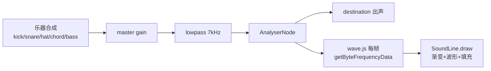

# 开发文档 — new_blog

> 面向**改代码的人**的文档，记录架构意图、模块边界与踩过的坑。
> 快速上手请看 `README.md`；本文侧重「为什么这么写」与「不要再踩」。
>
> 文档基线：2026-09-20。

---

## 1. 技术栈

| 层 | 选型 | 版本 | 备注 |
| --- | --- | --- | --- |
| 框架 | Vue | 3.5.42 | 全 SFC + `<script setup>` |
| 语言 | TypeScript | ~6.0.2 | ⚠️ 已弃用 tsconfig 的 `baseUrl`，见 §7.1 |
| 构建 | Vite | 8.3.0 | |
| 路由 | vue-router | 5.3.1 | `createWebHistory` |
| 动效 | motion | 13.4.0 | ⚠️ **无 Vue 入口**，见 §5.1 |
| 平滑滚动 | lenis | 1.3.26 | |
| 音频可视化 | @foobar404/wave | 2.0.5 | MIT，38KB，无依赖 |
| Markdown | markdown-it + highlight.js + dompurify | 15 / 11 / 3 | 见 §5.4 |
| 字体 | @fontsource | — | 本地打包，**不要换 CDN** |

★ **没有后端、也没有全局状态**。项目是纯静态站：
曾经有过 `src/api`（axios 封装）、`src/stores`（Pinia）、`src/types`
与对应的两个依赖，收尾时一并删掉了 —— 接后端时再加。

命令：

```bash
npm run dev      # http://localhost:5173
npm run build    # vue-tsc -b && vite build
npx vue-tsc -b --pretty false   # 只做类型检查
```

---

## 2. 目录结构（当前真实状态）

```
src/
├─ posts.ts          # 文章门面层：视图只 import 它（数据来自 content/posts/*.md）
├─ projects.ts       # 项目门面层：同上（content/projects/*.md，与文章共用 content-kit.ts）
├─ pages.ts          # 页面门面层：同上（content/pages/*.md，「关于」就是其中一篇）
├─ assets/works/     # 通用作品图池（avif）；文章/项目 md 的 cover 都能引用
├─ components/
│  ├─ AppLoader.vue        # 首屏载入动画（同一会话只播一次）
│  ├─ CursorDot.vue        # 跟随光标的半透明白圆（挂在 App.vue）
│  ├─ WaterBody.vue        # hero 线**以下**的水体（鼠标交互；原 HeroStage 3D 舞台已删）
│  ├─ InitialLetter.vue    # 巨型字母 SVG（Blog 的 B）
│  ├─ MarkdownRenderer.vue # markdown → 主题化 HTML（XSS 已加固）
│  ├─ MusicBar.vue         # 音乐栏（走带键 + 细轨进度 + 曲目抽屉 + 断点续播；曲目来自网易云，见 §5.6）
│  ├─ MusicBall.vue        # 音乐球（非首页的右下浮动球 + 面板：环状进度 + 走带键 + 曲目列表，见 §5.6）
│  ├─ NextButton.vue       # 「N ext」翻页按钮（各页共用）
│  ├─ SoundLine.vue        # 音频可视化横线（兼画 hero 渐变与线下填充）
│  └─ LiquidTransition.vue # 液态玻璃转场遮罩（App.vue 里独立的一层 fixed）
├─ composables/
│  ├─ lofi.ts        # 音频可视化状态（波形来自 player 的 analyser）+ 渲染器工厂；★ 不再合成音乐
│  ├─ siteViews.ts   # 站点浏览量（PV）：POST 计一次 / GET 读总数（端点由 VITE_VIEWS_ENDPOINT 注入）
│  ├─ steam.ts       # Steam「最近在玩」：读 /steam（workers/api/），没配端点不渲染那张卡
│  ├─ typewriter.ts  # 格言打字机（逐字出现 + 光标淡出；reduced-motion 直接给全文）
│  └─ motion.ts      # 动效基础设施（Lenis 单例、reduced-motion、启动信号）
├─ directives/
│  ├─ magnetic.ts    # v-magnetic 鼠标磁性偏移
│  ├─ reveal.ts      # v-reveal 滚动进场（motion 驱动）
│  └─ imgFallback.ts # v-img-fallback 图片坏图兜底（.is-broken / .has-broken-img）
├─ layouts/
│  └─ DefaultLayout.vue    # 顶栏 + main + 页脚（含毛玻璃检测、视图过渡）
├─ router/index.ts
├─ views/
│  ├─ HomeView.vue         # 首页（hero）
│  ├─ ArticleListView.vue
│  ├─ ArticleDetailView.vue
│  ├─ ArchiveView.vue
│  ├─ AboutView.vue         # 关于（两栏：左粘性头像卡 + 右玻璃面板；内容来自 content/pages/about.md）
│  ├─ ProjectListView.vue  # 项目列表（卡片网格，数据来自 content/projects/*.md）
│  ├─ ProjectDetailView.vue # 项目详情（与文章详情同版面；没有 TOC）
│  └─ NotFoundView.vue
├─ App.vue
├─ style.css               # 设计系统（令牌 / 基础 / 工具类 / 布局 / 组件）
├─ main.ts
└─ env.d.ts                 # virtual:posts / virtual:projects / virtual:pages 的模块类型声明
```

> ★ `README.md` 的目录树是**权威的**，与代码同步。

---

## 3. 路由

| 路径 | name | 标题 | 布局 |
| --- | --- | --- | --- |
| `/` | home | 首页 | DefaultLayout |
| `/articles` | article-list | 文章 | DefaultLayout |
| `/articles/:id` | article-detail | 文章详情 | DefaultLayout |
| `/archive` | archive | 归档 | DefaultLayout |
| `/about` | about | 关于（内容来自 `content/pages/about.md`） | DefaultLayout |
| `/projects` | project-list | 项目 | DefaultLayout |
| `/projects/:id` | project-detail | 项目详情 | DefaultLayout |
| `/:pathMatch(.*)*` | not-found | 页面不存在 | **顶层，不在 DefaultLayout 内** |

★ 404 是**顶层路由**，所以它**没有导航栏**。任何依赖 `--nav-h` 的顶部内边距
在 404 上都是错的（会让内容凭空下移）。详见 §7.6。

**滚动复位统一走 Lenis**：`router/index.ts` 的 `scrollBehavior` 调用
`lenis.scrollTo(top, { immediate: true })` 并 `return false`。
若不桥接，Lenis 内部状态停在旧位置，下一帧会把页面拽回去。

---

## 4. 设计系统（`src/style.css`）

文件按 6 段组织，改之前先确认落在哪一段：

| 段 | 内容 | 定位关键词 |
| --- | --- | --- |
| 令牌层 | `:root` 变量（栅格 / 配色 / 字号 / 间距 / 缓动） | `:root {` |
| 基础层 | reset、`html::before` 固定渐变层 | `基础层` |
| 排版工具类 | `.u-h1-cn` / `.u-h2-cn` / `.u-h3` ~ `.u-h4`、`.u-main`、`.u-small`、`.u-muted` | `排版工具类` |
| 布局 | `.u-container`、`.u-grid`、`.space-*` | `布局` |
| 组件 | 按钮、卡片、`.page-next` 等 | `组件` |
| 滚动进场动画 | 目前为空段（见段内注释） | `滚动进场动画` |

> ★ **不写死行号**：改一次代码就失效。用「分隔注释里的中文段名」定位最稳 ——
> 搜索 `Ctrl+F` 那段标题即可。

### 4.1 配色：只有两个颜色

```
--brand: #0631bb   唯一被显式指定的色（同时也是最深锚点）
--text : #fff8e7   米色（暖白）—— 用户要求「去掉纯白，改为米色」
其余全部由这两个派生（color-mix）
```

背景是一整块**由浅到深**的固定渐变，`--brand` 是最深处：

```css
--bg-top: color-mix(in srgb, var(--brand) 74%, #4fd2ff);  /* 顶部，偏青的浅蓝 */
--bg: var(--brand);                                       /* 底部，最深 */
```

★ 渐变画在 `body::before`（`position: fixed`），**不是**给 `body` 加 background。
理由：body 背景会随文档高度被拉伸，长页面上颜色错位，还会出现"渐变到头变纯色"的断层。
fixed 层永远填满视口。

⚠️ 后果：**视口顶部的颜色永远是 `--bg-top`**，无论滚到哪里。
所以导航的毛玻璃底色必须用 `--bg-top`，用 `--bg` 会在浅色渐变上压出一条深色横带。

### 4.2 hero 音频线的三层色

```
--bg-top    #195bcc   最浅
--hero-line #1049d0   音频线处的落点
--hero-fill #0735bd   音频线以下的实心填充
```

★★ **渐变不能在线处收敛到 `--hero-fill`**。同色盖同色 → 波形起伏肉眼完全看不出。
选色守三条：

1. `--hero-line` 必须比 `--bg-top` **暗**（否则"先沉后浮"）
2. 与 `--hero-fill` 的 WCAG 亮度比 **≥ 1.2:1**（`#1049d0` = 1.28，勉强够）
3. 三者与白字对比度都 ≥ 4.5

### 4.3 `--nav-h`：**它就是导航的高度**（唯一的真相）

★★ `.nav { height: var(--nav-h) }` —— 高度由这个值**直接决定**，
  不再由子元素的内边距撑出来。

  为什么这么改：旧写法是「高度 = `.nav-logo-link` 内边距 + 行高」自然撑开，
  而 `--nav-h` 是另一处写死的值，两者必须**手工同步**；
  于是每当断点里改字号或内边距就忘一次，hero 顶部凭空多出几十像素空隙
  （实测漂过 65vs63、54vs63）。现在从根上不可能再漂。

| 断点 | `--nav-h` | 实际 | 字号 |
| --- | --- | --- | --- |
| >767px | `4.5rem` | 72px | 16px |
| 521~767px | `4.3125rem` | 69px | `clamp(10px, 2.2vw, 16px)` |
| ≤520px | `4rem` | 64px | 同上 |
| ≤345px | `3.5rem` | 56px | 同上（已触底10px） |

★ **代价**：子元素必须装得进这个高度，否则会**溢出**（不再把导航撑高）。
  所以 `.nav-logo-link` 的纵向内边距写了自适应：
  `padding-block: min(1.5rem, calc((var(--nav-h) - 1.6em) / 2))`。
  写死 `1.5rem` 时实测 700px 下溢出 2.1px。

自检：`document.querySelector('.nav').getBoundingClientRect().height`
必须等于 `--nav-h` 的像素值（误差 ≤1px），
且 logo / 链接盒子的上下边都落在导航范围内。

### 4.4 中文字号与行高

参考站的行高是为**英文压缩字体**调的，直接套中文会严重重叠，必须分档：

| 类 | 英文 lh | 中文 lh |
| --- | --- | --- |
| `.u-h1-cn` | （英文原版 `.u-h1` 已于 2026-10-08 删除） | 1.15，并用 `clamp` 降字号 |
| `.u-h2-cn` | （英文原版 `.u-h2` 同上已删） | 1.45 |
| `.u-h3` / `.u-h4` | 1.1 | 1.5 |
| `.u-main` / `.u-small` | 1.25 | 1.75 |

★ **绝对不要给含中文的文本设 `line-height: 1`**。
自检：遍历叶子元素，含中文且 `lineHeight < fontSize * 1.15` 即算重叠。

---

## 5. 核心模块

### 5.1 `composables/motion.ts` — 动效基础设施

集中管理两件事，避免各组件各自初始化打架：

1. **Lenis 单例**：`initSmoothScroll()` / `destroySmoothScroll()` / `getLenis()` / `smoothScrollTo(top)`
2. **`prefersReducedMotion()` + `markBooted()` / `whenBooted()`**

★★ **motion v13 没有 Vue 入口**。`package.json` 的 exports 只有 `.` / `./react*` /
`./three` / `./vgpu`，**没有 `./vue`**。所以全部是原生 DOM 用法：
`animate(el, {...}, {...})` / `inView` / `scroll` / `stagger`。
可用 API：`animate` / `scroll` / `inView` / `stagger` / `spring` / `animateMini` / `frame`。
**没有 `timeline` / `createTimeline`**（实测 `undefined`）—— 要串联就用 `delay` 或 `.finished.then()`。

Lenis 的坑：

- `autoRaf: false` + 手动 rAF（便于精确启停，也便于 reduced-motion 下彻底不启动）
- `syncTouch: false`（移动端原生滚动已经够顺，接管反而打架）
- **所有滚动都必须走 `smoothScrollTo()`**，不要用 `window.scrollTo`
  也不要 `scrollIntoView`（会与 `scroll-behavior` 叠加，定位漂移）

### 5.2 `components/HomeView.vue` — hero

纵向 flex，`height: 100svh`，上下各 50%。用 `container-type: size` +
`cqh` 算「半个内容区高」（`--hero-half`）。

**尺寸体系**（全部定义在共同祖先上）：

```
--hero-content-h   内容区总高（= 100cqh，兜底 100svh − nav-h）  ← 垂直预算基准
--visual-w         中间舞台宽度（桌面 14rem；移动端按内容高算）
--brand-max-h      Blog 组的宽度/垂直上限
--brand-h          min(--hero-half, --brand-max-h)  ← 实际高度
--corner-w         L 形角标的线宽
```

**几条硬约束**：

- ★ **绝不能在入场动画里动 `transform`**。布局依赖 transform：
  `.hero-brand-row` 的基线对齐、`.hero-next` 的 baseline 对齐都会被打坏。
  只允许动 `opacity` / `filter`。
- ★ **`opacity: 0` → JS 恢复的模式必须有兜底**。已有 `armRevealSafety()`：
  3.5s 后强制把仍 < 0.05 的元素设为 1（否则 rAF 被挂起时元素永久不可见，
  NEXT 点不到，页面看着是坏的）。
- ★ **`.hero-contain` 是 `pointer-events: none`**（否则它铺满 hero 且 z-index 最高，
  会吃掉下面水体 / 音乐线层的鼠标事件）。`NEXT` / 播放按钮各自设回 `auto`。
- ★ **`.hero` 的子节点互为兄弟，不是父子**：`.hero-contain`、`<SoundLine />`、
  `<WaterBody />` 三者平级 ⇒ 在 `.hero-contain` 上定义的变量，另两个读不到，
  `width: var(--x)` 会**静默退回 `auto`**（实测曾被撑到 712px 并溢出，无任何报错）。
  共享变量（`--visual-w` / `--wave-*` / `--band-*`）必须放 `.hero`。

**移动端（≤767px）垂直预算**：

```
B       = 内容高 × 0.30
舞台    = 内容宽 32%（4:5 → 高 40%）
NEXT    = 0.38 × B
```

★ 别再用「倒推公式」（旧版是 `1.16 × --hero-half − 109px`）。
那是从舞台位置反解的，会把「B 占屏幕的比例」耦合到屏幕高度上
—— 实测占比随屏高从 33% 涨到 40%，越高的屏幕 B 越大、越挤模型。
直接写百分比，占比才恒定。

### 5.3 `components/SoundLine.vue` + `composables/lofi.ts` — 音频线

**数据流**：



- 波形数据来自 `player.ts` 的 analyser —— 播的是**网易云 320 kbps mp3**（见 §5.6）。
  ★ 2026-10-09 前这里写的是「实时合成的 lo-fi（BPM 74）」，那套合成器已删，别再照它改。
- `analyser` 是「边分析边透传」的，所以既能被读取又能出声。
- **必须在用户手势里 `ctx.resume()`**（浏览器自动播放策略），所以由按钮触发。
- ★★ **离开首页不要暂停**（2026-10-09 改）：要跨路由接着放，非首页由音乐球接管
  （`HomeView.vue` 的 `pauseMusic()` 已删，见 §5.6）。

★ **wave.js 的职责边界**（读 bundle 源码确认过，别猜）：

| 能做 | 不做 |
| --- | --- |
| 建 AnalyserNode、每帧取频谱、`clearRect`、rAF 循环、`addAnimation({draw})` | ❌ **devicePixelRatio**（源码出现 0 次）→ 必须自己适配 |
| | ❌ 采集系统音频 |

★ `new Wave(analyserNode, canvas)` 走 `instanceof AnalyserNode` 分支，
**直接用外部 AnalyserNode，不自己建音频图**（否则会把播放中的音频改道）。
但它**不设** `smoothingTimeConstant` / `fftSize`，要自己设（与其内部一致：.85 / 1024）。

★★ **renderer 是模块级单例，必须比对 canvas**：

```ts
export function createRenderer(canvas: HTMLCanvasElement) {
  if (!analyser) return null
  if (renderer && boundCanvasOf(renderer) === canvas) return renderer  // ★ 比对
  renderer = new Wave(analyser, canvas)
  return renderer
}
```

组件重挂载（HMR / 路由来回）会创建**新的 canvas 元素**，
旧实例仍指向已脱离 DOM 的旧 canvas → 动画全画到虚空。
症状：`draw()` 被调用正常、音频数据在流，但画布 hash 恒定不变。

⚠️ 关掉库的 rAF 时走 `createRenderer(cv)?.clearAnimations()`，
**不要**用 `getRenderer()?.clearAnimations()`（可能作用在旧实例上）。

**波形绘制**（三层叠加，逐层见代码注释）：

- **主体涌浪** —— 6 个谐波，各带基形权重与频谱调制；再经 `sharp()`
  做斯托克斯变形（波峰窄、波谷宽）→ 像水而不像信号
- **成组涌动** —— 很慢的行波包络，让高度有「一波一波」的涨落
- **泛波** —— 26 周期的高频细纹，不接频谱，保证水面永远不“干净”
- 参数（2026-10-09 调过一轮「波动太小」，与 `AGENTS.md` §5.2 的清单一致）：
  `MAX_AMPLITUDE`（运行时读 CSS `--wave-amp`，兜底 40）、`POINTS = 128`、`HARMONICS = 5`、
  `HARMONIC_CYCLES = [1.6, 2.9, 4.5, 6.3, 8.6]`、`SPEED_K = 0.023`、
  `LEVEL_REF = 0.78`（★ 2026-10-09 由 0.24 上调：旧值按内置合成器的 `avg ≈ 0.29` 定，
  而实盘曲目 `avg ≈ 0.58~0.65` ⇒ 95% 以上的活跃帧贴顶、振幅恒定不动）、
  `PUNCH_GAIN = 0.9` / `FLUX_WEIGHT = 2`（节拍走「能量 + 2×谱通量」）、`BODY_GAIN = 1.4` + `tanh` 软限幅
- 取频谱前 64 个 bin（低频能量大、与鼓点相关性最高）；**节拍**另看逐 bin 正向增量的
  谱通量 —— 全带能量对鼓点只有 0.69 次/s，谱通量能到 1.7 次/s（≈ 真实 101 BPM）
- **`waveY` 必须是 `drawLine` 的内部闭包**，见 §7.4

### 5.4 `components/MarkdownRenderer.vue`

三件套：`markdown-it`（解析）+ `highlight.js`（高亮）+ `DOMPurify`（清洗）。

★ **代码高亮必须用「核心包 + 按需注册语言」**：

```ts
import hljs from 'highlight.js/lib/core'
import javascript from 'highlight.js/lib/languages/javascript'
hljs.registerLanguage('javascript', javascript)
hljs.registerAliases(['js', 'jsx'], { languageName: 'javascript' })
```

不要 `import hljs from 'highlight.js'` —— 全量包 5MB+ 会把包体撑爆。

★ **安全双保险**：`markdown-it` 设 `html: false`（不解析原始 HTML）+ 输出再走
`DOMPurify.sanitize()`。已用 7 个攻击向量实测拦截
（`<script>` / `` / `javascript:` 链接 / `<iframe>` / `data:text/html` 等）。

### 5.5 `layouts/DefaultLayout.vue` — 导航毛玻璃

`detect()` 判断「导航条带（文档坐标 `[scrollY, scrollY + navH]`）是否与任一内容区间相交」。
相交则挂 `.is-overlapping`。

★ **判断必须用区间相交，不能只缓存「最靠上内容的顶边」再比 `scrollY`**
—— 内容已经滚到视口上方时会误判为重叠（实测 320×700 的 `/about` 滚到底就是）。

★ 内容位置用 `offsetTop` 累加算**文档坐标**（绕开 transform 位移），
且只统计**叶子元素**（容器自身的顶边带着内边距，不是内容真实位置）。

★ 页面组件是**懒加载**的：`DefaultLayout` 的 `onMounted` 会先于内层页面执行，
那时 `<main>` 还是空的 → 测到空数组。必须用 `MutationObserver` 监听
`<main>` 子树变化来补测，否则一旦首测为空就**永久失效**。

★ 毛玻璃在**所有断点**生效，**不要**在 JS 里加 `matchMedia` 尺寸门控。
CSS 侧改成全断点后 JS 门控漏改过一次，导致窄屏完全没有毛玻璃（静默失效）。

---

### 5.6 「音乐栏」与「音乐球」的播放器（`composables/player.ts` + `MusicBar.vue` + `MusicBall.vue`）

**曲目来自网易云（2026-10-09 改，此前是 `public/music/*.mp3` + `virtual:music`）**：
`src/playlist.ts` 是唯一真相源（两首 id + 手写元数据），`url = ${VITE_MUSIC_ENDPOINT}/stream?id=<id>`，
dev 未配就落 `/music`（`plugins/vite-plugin-api-proxy.ts` 装的是与线上同一份
`workers/api/src/netease.js`）。Worker 先换 320 kbps 直链（`level=exhigh`；直链带 IP 令牌 +
`expi=1200`，所以缓存 15 分钟）再把 `Range` 原样透传。
★ 网易云 API 无 CORS 头 ⇒ 浏览器不能直连；CDN 直链虽有 `ACAO: *`，但音频要进 Web Audio 图，
所以 `player.ts` 的 `audio.crossOrigin = 'anonymous'` **不能删**（删了 = 进度在走、没声音、波形全零）；
端点还必须 expose `Content-Range`，否则拖进度条失灵。仓库里**没有任何音频文件**
（`public/music/`、`plugins/vite-plugin-music.ts`、`plugins/mp3.ts`、`virtual:music` 都已删除）。
★★ **dev 中间件转发必须走 `pipeline`，不能裸 `pipe(res)`**（2026-10-09 修，真踩到）：
`<audio>` 缓冲够了 / 拖进度条 / 切歌都会主动 abort 上一个请求（`net::ERR_ABORTED`），
裸 pipe 不给 Readable 挂 error 监听 ⇒ 上游体被 `read ECONNRESET` 打断时抛出**无人接管**的
`'error'` 事件 ⇒ **整个 vite 进程退出**（实测 `TypeError: terminated`，退出码 1）。
现在 `plugins/vite-plugin-api-proxy.ts` 用 `await pipeline(source, res)` + `isClientGone()`，
把这类收尾降级成一行 warn；只有真正的转发失败才报 502。

引擎是 `player.ts`：模块级 `new Audio()`（**不挂进 DOM**，免得动 hero 布局），Web Audio 图
`element → analyser → gain → destination`（音量走 GainNode，analyser 同时喂 `SoundLine`），
状态机由 HTMLMediaElement 事件驱动，断点续播写 localStorage（`blog:music:volume|muted|slug|pos:<slug>`）。

UI 只被首页用（`.hero-music-row` 里那个 240px 胶囊，**不是全局底栏**；非首页的入口是音乐球，见下）。两行：
行 1 = 走带键 + 时间 + 静音/抽屉；行 2 = **只有细轨**（3px 轨 + 9px 播放头 + 透明 range）。
移动端（≤767px）整个外壳变成 `position: fixed` 的 48×48 圆钮，行 2 与曲目抽屉都不渲染。

★ 播放态的换色不是「换一套主题色」，而是靠 `--mb-wipe` 把外壳整体擦成蓝底、字色翻米色；
`--mb-track` / `--mb-fill` / `--mb-edge` 用 `@property syntax: '<color>'` 注册过，
所以它们参与 0.35–0.45s 过渡、`getComputedStyle` 读出来已是解析后的颜色 ——
进度条与播放头的取色都靠这一点。

**非首页的入口是「音乐球」`components/MusicBall.vue`（2026-10-09 加）**：挂在
`layouts/DefaultLayout.vue` 的 `</footer>` 之后（`<main>` 之外 —— 祖先有 transform 会让 fixed 换包含块），
`visible = !onHome && hasTracks`、`z-index: 54`；球 = 52px 圆 + SVG 进度环
（`stroke-dasharray: 138.23`，与 JS 的 `2π × 22` 必须一致）+ 均衡器，点开是面板
（标题 / 细轨 / 走带键 / 静音 / 曲目列表，收起时 `inert`；再点球、点面板外、Esc 三种关法）。
★★ 同一轮删掉了 `HomeView.vue` `onBeforeUnmount` 里的 `pauseMusic()`：不删，「切页继续播」
永远不可能发生（实测切到 `/about` 后 status 变 `paused`）。不要再加回来。

#### 历史：真实波形（2026-10-07 当天加、当天撤）

那天做过「手写外壳 + wavesurfer 波形」并实测全绿，随后用户（m10392）说「不用这个真实波形了」
⇒ **依赖已 `npm uninstall wavesurfer.js`、代码已删**（`player.ts` 也不再导出
`getAudioElement()` / `absoluteTrackUrl()`）。若将来又要上，下面这些不用重测：

- 波形库只当「画布 + 指针 seek」：`media` 传**引擎那个 audio 元素**，URL 必须与引擎写进
  `audio.src` 的**完全同一字符串**（wavesurfer 的 `setSrc()` 里 `if (prevSrc === url) return`，
  字符串一致时 `load()` 是空操作，否则它重新赋 src、把播放位置归零）。
  play / pause / 切歌 / 续播仍**全部**归 `player.ts`（它不调 `createMediaElementSource`，不会撞车）。
- **`await import('wavesurfer.js')` 必须动态**：单独成块 50.95 KB raw / 14.59 KB gz，
  静态引入会把首屏从 71 KB 顶到 ~120 KB，破 `scripts/budget.mjs` 的 88 KB 门槛。
- **第一次真的播放才建**（画波形要下载 + `decodeAudioData` 整首 mp3）；≤767px 不建
  （行 2 是 `display: none`），窗口拉宽且正在播放时靠 `matchMedia('(min-width: 768px)')` 补建。
- **`ws.load()` 的 rejection 要接住**：v8 在「上一条还没解码完就来下一条」时以
  `AbortError: The load was superseded by a newer load call` 拒绝（快速连点下一首会踩到）。
- 配色不写死：从 `--mb-track` / `--mb-fill` 读，再经 `canvasColor()` 借 2D context 的
  `fillStyle` 规范化成 canvas 认得的串；外壳换色有 0.35–0.45s 过渡，所以等 460ms 再 `setOptions()`。

★ 那次**顺手修好、并且保留下来了**的三件事（与波形无关）：① `.mb-thumb` 从 `.mb-track`
里搬出来直接挂 `.mb-scrub` 下（定位相同，但不再被轨道裁剪）；② `.mb-thumb` 背景改
`var(--mb-fill)`（播放态翻米色，原来的品牌蓝点在蓝底上几乎看不见）；
③ range 的 `step="10"` + `onScrubMove()` 里 `if (dragRatio.value == null) beginScrub(r)`
—— 原来键盘 ←/→ 完全无效（键盘只派发 `input`、从不派发 `pointerdown`）。

## 6. 已知的环境限制

### 6.1 系统音频采集做不到（已放弃，不要再探索）

需求「监听电脑正在播放的声音（网易云）」**纯网页做不到**：

- npm 上的方案（`electron-audio-loopback` / `wasapi-audio-capture` /
  `node-system-audio` 等）**全都要 Node/Electron**，浏览器跑不了
- 浏览器侧接口只有 `getUserMedia` / `getDisplayMedia` / `enumerateDevices` /
  `getSupportedConstraints` / `setCaptureHandleConfig`，**没有** `getSystemAudio` 之类
- 这是沙箱的硬性设计（防窃听），不是库缺失

**现行方案**：本页自播音乐（§5.3），零权限零弹窗。

### 6.2 集成浏览器不适合验证「随时间变化」的东西

VS Code 内置浏览器的标签页被标记为 `document.hidden: true`，
浏览器把 `requestAnimationFrame` 限流到 **~1fps**（实测 4.2s 只跑 23 帧）。

后果：

- 所有 JS 动画几乎不推进，CSS 过渡也不跑
- **连 `:hover` 都不触发**（磁性 / 悬停类交互无法在此验证）
- 截图管线不可靠：**同一元素两次 `locator.screenshot()` 会得到不同尺寸**
  （128×128 / 80×80 / 125×125），像素级比对全是噪声

**可靠的验证方式**：

- 几何用 `getBoundingClientRect()` + `getComputedStyle()` —— 这两个**可靠**
- 波形类：在页面里**手动调用** `anim.draw(buf, ctx)` 绕开 rAF 限流，再读像素
- 判断动画完成看**最终状态**（opacity 是否到 1、Loader 是否移除），别盯中间帧
- ⚠️ 排查前**先把背景色算出来做基准**。曾把 `6+49+187 = 242` 误读成
  "亮度 242 的白线"，实际那正是背景色本身。

### 6.3 PowerShell 5.1 会毁掉含中文的 UTF-8 文件

**绝不要**用 `Get-Content` / `Set-Content` 批量改含中文的文件
（PS 5.1 默认按 GBK 读，中文字符后的字节会被吞掉 → 语法损坏）。
批量替换一律**写 Node 脚本**（`fs.readFileSync(f, 'utf8')`）。
检查乱码：读进来判断是否含 `\uFFFD`。

---

## 7. 踩过的坑（改动前先读）

### 7.1 TS 6 弃用 `baseUrl`
报 TS5101。删掉 `baseUrl`，`paths` 写 `"@/*": ["./src/*"]`。

### 7.2 `flex-direction` 改变后必须重置 `align-items` / `justify-content`
`.hero-top` 桌面端是 `align-items: flex-end`（纵向 flex 里表示"贴底"）；
一旦 `flex-flow: column`，`align-items` 就变成**水平**对齐 → 内容被推到右侧。

### 7.3 自定义属性里的 `%` 会解析到「使用它的元素」上
`max-height: var(--x)` 里的 `%` 会按**高度**算，结果错误。要用 `vw`。

### 7.4 ★★ 改函数签名漏改调用点 → 参数静默错位
把 `waveY(i, w, centerY, a)` 改成 `waveY(i, centerY, a)` 时漏改 3 处调用。
**JS 不检查参数个数**，于是波形被画到 y≈1425（画布外）。
症状：「白线消失、填充不动」，**且没有任何报错**。

✅ 修法：把 `waveY` 改成 `drawLine` 的**内部闭包**，直接捕获 `centerY` / `amp`。

### 7.5 `ResizeObserver` 回调覆盖动画
回调里写 `if (!getRenderer()) drawStaticLine()` —— 而 renderer 在首次播放前
恒为 `null`，于是每次尺寸回调都重画静止态。
✅ 修法：`resize()` 开头比对尺寸，**没变就直接 return**；只保留一处
`if (playerState.value !== 'playing') drawStaticLine()`。

### 7.6 404 页没有导航，却套了给导航让位的 `--page-top`
内容凭空下移 98px。404 是顶层路由，必须**单独给值**。
另外中段垂直居中要用 **grid**（`grid-template-rows: 1fr auto 1fr`），
不能用 `flex: 1` —— 两侧行高不等时中段会被挤偏。

### 7.7 `clamp` 上限锁死导致「宽屏反而更小」
`clamp(4rem, 13vw, 10rem)`：1920 下只占屏宽 12.4%，而 390 下占 32.6%。
✅ 改为按 **vw/vh 双轴取小**：`clamp(5rem, min(30vw, 40vh), 28rem)`。

### 7.8 不要给当前导航页任何常驻样式
`Home` 指向 `/`，而首页就是当前路由，所以**任何** `.router-link-exact-active`
样式都会永久生效，与 hover 视觉撞车（用户连报两次）。
最终：当前页**完全不加样式**。

### 7.9 卡片/列表的 hover 判定必须两个轴都相交
桌面/平板是左右分栏，caption 与舞台**纵向重叠是正常的**（横向分离）。
只看纵向会误报一堆「重叠」。

### 7.10 超窄屏代码块 token 溢出
`pre { overflow-x: auto }` 不够 —— highlight.js 的 token 是**内联 span**，
单个超长 token 不能折行，会把 `pre` 顶宽。三层一起：

```css
.md-code pre  { overflow-x: auto; min-width: 0; max-width: 100%; }
.md-code code { display: block; white-space: pre-wrap; overflow-wrap: anywhere;
                width: max-content; min-width: 100%; }
```

### 7.11 测「元素是否被遮挡」不要只看 `elementsFromPoint`
它默认**跳过 `pointer-events: none` 的元素**。若目标是这类元素
（如 hero 里的角标，继承自 `.hero-contain` 的 `none`），
会永远只返回容器本身 —— **这不代表它不可见**。

---

## 8. 回归自检清单

改动布局相关代码后，至少跑一遍：

```js
// 视口矩阵
const vps = [[1920,1080],[1440,900],[1024,768],[900,800],[768,900],
             [640,480],[540,720],[430,932],[390,844],[375,667],
             [360,640],[320,568],[320,480]]
// 页面
const pages = ['/', '/articles', '/archive', '/about',
               '/articles/1', '/nonexistent-xyz']
```

每组合检查：

| 检查项 | 期望 |
| --- | --- |
| `scrollWidth > clientWidth` | ❌ 不应出现横向溢出 |
| `.nav` 高度 vs `--nav-h` | 误差 ≤1px |
| 导航是否遮住 `main` 里第一个有文字的元素 | 否 |
| `.nav-logo-link` 与 `.nav-list` 是否相交 | 否 |
| 舞台 / NEXT / caption 两两相交 | 否 |
| 舞台是否完全在 hero 内 | 是 |

当前基线：**78 组合（6 页面 × 13 视口）全部通过**。

---

# 灵感池

> 还没做的想法。记下**为什么**想做和**怎么做**，避免以后只记得一个模糊的印象。

## 💧 #1 — 模型砸落溅浪 + 波浪文字遮罩（Persona 3）

**状态**：💡 构思中，未开工
**日期**：2026-09-20
**关联模块**：`SoundLine.vue` / `lofi.ts` / `HomeView.vue`
（原写在这里的 `DeferredStage.vue` 已于 2026-10-08 大清洗删除 —— 见下）

### 目标效果

1. **砸落**：3D 模型从上方落进音频线，接触瞬间激起飞溅浪花
2. **文字遮罩**：波浪线**以下**的区域作为文字遮罩 —— 文字只在"水面以下"可见，
   浪起浪落时文字如水下浮沉
3. **气质**：对齐 Persona 3 —— 深蓝 + 白、锐角水花（不是圆润水滴）、克制

### 为什么和现有架构契合

- `SoundLine` 已经把「hero 渐变 + 波形线 + 线下填充」画在**同一帧、同一坐标系**里，
  再叠一层"水面"是自然的延伸
- ~~`DeferredStage` + `deferredAsset.ts` 已经就位~~ ⇒ **2026-10-08 已删**（`three` 没装回来、全仓零引用）。真要上模型时自己动态 `import('three')` 并照 `AGENTS.md` §5.10 的规矩重建这条管线（★ 当时留的备份 `%TEMP%\dsh-cleanup-backup` 已于 2026-10-09 按用户要求整目录删除，别再去找了）
- 双色约束（`--brand` + `--text`）天然覆盖 P3 的蓝白水花

### 实现要点

**① 先抽出「单一波形真相源」**

目前 `waveY` 是 `drawLine` 的内部闭包。要新增溅浪与遮罩，
三处必须用**同一条曲线**，否则水面与文字边界会错位。

建议在 `lofi.ts`（或新建 `composables/waveShape.ts`）导出：

```ts
export interface WaveFrame {
  centerY: number     // 水面基准 y
  amp: number         // 当前振幅（已含砸落冲击的加成）
  phase: number
  width: number
  sampleY(x: number): number   // 给定 x 返回水面 y —— 三个消费者共用
}
```

`SoundLine.draw` / 飞溅粒子 / SVG 遮罩路径全部从这一个源取数。

**② 砸落触发**

（原方案：`DeferredStage` 的落点动画结束时派发事件 —— 该组件已删，
改成自己在挂载 3D 的组件里用 `onReady` 拿到节点后编排。）
收到后向波形注入一次**冲击**：

```ts
impact = 1                                // 触发
ampBurst = impact * BURST_MAX             // 振幅瞬时加成
impact *= 0.92                            // 每帧衰减
```

落点 x 取舞台中心的 x，作为水花的中心。

**③ 飞溅（P3 的锐角，不是圆水滴）**

在落点附近生成 N 条**尖三角**，从水面往上放射：

- 每条有自己的高度、倾角、衰减系数
- 高度用 `1 - t` 的幂次衰减，宽度收窄 → 视觉上是"水柱"
- **纯 `--text` 白色**，不引入新色相
- 关键：**只画在水面线之上**，与水下的文字遮罩形成明确的水陆分界

**④ 文字遮罩 —— 推荐 SVG `clipPath`**

保持文字是**真实 DOM**（可选中、可被读屏），只给元素套 CSS 裁剪：

```html
<!-- 内联在 hero 里，宽高 100% -->
<svg width="0" height="0" aria-hidden="true">
  <defs>
    <clipPath id="waveClip" clipPathUnits="userSpaceOnUse">
      <path ref="clipPathEl" />
    </clipPath>
  </defs>
</svg>
```

```css
.hero-underwater-text { clip-path: url(#waveClip); }
```

每帧更新 `path` 的 `d`，形状是「水面曲线 + 右下角闭合」：

```
M 0,y0  L x1,y1  ...  L W,yN  L W,H  L 0,H  Z
```

**权衡对比**（别选错）：

| 方案 | 可选中 | 性能 | 备注 |
| --- | --- | --- | --- |
| **SVG `clipPath` + CSS `clip-path: url()`** | ✅ | 每帧一次属性写入 + 重栅格化 | ✅ 推荐 |
| Canvas `destination-in` 合成 | ❌ 文字变成位图 | 好 | 丢语义，SEO/读屏都拿不到 |
| 静态斜向 `mask-image: linear-gradient` | ✅ | **零成本** | 只是斜线，**但 P3 本来大量用斜切** —— 想快速出效果先做这个 |

⚠️ `clipPathUnits="userSpaceOnUse"` 必须写，否则坐标按 0~1 归一化。

**⑤ 无障碍与降级**

`prefersReducedMotion()` 时：不砸落、不飞溅，水面静止；
遮罩可用静态斜线（正好是上表第三行）。

### 风险 / 已知坑

- **每帧改 `clip-path` 会重栅格化**，hero 尺度下要实测帧率。
  兜底：隔帧更新，或把 y 量化到 0.5px（减少无效重绘）
- 文字必须在**波浪下方**才可见，所以遮罩区域是「曲线以下的全部」——
  注意别把导航和 `NEXT` 也裁进去，遮罩元素要单独包一层
- 水面 y 用的是 `--hero-content-h` 体系，**改尺寸逻辑时三处要同步**
- 砸落只在**首次进入**播一次（同 `AppLoader` 的思路），
  每次滚动都砸会很闹

### 验收标准

- [ ] 水面曲线与 `SoundLine` 的波形**逐像素重合**（同一 `sampleY`）
- [ ] 静止时（未播放音乐）水面是一条直线，文字遮罩边界与之平齐
- [ ] 播放时文字随浪起伏，且**文字本身不移动**（只有裁剪边界在动）
- [ ] 砸落瞬间振幅有明显尖峰，1.5s 内平滑回落
- [ ] `prefers-reduced-motion` 下无动画、无飞溅
- [ ] 78 组合回归零失败（无横向溢出、元素不越界）
- [ ] 移动端（≤767px）舞台重心与水面不打架
