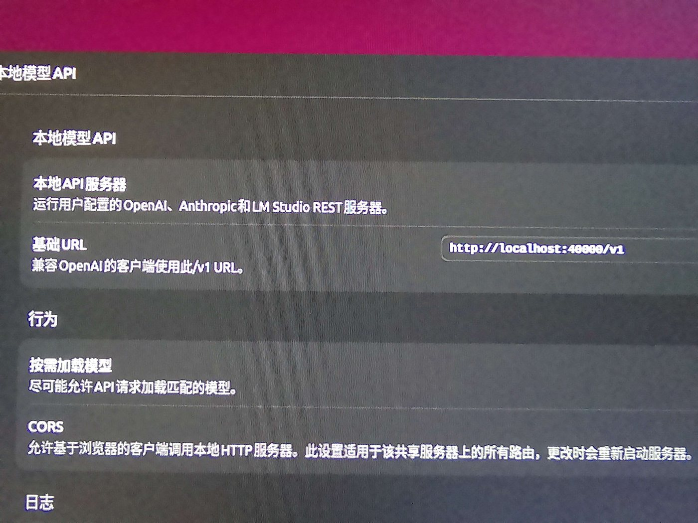
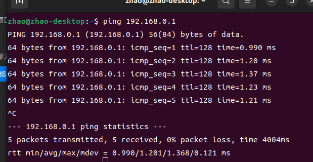
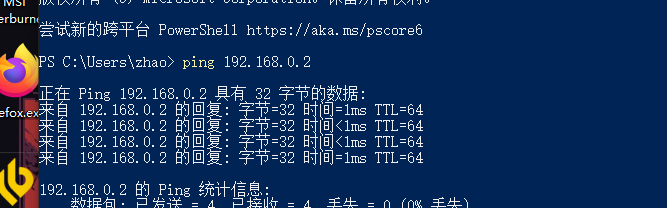
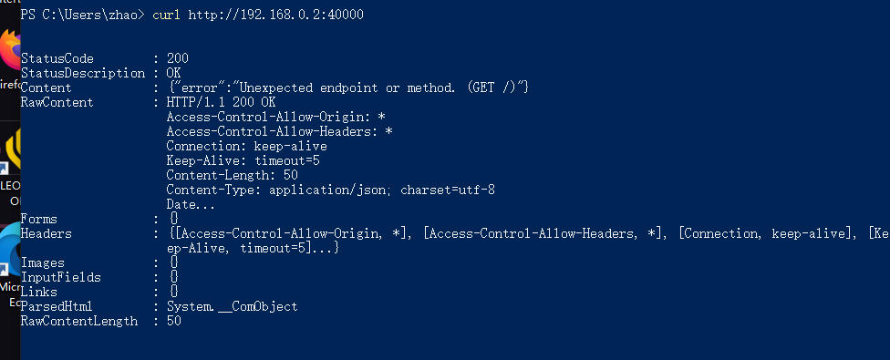

一台退役的服务器、一张 Tesla P100，加上一晚上的折腾，本地大模型就跑起来了。下面是从挑硬件到在另一台电脑上用上它的完整记录。

## 一、硬件选型

- **操作系统**：乌班图 22.04
- **主板**：爱国者 x99
- **CPU**：e5 26 啥我忘了（记得去看一眼补一下）
- **内存**：64G DDR3 ECC 内存（两根镁光两根三星）
- **显卡**：Tesla P100 16G
  - 神秘亮机卡（大概是 AMD HD 系列）
- **硬盘**：128G 三星 M.2

## 二、装机

**电源问题**：点不亮 → 排查 → 最后发现是一拖二的 PCIe 8pin（单根最多承载 125W，但显卡 250W）→ 重买电源 → 重装系统 → 解决问题。

## 三、安装 LM Studio

从官网安装完成后修改一个配置文件，让菜单变为中文。

## 四、安装模型

使用 LM Studio 下载模型。

## 五、模型选择

最终选择了中文理解能力强的 Qwen3 35B A3B。

## 六、DNS 污染是什么？

- LM Studio 下载不动模型文件 → 让 dsh 查问题 → DNS 污染
- DNS 污染发生在解析阶段，分缓存投毒和链路注入，我们遇到的是链路注入。

## 七、初步体验与网络配置

安装完成，在 LM Studio 上进行初步体验，感觉不错，准备在这台电脑上使用。

### 网络发现与 API 端口放行

连接网线、点对点通信，打开控制面板中的网络，先启用客户端电脑上的网络发现，就能看到以太网连接（客户端）。

要让别人访问服务器，不管是挂路由器、走网关还是点对点，都需要在服务器防火墙上放行端口。

LM Studio 提供了一个本地 API 服务器，它默认只监听 `127.0.0.1`（本地回环）。我们要做的是让它监听网卡，所以先放行端口 —— 这里我改成了 40000：



```
# 先放行服务器端口
sudo ufw allow 40000/tcp
sudo ufw reload
```

LM Studio 的 GUI 里没有网络配置，得直接改配置文件。`~/.lmstudio/apps/bionic/.internal/` 目录下有三个重要文件：

| 配置文件 | 作用 | 关键内容 / 注意点 |
| --- | --- | --- |
| `settings.json` | 应用级设置 | 约 60 个嵌套键；护栏 off、强制加载 true、日志级别 5 |
| `http-server-config.json` | 网络监听配置 | `networkInterface: 0.0.0.0`、端口 40000 |
| `http-server.json` | 运行时的实际 host / port / pid | 由程序自己写入，不能改 |

把 `http-server-config.json` 里的 `networkInterface` 从 `"127.0.0.1"` 改成 `"0.0.0.0"`，它就会监听网卡了。

### 点对点 IP 配置与连通测试

先走点对点：没有路由器或网关（DHCP），不会自动分配 IP，所以要手动分配固定 IP。先给乌班图主机在设置里分配 `192.168.0.2`。

然后回到 Win10 那台机子：`控制面板 → 网络与 Internet → 网络连接` → 选中对应的以太网 → 属性 → Internet 协议版本 4（TCP/IPv4）→ 手动分配地址，改成 `192.168.0.1`。

在服务器上 ping 一下：



再在客户端 ping 一下：





成功。之后在 CC Switch 里稍微配置一下供应商，就能愉快地用上本地 LLM 了。
