OpenCV是一个开源，并广泛使用的计算机视觉工具（库），并且支持多数语言，比如我们在学的c# and python

也许之前你也听说过halcon，它是由德国MVTec公司开发的集成开发环境（HDevelop）的机器视觉软件，跨平台，但是不开源，使用它的体验更类似于使用js写vue和使用winfrom拖控件的感觉，它更多给你带来一站式的快速开发体验，使得你能快速完成功能，而无需了解底层实现

‍

要了解这个库，首先我们要了解这个库主要面向工作的对象：图片

图片本质就是由许多像素点组成的图片，比如说你的1080p桌面，本质上就是由1920×1080个像素点组成的图片！我们现在先不说颜色，只说黑白的话，图片会变成这样

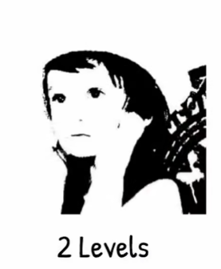

这种图片叫二值图片，只有黑白色，我们也可以让其level多一些，从而得到如下图片

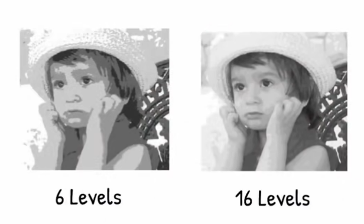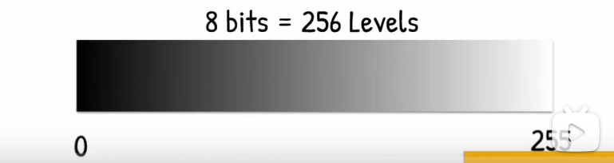

我们总共可以将黑白灰分为256个等级，这种包含了黑白灰的图片叫做灰度图片

接下来我们说说图片的色彩，任何颜色都离不开RGB（红绿蓝三原色），不同的RGB占比可以得出不同的颜色，通过调整像素点RGB占比，我们可以得到一张全彩图

‍

大概了解下图片，我们就可以开始学习openCV了

要学习，先下包

```python
pip install opencv-python
```

```python
#cv2是opencv的核心类
import cv2
```

我们创建一个照片捕获对象

```python
import cv2
#资源路径
img =  cv2.imread("4e73183f340b25e90c058aba37effc26.jpg")

if img is not None:
#窗体名称为output，show的对象是img
	cv2.imshow("Output", img)
#显示时间，0默认无限时间
cv2.waitKey(0) 
```

启动后我们运行程序，就可以看到舍友的帅照显示了

我们再来试试创建一个视频捕获对象

```python
import cv2

cap = cv2.VideoCapture("Signalis 2026.10.31 - 22.14.00.03.mp4")

while True:
	#success为一个bool，若它为false则返回
    success , img = cap.read()
    cv2.imshow("Video",img)
#	按下q退出
    if cv2.waitKey(200) & 0xFF == ord("q"):
        break
```

启动后可以看到视频

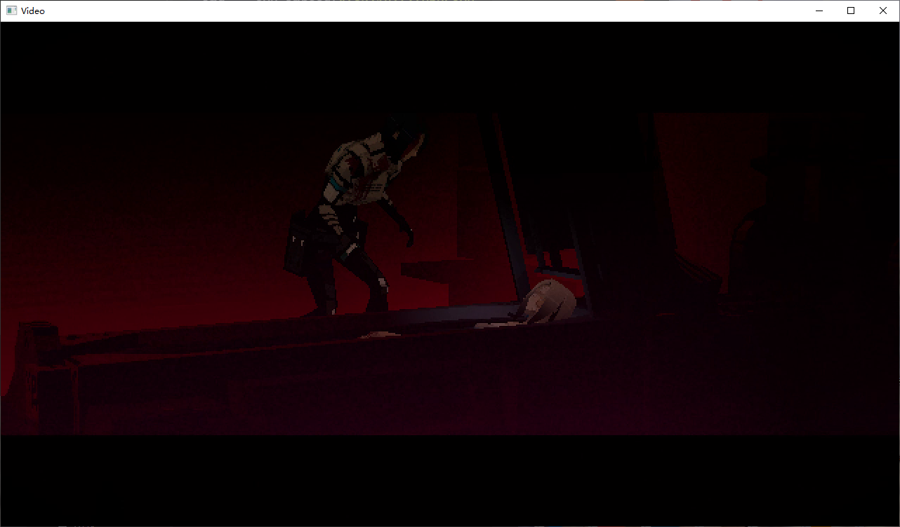

当上述代码中的文件路径变为0，则使用默认摄像头，如果你想使用一个网络上的摄像头，就指定ip和端口吧！这是一个神奇的参数

如果你想指定一些参数，可以使用cv2的.set方法

```python
cap = cv2.VideoCapture(0)
cap.set(3,640)
```

使用cv2.cvtColor()试试把图片转换为灰度图像！

```python
imgGray = cv2.cvtColor(img,cv2.COLOR_BGR2GRAY)
cv2.imshow("zhujunye",imgGray)
```

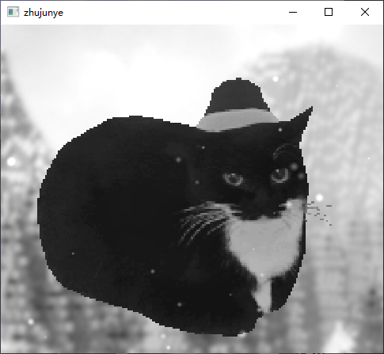

也可以试试使用高斯模糊

```python
#参数依次为：img ，core大小（模糊级别），x位置
imgBlur = cv2.GaussianBlur(img,(9,9),0)
```

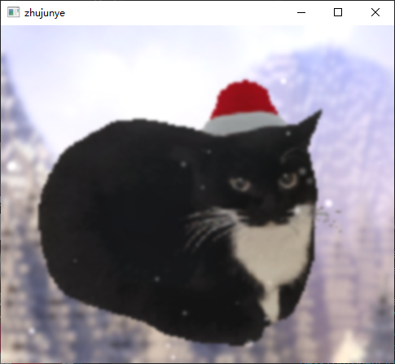

边缘检测器Canny

它可以帮助你找到图像中的边缘

```python
#参数：（照片对象，）
imgCanny = cv2.Canny(img,100,100)
```

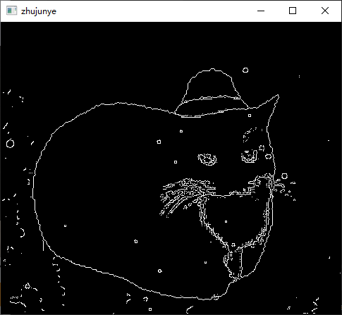

如果想让这个描边变粗，可以使用图像膨胀，但膨胀函数需要一个（内核）矩阵参数，numpy可以更好的处理它，于是我们可以

```python
pip install numpy
#并在项目中
import numpy
```

```python
#定义这个矩阵（内核）
kernel = numpy.ones((5,5),numpy.uint8)
#定义这个膨胀边框图片
#参数依次为：图片对象，矩阵（core），迭代次数
imgDialation = cv2.dilatecv2.dilate(imgCanny,kernel,iterations=1)
```

得到了

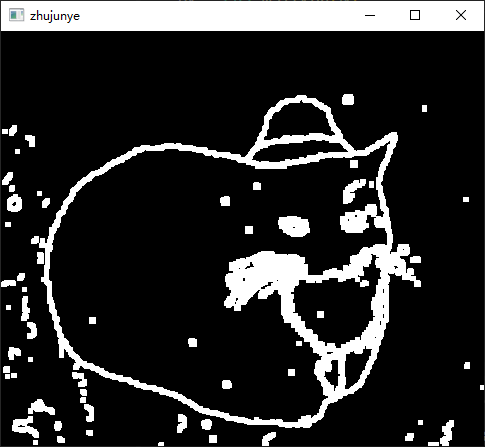

膨胀的相反操作是侵蚀，它跟膨胀的参数基本一致

我们这里把膨胀的图片侵蚀一下

```python
kernel = numpy.ones((5,5),numpy.uint8)
img = cv2.imread("101b15c2ebfc684f8fec43f3ce58e19f.png")

imgCanny = cv2.Canny(img,100,100)
imgDialation = cv2.dilate(imgCanny,kernel,iterations=1)
imgEroded = cv2.erode(imgDialation,kernel,iterations=1)

cv2.imshow("zhujunye",imgEroded)
cv2.waitKey(0)
```

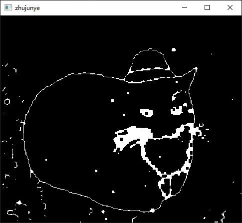

在opencv中，南为正方向，北为反方向，如图

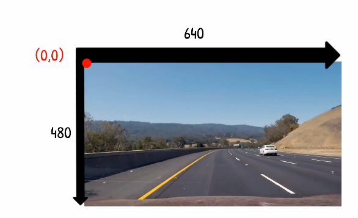

以此，我们可以尝试着去调整图像的大小

以最上面展示图片的代码为基础，加入下面的代码，我们可以得到图像对象的数据

```python
#打印图片数据
print(img.shape)
#输出为(415, 483, 3)
#分别代表长，宽，通道数
```

使用resize函数调整图像大小

```python
print(img.shape)
imgResize = cv2.resize(img,(320,120))
```

得到

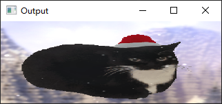

一只扁猫咪

我们不止可以压缩，也可以裁剪，我们说过图像本质是一个矩阵，所以我们也可以通过指定一个矩阵，从而实现裁剪

```python
#第一个切片是高度切片，第二个是宽度切片
cut_img = img[100:270,200:400]
```

可以裁到小猫脸

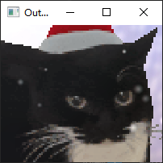

在图像上绘制形状

使用cv2.line()方法画线条

```python
import cv2
import numpy


img = numpy.zeros((512,512),numpy.uint8)

cv2.line(img,(0,0),(100,300),(0,255,0),3)

cv2.imshow("123",img)

cv2.waitKey(0)
```

如果你想要对角线

```python
#参数：img：图片对象，pt1：起点，pt2：终点，color：颜色，thickness：线宽
#坐标是 (x,y)：x 是横向、y 是纵向，和 img.shape 的顺序正好反着
#img.shape = (高,宽,通道) → 最大x = img.shape[1]-1，最大y = img.shape[0]-1
#所以 (0,0) 是左上角，(img.shape[1]-1,img.shape[0]-1) 是右下角 → 连起来就是对角线
#（写反成 (img.shape[0]-1,img.shape[1]-1) 也不会报错，但画出来是歪的，超界也只会被裁掉）
cv2.line(img,(0,0),(img.shape[1]-1,img.shape[0]-1),255,3)
```

使用cv2.rectangle()画矩形（线框）

```python
#同上复用代码
#参数：img:图片对象，pt1:矩形左上角，pt2：矩形右下角，颜色（0-255），thickness：线框
#如果将最后一个参数改为cv2.FILLED(-1) 就变成实心填充
cv2.rectangle(img,(0,0),(250,350),255,cv2.FILLED)
```

或是使用cv2.putText()放置文字

```python
#参数：img：图片对象，text：需要放置的文字，org：从何坐标开始写入文字
#fontFace：字体，fontScale：字号，thickness：笔画粗细
cv2.putText(img,"cat",(20,300),cv2.FONT_HERSHEY_SIMPLEX,1,255,2,cv2.LINE_AA)
```

‍

扭曲视角获取鸟瞰图

扭曲视角可以让你把斜着拍的东西扭正，也就是鸟瞰图（bird's eye view），思路是在图上手动找四个角点，再告诉opencv这四个点该变成什么形状，中间的内容就会跟着一起被拉过去

```python
#参数：img：图片对象，M：变换矩阵，dsize：输出图片的大小
#pt1：在原图里找出的四个点，顺序必须和pt2一一对应（我给的是 左上，右上，右下，左下）
#pt2：这四个点在结果图里的新位置，摆成一个矩形，斜视就变成俯视了
pt1 = numpy.float32([[30,70],[370,70],[290,430],[110,430]])
pt2 = numpy.float32([[40,40],[360,40],[360,360],[40,360]])

#根据两组点算出变换矩阵
M = cv2.getPerspectiveTransform(pt1,pt2)
#把矩阵套到图上，得到鸟瞰图
imgBev = cv2.warpPerspective(img,M,(400,450))
```

拿一块棋盘格地面演示，红点是找出来的四个角点

得到

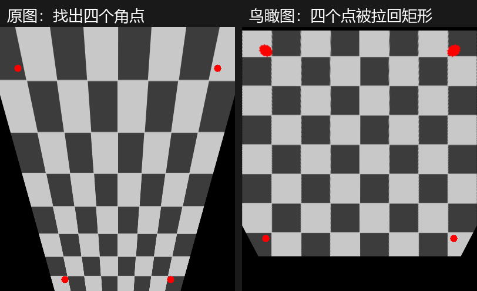

使用numpy+opencv堆叠图片

```python
#竖向堆叠
dbimg = numpy.vstack((img,img))
#或者横向堆叠
#numpy.hstack((img,img))
cv2.imshow("dbimg",dbimg)
cv2.waitKey(0)
```

‍

（最激动的）轮廓与形状检测

首先我们来说说 opencv 是怎样进行形状检测的：上面使用 canny 得出的边缘检测图并不能让机器知道这到底是什么图形，它只是生成了一张轮廓图——Canny 只回答"这里的亮度变化很剧烈"，完全不知道这条线围起来的是什么。想让它判断出这是三角形还是正方形，中间还得走几步：先把灰度图二值化，把"有东西的地方"变成实心白块；再用 ​`cv2.findContours()` 沿着白块的边界走一圈，得到一串按顺序排好的点坐标；最后对这串点做几何计算——数顶点、算面积周长、算圆形度，再用 if 判断出形状

‍

进行图像检测前最好把它转化为一张灰度图像，这样有利于我们捕获它的轮廓点

使用这张图片做为捕获的参考

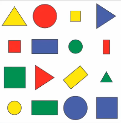

我们依旧会使用canny边缘检测器来绘制边缘

```python
import cv2
import numpy

path = "ScreenShot_2026-11-06_152550_727.png"
img = cv2.imread(path)
#转化为灰度图像
imgGray = cv2.cvtColor(img,cv2.COLOR_BGR2GRAY)
#高斯模糊
imgBlur = cv2.GaussianBlur(imgGray,(7,7),1)
#使用canny边缘检测器生成边缘图
imgCanny = cv2.Canny(imgBlur,50,50)
cv2.imshow("123",imgCanny)
cv2.waitKey(0)
```

得到

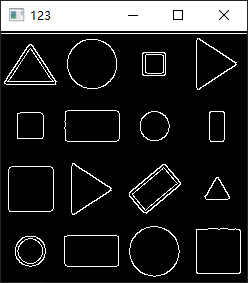

（这里想说一下为什么在中间使用高斯模糊：opencv中的canny，sobel等边缘检测算法的工作原理是寻找图像中灰度值（亮度）剧烈变化的地方，图像中的噪声点会影响最终边缘生成的平滑度，这些噪声点生成的边缘叫做伪边缘，但通过高斯模糊，可以将噪声点去除，让生成的边缘平滑连续，但不合适的高斯核标准差也会去掉过多边缘细节，所以要根据合适的情况进行调整）

接下来我们使用cv2.findContours() 方法去寻找边

```python
import cv2
import numpy


def getContours(img):
    """找出外轮廓并打印面积,并给被检测图形画上蓝色边缘"""
    #img：图片对象，mode：检索方法（这里是检索极端外轮廓）method:要存多少轮廓点
    contours,hierarchy = cv2.findContours(img,cv2.RETR_EXTERNAL,cv2.CHAIN_APPROX_SIMPLE)
    for cnt in contours:
        area = cv2.contourArea(cnt)
        print(area)

path = "ScreenShot_2026-11-06_152550_727.png"
img = cv2.imread(path)
imgGray = cv2.cvtColor(img,cv2.COLOR_BGR2GRAY)
imgBlur = cv2.GaussianBlur(imgGray,(7,7),1)
imgCanny = cv2.Canny(imgBlur,50,50)


_, imgBinary = cv2.threshold(imgBlur,127,255,cv2.THRESH_BINARY_INV)

getContours(img=imgBinary)      #【改动2】传二值图，不传 Canny 图

cv2.imshow("123",imgBinary)
cv2.waitKey(0)
```

得到以下数据，这就是它们的面积

```python
1664.5
1953.5
1930.5
320.0
2011.5
1287.5
1113.5
668.0
446.0
672.5
1666.0
527.0
1162.0
1930.0
1108.5
```

并且你可以得到二值化图

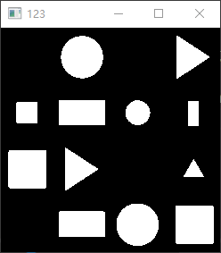

‍

使用opencv颜色检测

我们直接说思路，1，将RGB转HSV 2.使用numpy划定颜色范围 3.检测图中哪些图形命中了，并返回命中的图形，实现颜色筛选

GRB我们了解了，但opencv里检测使用的是HSV

‍

什么是HSV?

在RGB中颜色是由三个参数决定的，而HSV中只有一个参数表示颜色，其余是SV两个参数，解决了RGB改一个颜色三通道都要跟着变的问题，比如说指定了红色之后，通过划定S,V参数的范围，即使是稍微浅/深 or 亮/暗 也能正常识别命中，这是RGB做不到的

‍

H：色相（颜色）

S：饱和度（颜色浓度）

V：明度（亮度）

可以参考如下图

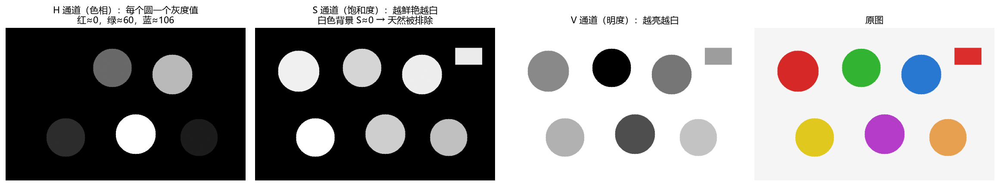

‍

那我们先使用cv2.cvtColor()方法转换为HSV

```python
hsv = cv2.cvtColor(img,cv2.COLOR_BGR2HSV)
```

然后用numpy划定颜色命中范围

```python
#HSV上限范围
lower = numpy.array([0,120,70])
#HSV下限范围
upper = numpy.array([10,255,255])
```

使用cv2.inRange()方法进行检测，里面存储了所有命中的像素位置（输出一张黑白图，白色为命中区域）

```python
#参数：hsv：hsv图，lower：下限范围，upper（上限范围）
mask = cv2.inRange(hsv,lower,upper)
```

最后使用cv2.bitwise_and()方法进行加工（逐位做与运算）

这里要科普下什么是掩膜，掩膜类似于遮罩，就是挡住其他不符合条件的区域，上面我们已经进行检测并生成mask，这里就是丢弃所有mask指定像素外的区域，只留下mask返回的区域

```python
#参数：src1：与运算图片1，src2：与运算图片2，mask：掩膜
#这里填两个img互相做与运算结果还是img，这里只是为了占位
#真正想做的是把mask指定的区域从原图上显示出来
result = cv2.bitwise_and(img,img,mask=mask)
```

最后得到


有点噪声，我们可以合理运用膨胀和腐蚀的概念，将这些边边变得圆滑一些，但不是直接使用dilate or erode方法，简单的进行膨胀和腐蚀会让物体面积永久减少或者增加，但进行开运算就可以不削减物体面积情况下而让其边缘变得平滑，开运算本质就是先腐蚀再膨胀，闭运算反之

使用cv2.morphologyEx()方法进行形态学清理

```python
#参数：img：图片对象，constant：可以选开运算或是闭运算，也可以直接侵蚀或者膨胀
#	  kernel：核（矩阵）用来调整运算程度
kernel = numpy.ones((5,5),numpy.uint8)
mask = cv2.morphologyEx(mask,cv2.MORPH_OPEN,kernel)
```

会好那么一些

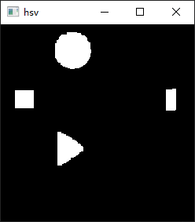

不过上面的颜色范围都是我们手动填死的，换一张图、换一种光线就得重新试一遍参数，很麻烦，这时就可以用 Trackbar（滑动条），把参数变成能拖的滑块，边拖边看效果，是很实用的工具

先创建一个窗口，再用 cv2.createTrackbar() 挂上滑块

```python
#滑动条一动就会调用这个回调函数，我们这里不需要做任何事，所以写个空函数
def empty(a):
    pass

cv2.namedWindow("HSV")
#参数：窗口名，滑块名，最小值，最大值，默认值，回调函数
#H最高是179，S和V最高是255
cv2.createTrackbar("H MIN","HSV",0,179,empty)
cv2.createTrackbar("H MAX","HSV",10,179,empty)
cv2.createTrackbar("S MIN","HSV",120,255,empty)
cv2.createTrackbar("S MAX","HSV",255,255,empty)
cv2.createTrackbar("V MIN","HSV",70,255,empty)
cv2.createTrackbar("V MAX","HSV",255,255,empty)
```

然后在 while 循环里用 cv2.getTrackbarPos() 把滑块当前的值读出来，再走一遍前面的流程

```python
while True:
    hsv = cv2.cvtColor(img,cv2.COLOR_BGR2HSV)

    #参数：滑块名，窗口名（必须和创建时写得一模一样）
    hMin = cv2.getTrackbarPos("H MIN","HSV")
    hMax = cv2.getTrackbarPos("H MAX","HSV")
    sMin = cv2.getTrackbarPos("S MIN","HSV")
    sMax = cv2.getTrackbarPos("S MAX","HSV")
    vMin = cv2.getTrackbarPos("V MIN","HSV")
    vMax = cv2.getTrackbarPos("V MAX","HSV")

    lower = numpy.array([hMin,sMin,vMin])
    upper = numpy.array([hMax,sMax,vMax])

    mask = cv2.inRange(hsv,lower,upper)
    result = cv2.bitwise_and(img,img,mask=mask)

    cv2.imshow("HSV",result)
    #按下q退出
    if cv2.waitKey(1) & 0xFF == ord('q'):
        break
```

为什么要写在 while 里？因为每拖一次滑块，循环就会再跑一遍，画面才能跟着实时刷新

效果如下，只拖动 H MAX 这一个滑块，范围越宽，命中的颜色就越多

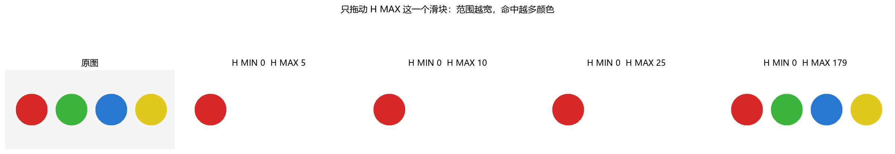

把 img 换成 cap.read() 读到的帧，就是摄像头的实时颜色检测，代码一行都不用改

‍

下面才是重头戏：使用OpenCV进行人脸检测！

大体思路就是创建

我们之前学过机器学习，通过训练一个图像识别的模型，我们可以得出命中人脸后的结果，这建立在模型进行大量训练的基础上

不过openCV已经为我们想好了，YuNet为我们解决了许多难题，它是一个轻量的人脸检测（预训练）模型，格式是**onnx**

我们需要先下载模型

```python
https://github.com/opencv/opencv_zoo/raw/main/models/face_detection_yunet/face_detection_yunet_2023mar.onnx
```

我们这里直接展示完整代码，总体思路就是：获取图片宽高->创建检测器->使用检测方法检测->把检测方法返回的数组遍历，并画框，标注关键点

```python
import cv2

path = "3cdd148b4318d77e5977f77bafac9204.png"
img = cv2.imread(path)
#imread 读不到时会返回 None，这里提前判断，顺便让类型检查器知道 img 一定不是 None
if img is None:
    raise FileNotFoundError(f"读不到图片：{path}")

#先取图片的高和宽，这是创建检测器的必要参数
h,w = img.shape[:2]

#使用cv2.FaceDetectorYN.create()创建检测器
#参数：model:模型路径，config：配置（ONNX 模型可以留空）,input_size:(宽,高),
#     score_threshold:置信度阈值，nms_threshold:NMS阈值（重叠框合并程度），top_k:NMS前保留的候选框数
#注意：top_k 不是"最多几张脸"，写 1 的话画面里有几张脸也只留一张，想全都找出来要给大一点
detector = cv2.FaceDetectorYN.create("face_detection_yunet_2023mar.onnx","",(w,h),0.9,0.3,5000)
#如果需要中途切换尺寸，使用detector.setInputSize((new_w,new_h))重新更换尺寸

#使用detector.detect()方法检测
#参数：图片对象

retval , faces = detector.detect(img)

#YuNet方案相较于老版本opencv采用Haar级联分类方案来说，拥有更好的检测效果，
# 无需转灰度图的便捷。以及对模型的兼容性

#接下来绘制结果,画出框框
#需要判断有没有检测到脸，没有脸不画框
if faces is not None:
    for face in faces:
        # 前4个数字是框
        x, y, fw, fh = face[0:4].astype(int)
        cv2.rectangle(img, (x, y), (x + fw, y + fh), (0, 255, 0), 2)

        # 后面10个数字是5个关键点，两个一组
        #分别是两个眼睛点，两个嘴角，一个鼻子
        for i in range(5):
            px = int(face[4 + i * 2])
            py = int(face[5 + i * 2])
            cv2.circle(img, (px, py), 3, (0, 0, 255), -1)

        # 最后一个是置信度
        cv2.putText(img, f"{face[14]:.2f}", (x, max(y - 8, 14)),
                    cv2.FONT_HERSHEY_SIMPLEX, 0.6, (0, 255, 0), 2, cv2.LINE_AA)


cv2.imshow("face",img)
cv2.waitKey(0)
```

得到

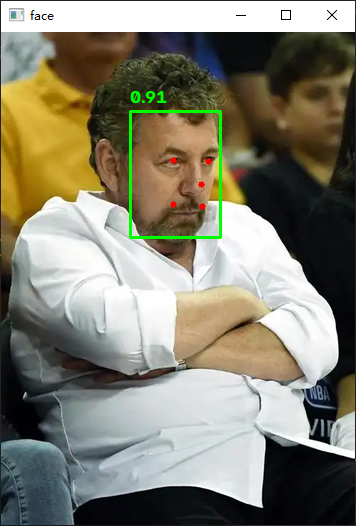

如果你想要用摄像头识别，就用上面的cv2.VideoCapture()方法套一层while True死循环，再把方法返回的img放在我们上面识别图片的逻辑里，就可以了

```python
while True:
    success, img = cap.read()
    if not success:
        break
	"""下面代码略"""
```

‍

暂时结束！也许之后会做有趣的相关小项目更新在下面！

‍
